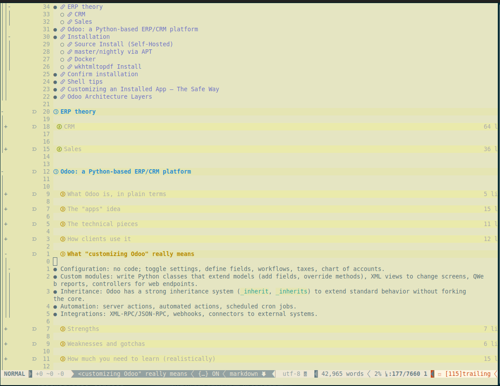

<!-- vim: set ts=2 sts=2 sw=2 expandtab tw=0 foldcolumn=9 foldmethod=expr : -->

- [ERP theory](#erp-theory)
  - [CRM](#crm)
  - [Sales](#sales)
- [Odoo is a Python-based ERP-CRM platform](#odoo-is-a-python-based-erp-crm-platform)
- [Installation](#installation)
  - [Source Install (Self-Hosted)](#source-install-self-hosted)
  - [master/nightly via APT](#masternightly-via-apt)
  - [Docker](#docker)
  - [wkhtmltopdf Install](#wkhtmltopdf-install)
- [Confirm installation](#confirm-installation)
- [Shell tips](#shell-tips)
- [Customizing an Installed App — The Safe Way](#customizing-an-installed-app--the-safe-way)
- [Odoo Architecture Layers](#odoo-architecture-layers)


> ℹ️ Recommended Neo/Vim editor for folding and unfolding sections




# ERP theory

## CRM

### Lead

In the context of an ERP and specifically within the **CRM (Customer Relationship Management)** module, a **Lead** represents a raw, unqualified potential customer or sales opportunity. It is the very first stage in the sales pipeline.

#### Key Characteristics:
1.  **Unqualified Status**: A lead is typically just contact information (name, email, phone) obtained from various sources such as:
    *   Website forms
    *   Trade shows
    *   Social media inquiries
    *   Cold calls or emails
    *   Imported lists
2.  **Low Commitment**: At this stage, there is no confirmed interest in buying, no budget verification, and no defined timeline. It is essentially a "suspect" rather than a "prospect."
3.  **Short Lifespan**: Leads are meant to be processed quickly. The goal is to either **qualify** them or **discard** them.

#### The Lead Lifecycle in Odoo (and most ERPs):
1.  **Creation**: The lead enters the system automatically or manually.
2.  **Qualification (Scoring)**: Sales teams or automated rules assess the lead based on criteria like:
    *   **BANT**: Budget, Authority, Need, Timeline.
    *   Fit with ideal customer profile.
3.  **Conversion**:
    *   If **Qualified**: The Lead is converted into an **Opportunity** (a qualified sales deal with estimated revenue and probability) and/or a **Customer** (partner record).
    *   If **Unqualified**: The Lead is marked as "Lost," "Spam," or "Duplicate" and archived.

#### Lead vs. Opportunity:
| Feature | Lead | Opportunity |
| :--- | :--- | :--- |
| **Stage** | Top of funnel (Raw) | Middle/Bottom of funnel (Qualified) |
| **Data** | Minimal contact info | Detailed needs, budget, expected revenue |
| **Action** | Qualify or Discard | Negotiate, Quote, Close |
| **Value** | No monetary value assigned | Estimated revenue assigned |

#### Why it matters in an ERP:
Separating Leads from Opportunities allows sales teams to focus their high-value time on deals likely to close, while using automation or junior staff to filter out noise at the Lead stage. This improves **sales efficiency** and **pipeline accuracy**.


### CRM vs Sales

#### They serve different purposes

**CRM** is about the *relationship and the process before the sale*: tracking leads, qualifying opportunities, managing the pipeline, assigning salespeople, forecasting. It is centered on the **opportunity** (a potential deal), not on products or money.

**Sales** is about the *transaction*: quotations, order lines, pricing, delivery, invoicing. It is centered on the **sale order** (a concrete commercial document).

The same contact can make several orders—but that is exactly why the two are separated: one customer/opportunity can generate zero, one, or many quotations/orders over time, and CRM needs to track the relationship across all of them without being flooded by transactional documents.

#### Technical and business reasons for separation

1. **Modularity.** Odoo is built from independent apps. You can run CRM without Sales (pure lead management, e.g., a call center), or Sales without CRM (pure B2C order taking, e.g., a shop). If they were a single app, every user would carry the full weight of both.
2. **Different user roles.** A sales rep working the pipeline needs CRM views (Kanban of opportunities, activities, lead scoring). An order clerk needs quotation and order forms with product lines and pricing. Mixing them creates a crowded, confusing UI for both.
3. **Different data models.** An opportunity (`crm.lead`) and a sale order (`sale.order`) are different objects with different lifecycles. One opportunity can link to many quotations; one quotation can exist without an opportunity (direct Sales). Keeping the models separate keeps the logic clean.
4. **Optional bridge.** The two apps are connected by an *optional* bridge module (`sale_crm`) that adds the **New Quotation** button and the **Quotations** smart button. Install both apps and you get the link; install only one and nothing breaks. If they were one app, you could not opt out.
5. **Performance and clean records.** Transactional documents (orders, invoices) can grow into thousands of rows. Keeping them out of the CRM pipeline keeps CRM queries fast and the pipeline readable.

#### The mental model

Think of it as **relationship layer vs transaction layer**:

- CRM = *who* and *why* (the customer, the opportunity, the stage).
- Sales = *what* and *how much* (the products, the price, the order).
- The **contact** is shared by both, which is why the same customer can appear in many opportunities and many orders—each app tracks its own dimension of the same relationship.

So they are closely related *by design*, but separated *on purpose*: modularity, distinct roles, distinct data models, and an optional bridge that links them only when you need it.


## Sales

### Quotation vs order vs invoice


In the ERP context, these three documents correspond to different stages of the sales process, with legal and accounting implications that vary significantly.

**General understanding (industry consensus):**

- **Quotation**: A **proposal** to the customer, non-binding, with no accounting impact. Its purpose is to provide pricing and terms, which may or may not be accepted by the customer .
- **Order (Sales Order)**: The customer's **commitment to purchase**. It drives inventory planning, production, or delivery, but typically **does not directly generate accounting entries** (or only generates commitments) .
- **Invoice**: A **legally binding request for payment**. It is the only mandatory accounting document that generates revenue and accounts receivable, and is also a tax document .

#### ERP softwares (beyond Odoo)
- **SAP Business One** is a typical representative: quotation → sales order → delivery → A/R invoice, with the invoice being the only step that must occur .
- **Microsoft Dynamics GP** similarly distinguishes Quote, Order, and Invoice, where the invoice is the point at which posting occurs .


#### Odoo's terminology characteristics

- Odoo's "Order" **does not have an independent database entity**.
- Quotation and Sales Order are **two states of the same record** (`sale.order`):

Thus,

- The `draft` / `sent` states display as "Quotation"
- After clicking "Confirm", the state changes to `sale`, and the same record is then called "Sales Order"

Therefore, in Odoo, "Order" is not a document type independent of quotation, but rather the **post-confirmation version of the quotation**.
This differs from SAP's independent sales order document in form, but semantically both represent the customer's purchase commitment.

FYI. An easily to confuse term is **Proforma Invoice**:
- It sounds like an "invoice" but is essentially a **formalized quotation or pre-shipment estimate**, with no legal validity or accounting impact.
- It is commonly used for customs declarations, letter of credit applications, or internal approval processes.
- Odoo's standard sales flow does not use this term by default, but in practice it can be simulated using quotation or draft invoice.


# Odoo is a Python-based ERP-CRM platform


### What Odoo is, in plain terms

Odoo is a **business management software suite** — commonly called an **ERP** (Enterprise Resource Planning) with a built-in **CRM**. Think of it as one platform that runs most of a company's day-to-day operations: sales, purchases, inventory, accounting, HR, projects, manufacturing, e-commerce, and more.

Originally called **TinyERP** and later **OpenERP**, it's open source (with a paid Enterprise edition) and written in **Python**, which is why your role asks for Python skills.

### The "apps" idea

Odoo is modular. You install "apps" depending on what the client needs:

- **Sales / CRM:** leads, opportunities, quotations, pipelines.
- **Purchase:** suppliers, purchase orders, receipts.
- **Inventory:** warehouses, stock moves, lot tracking.
- **Accounting:** invoices, taxes, bank reconciliation, financial reports.
- **Manufacturing (MRP):** bills of materials, work orders, planning.
- **Projects / Timesheets:** tasks, planning, billing.
- **HR / Payroll:** employees, contracts, leave.
- **Website / eCommerce:** shop, blog, forms.
- **Helpdesk, Field Service, Rental, Subscriptions**, etc.

You can install only the apps a client needs, and they all share the same database and user interface.

### The technical pieces

- **Backend:** Python (the ORM is central; Odoo uses its own ORM rather than SQLAlchemy/Django ORM).
- **Frontend:** JavaScript with the **OWL** framework for the web client.
- **Views:** XML (forms, lists, kanban, calendars, graphs, pivot).
- **Reports:** QWeb (XML-based templating for PDFs).
- **Database:** PostgreSQL (not MySQL).
- **Deployment:** Linux servers (Debian/Ubuntu typical), Nginx in front, systemd services, backups.
- **APIs:** XML-RPC and JSON-RPC for integrations.
- **Customization:** custom Python modules, inherited views, automated actions, server actions.
- **Marketplace:** Odoo Apps Store (community modules) and Enterprise modules.

### How clients use it

A client (say, a manufacturer) buys Odoo and hires an implementation partner to:

1. **Analyze** their processes (sales, stock, production, accounting).
2. **Configure** Odoo apps and settings to match.
3. **Customize** with Python modules when standard features aren't enough.
4. **Migrate** data from old systems.
5. **Deploy** on servers and set up backups, monitoring, security.
6. **Train** users and **support** them after go-live.


### What "customizing Odoo" really means

- **Configuration:** no code; toggle settings, define fields, workflows, taxes, chart of accounts.
- **Custom modules:** write Python classes that extend models (add fields, override methods), XML views to change screens, QWeb reports, controllers for web endpoints.
- **Inheritance:** Odoo has a strong inheritance system (`_inherit`, `_inherits`) to extend standard behavior without forking the core.
- **Automation:** server actions, automated actions, scheduled cron jobs.
- **Integrations:** XML-RPC/JSON-RPC, webhooks, connectors to external systems.

### Strengths

- Open source core (community edition is free).
- All-in-one, so clients avoid dozens of separate tools.
- Strong customization and module ecosystem.
- Python backend, easy for Python developers to pick up.
- Good for SMBs and mid-market, increasingly for larger companies too.

### Weaknesses and gotchas

- **Upgrades can be painful** across major versions (custom code must be adapted).
- **Performance** depends heavily on PostgreSQL tuning, indexing, and how you write code (the ORM can generate heavy queries).
- **Steep learning curve** for the framework: ORM, views, security rules, QWeb, workflows.
- **Best practices matter**: bad customization creates technical debt that is hard to undo.

### How much you need to learn (realistically)

For a junior Odoo developer job, you don't need to master all of Odoo. You need:

1. **The ORM and models:** fields, relations, computed fields, overrides (`create`, `write`, `unlink`), `_inherit`.
2. **Views and XML:** form, list, kanban, search, inherited views, xpath.
3. **Security:** groups, access rights (`ir.model.access`), record rules.
4. **Deployment:** install Odoo on Ubuntu, PostgreSQL, Nginx, systemd, backups, logs.
5. **Performance:** indexes, `read_group`, avoiding N+1, query plans.
6. **Standard apps** at a business level: Sales/CRM, Purchase, Inventory, Accounting basics.
7. **APIs:** XML-RPC/JSON-RPC for integrations.

Time estimate: with a Python and Linux background, **3–6 weeks of focused study** gets you productive on simple customizations; **2–3 months** to be comfortable across deployment, performance, and client-facing solution design.


### Bottom line

Odoo is a **Python-based ERP/CRM platform** that companies use to run their business. In this job you wouldn't sell software — you'd **implement, customize, deploy and support Odoo for clients**, which means learning the ORM, views, security, deployment and the main business apps. It's a real skill investment, but it fits well with your Python and Linux background and would give you a stable, in-demand consulting/engineering profile.

---
---
# Installation

## Installation Approaches — Comparison

Not all installation paths are equivalent.
Below, ranked by how well each suits a production ERP deployment.


### ✅ Production-Grade (Managed or Full-Control)

#### Odoo.sh (PaaS - Odoo's Cloud)

**Recommended for teams that want managed infrastructure with development capabilities.**

Odoo.sh is Odoo's official Platform-as-a-Service. It provides built-in staging and development environments, native GitHub integration, and is fully managed by Odoo S.A. It supports custom modules and is a true production environment.

- **Pros:** Managed infrastructure, CI/CD, staging environments, perfect for teams following Odoo's development workflow.
- **Cons:** 💰 Paid service.
- **References:**
  - https://www.odoo.com/documentation/master/administration/odoo_sh/getting_started/create.html


#### Source Install (Self-Hosted) approach

**Recommended for maximum control and flexibility.**

Running Odoo directly from a Git checkout.
This is the most flexible method, ideal for custom module development and running multiple Odoo versions on the same server.

- **Pros:** Full control, easiest module development, branch pinning (`git checkout 19.0`), can be used as a base for production.
- **Cons:** Requires significant technical expertise.
- **References:**
  - https://www.odoo.com/documentation/master/administration/on_premise/source.html
  - https://www.odoo.com/de_DE/forum/getting-started-3/how-install-odoo-18-in-desktop-273182


#### Docker (Official Image) (Self-Hosted)

**Recommended for isolation and reproducibility.**

Using the official Odoo Docker image for development or deployment. It provides very good isolation and is easy to set up with Docker Compose.

- **Pros:** Reproducible, isolated, quick to deploy.
- **Cons:** No official Enterprise image — Enterprise modules must be added by building a custom image.
- **References:**
  - https://hub.docker.com/_/odoo/


#### DEB Package (Distribution Package)

**Suitable for testing and module development, can be used for long-term production with additional maintenance.**

The classic single-file installer. It's a simple way to get started and allows for more flexibility than Odoo Online, but shifts the maintenance burden to you.

- **Note:** Not a repository, so upgrades are manual.
- **References:**
  - https://www.odoo.com/documentation/master/administration/on_premise/packages.html#distribution-package (which also links to https://www.odoo.com/de_DE/page/download)

##### 🔧 Sidenote — What "Build scripts" means

The **Build Scripts** link on https://nightly.odoo.com/ points to a file inside the Odoo source tree
— for the `20.0` branch it is [`setup/package.py`](https://github.com/odoo/odoo/blob/20.0/setup/package.py).

It is **not** another name for source install.
It is the Python utility that the nightly server runs to **build the `.deb` / `.rpm` packages** from a source checkout:

```text
source tree  →  [setup/package.py]  →  .deb / .rpm  →  nightly repository
```


#### RPM Package (Distribution Package)

Same caveats as the DEB package, but for RPM-based distros (RHEL, Alma, Rocky, Fedora).

Download the `.rpm` for a released version and `sudo dnf install ./odoo_*.rpm`.

- **Note:** Not a repository, so upgrades are manual.
- **References:**
  - https://www.odoo.com/documentation/master/administration/on_premise/packages.html#distribution-package


### ⚠️ Production, but No Custom Modules

#### Odoo Online (SaaS)

**Not for custom development.**

Fully managed by Odoo S.A.
Ideal for standard business workflows but unsuitable for any custom development.

- **Pros:** It's the easiest way to start.
- **Cons:** Has major limitations:
  - **No custom modules** — cannot install custom Python modules.
  - **No server/DB access** — no direct file or database access.


### ❌ Not for Production (Testing / Bleeding-Edge)


#### APT from a Stable Branch

**Not for production.** Less churn than `master`, but still a nightly.

Replace `master/nightly` with a branch path (e.g., `19.0/nightly`).

- **Note:** **Not available for Odoo 20 today** — only already-released branches (≤19.0) currently have nightlies. Released-20 channels will appear only when 20.0 is GA. Until then, source install is the only production-grade path for Odoo 20.

- **Community → Enterprise:** On a **stable branch** (e.g. `19.0/nightly`), the standard upgrade path applies:
  [Switch from Community to Enterprise](https://www.odoo.com/documentation/master/administration/on_premise/community_to_enterprise.html).
  It does **not** apply to `master/nightly` — see next entry.


#### `master/nightly` via APT approach

**Not for production.** See the respective section below.

An alpha build of the `master` branch (e.g., `odoo 20.1a1.20261018`, ~330 MB download).

- **This is the Community edition only** (no Enterprise code). Enterprise has no nightly repository, so the standard Community → Enterprise upgrade path does **not** apply here.
- Perfect for exploring Odoo 20 and validating the `wkhtmltopdf` setup.
- **Risks:**
  - `master` changes daily and may ship broken migrations.
  - Unstable modules.
  - Schema changes without warning.
  - ⚠️ A routine `sudo apt update && sudo apt upgrade` will silently pull in the **next night's build**. Use `sudo apt-mark hold odoo` to freeze the version, or avoid this repo outside of evaluation.


#### Any Future `20.0/nightly`

**Not for production.** Prefer source install until 20.0 is GA (General Availability).

Once a stable 20.0 branch is cut, `20.0/nightly` will appear and be less unstable than `master` — but it will still be a nightly, not a release.


#### Demo (Evaluation Only)

**Not an installation.**

Only suitable for getting a quick feel for Odoo or trying something out.


## Releases notes

The Odoo GitHub repository:
- does NOT use traditional GitHub Releases or version tags like "v20"
- Odoo uses a BRANCH-BASED VERSIONING STRATEGY
- Releases notes are under https://www.odoo.com/de_DE/page/release-notes. E.g. https://www.odoo.com/odoo-20-release-notes

Each major version has its own branch:
- `20.0` - Latest stable (Odoo 20)
- `19.0` - Previous version
- `18.0`, `17.0`, etc.
- `master` - Development branch (bleeding edge)

To get an specific version:

```bash
# Clone a specific version branch
git clone https://github.com/odoo/odoo.git --branch 20.0 --single-branch

# Or switch to a version after cloning
git clone https://github.com/odoo/odoo.git
cd odoo
git checkout 20.0
```

Special Branches:
- `saas-XX.X` branches - For SaaS/Odoo.sh deployments with minor updates
- `master` - Current development version

Key:
- Odoo 20.0 branch is now available and marked as FINAL
- This approach allows continuous development while maintaining stable version branches
- For production, use numbered branches (19.0, 20.0); for testing new features, use `master`

This is different from typical software that uses semantic versioning with tags, but it makes sense for an ERP system with continuous deployment needs.


---

## Source Install (Self-Hosted)

Running Odoo directly from a Git checkout is the most flexible installation path.
It is the recommended base for custom module development and for running multiple Odoo versions side-by-side on the same server.

### ✅️ Yes for Production

> See the **Installation Approaches — Comparison** section at the top of this
> guide for all available install paths, ranked by production suitability.

Source install is production-grade **provided you complete this entire section** —
a bare `git clone` and `python3 odoo-bin` is a development setup, not a deployment.

### ⚠️❗ Uninstall On-Premise Alternatives First

Before proceeding, follow the **Uninstall** section of this guide for any other
Odoo installation method you previously used (APT nightly, DEB package, Docker).
Two Odoo instances competing for port `8069`, the same PostgreSQL cluster, or the
same filestore will produce confusing errors.

Confirm the slate is clean:

```bash
# Package gone, port free, unit absent, no leftover odoo user
dpkg -l | grep -i odoo
ss -tlnp | grep 8069
systemctl status odoo --no-pager
id odoo 2>&1
```


### System Preparation

Ubuntu 24.04 (Noble) ships **Python 3.12** and **PostgreSQL 16**, which satisfy Odoo 20's minimum requirements out of the box. No third-party repositories are needed.

```bash
sudo apt update && apt list --upgradable
sudo apt upgrade -y
```


#### Create a dedicated system user

Do not run Odoo as your login user or as `root`.
A dedicated `odoo` user isolates permissions and matches the convention used by the packaged installers.

```bash
# Create if missing (idempotent — safe to re-run)
id odoo >/dev/null 2>&1 || sudo adduser --system --home=/opt/odoo --group odoo

# Confirm
id odoo
```


### Dependencies

#### PostgreSQL

##### Install PostgreSQL and client

Odoo 20 requires **PostgreSQL 16 or above**.

```bash
sudo apt install -y postgresql postgresql-client
```

Confirm the service is running:

```bash
sudo systemctl status postgresql --no-pager
```

Expected: `Active: active (exited)` — the wrapper unit is oneshot; the actual
cluster runs under `postgresql@16-main.service`.


##### Create a PostgreSQL role

Odoo forbids connecting as the `postgres` superuser; create a role that can create databases (`-d`), but is **not** a superuser (`-S`) and **cannot create roles** (`-R`).

```bash
# Create if missing (idempotent)
sudo -u postgres psql -tAc "SELECT 1 FROM pg_roles WHERE rolname='odoo'" | grep -q 1 \
  || sudo -u postgres createuser -d -R -S odoo

# Confirm: role exists and is not superuser, cannot create roles, can create DBs
sudo -u postgres psql -c "\du odoo"
```

> Because the PostgreSQL role name matches the Unix login name (`odoo`), local
> peer authentication allows password-less connections — no `db_password` is
> needed in `odoo.conf` for a local socket connection.

Expected output line for `odoo`:

```text
     List of roles
 Role name | Attributes
-----------+------------
 odoo      | Create DB
```

The **Attributes** column should read `Create DB` only — **no** `Superuser`, **no** `Create role`. `createuser` fails with "role already exists" on re-run, so the `grep -q 1 ||` guard makes it safe.


#### wkhtmltopdf (PDF reports)

This is **not** installable through `pip` and must be installed manually in
**version 0.12.6 with the patched Qt build**, otherwise headers and footers in
PDF reports break.

Follow the **wkhtmltopdf Install** section already present in this guide.
Confirm the patched build before continuing:

```bash
wkhtmltopdf --version   # must print: wkhtmltopdf 0.12.6 (with patched qt)
```

#### Optional: rtlcss (right-to-left languages)

Only required if you will use Arabic, Hebrew, or another RTL interface.

```bash
if false; then
    sudo apt install -y nodejs npm # or other installation approach
    sudo npm install -g rtlcss
fi
```


### Clone the Repository

Clone the **stable `20.0` branch**, not `master`. `master` is a development branch
and changes daily; `20.0` is the released, production branch.

```bash
odoo_install_root="/opt/odoo"
odoo_checkout="$odoo_install_root/odoo"
odoo_version="20.0"   # ⚠️ customize: 20.0 = current stable

sudo mkdir -p "$odoo_checkout"
sudo chown -R odoo:odoo "$odoo_install_root"

sudo -u odoo git clone \
  --branch "$odoo_version" \
  --single-branch \
  --depth 1 \
  https://github.com/odoo/odoo.git \
  "$odoo_checkout"
```


- `--single-branch` avoids downloading every historical branch.
- `--depth 1` keeps the checkout lean; drop it if you need full Git history for
  bisecting or cherry-picking.

> **Enterprise edition:** clone `odoo/enterprise` into a separate directory and
> add it to `addons_path` **before** the Community addons path. The Enterprise
> repository contains only extra add-ons; the server code always comes from
> Community.

Check

```bash
sudo -u odoo ls -la "$odoo_checkout"/odoo-bin
sudo -u odoo ls -la "$odoo_checkout"/.git
sudo -u odoo git -C "$odoo_checkout" branch --show-current      # should print: 20.0
sudo -u odoo git -C "$odoo_checkout" log -1 --oneline           # single commit, shallow
```


#### Sidenote: `/opt/odoo/odoo` location instead of `$HOME`

Three reasons, none of which the [docs](https://www.odoo.com/documentation/master/administration/on_premise/source.html#git) spells out:

- **Separation from the login user.** The `odoo` system user is created with `--system`, which normally means **no home directory** or a dummy `/nonexistent`. Putting code in `$HOME` would mean logging in as `odoo`, which defeats the purpose of a service account. `/opt/odoo` is a dedicated tree owned by `odoo` but never logged into interactively.
- **Filesystem Hierarchy Standard.** `/opt` is the canonical location for "add-on application software packages" on Debian/Ubuntu — self-contained software that is not managed by `dpkg`. Putting Odoo under `/opt` signals "this is not an apt package" and keeps it out of `/usr/local` (which mixes with manual installs) and `/home` (which is user data, not service data).
- **Path stability.** The systemd unit, `addons_path`, and any backup scripts reference `/opt/odoo/odoo` as an absolute path. `$HOME` on a system user is fragile — it can change, be empty, or be `/nonexistent` depending on `adduser` flags. `/opt/odoo` is deterministic.

The upstream doc omits a target path because it assumes you run `git clone` from wherever you like (typically `$HOME/odoo` for **development** on a laptop). For **production**, `/opt/odoo` is the conventional choice. The nesting `/opt/odoo/odoo` (parent = install root, child = the git checkout itself) leaves room for siblings:

```text
/opt/odoo/odoo/       # git checkout (Community source)
/opt/odoo/enterprise/ # git checkout (Enterprise addons, optional)
/opt/odoo/venv/       # virtualenv
/opt/odoo/data/       # (optional) local data_dir if you prefer it here
```

If you prefer `/srv/odoo` instead of `/opt/odoo`, that is equally valid — `/srv` is the FHS location for "data served by this system". Either works; pick one and be consistent with the systemd unit and `odoo.conf` paths.

> ℹ️ **A note on `~/src` in the official docs.**
> You will see `~/src` frequently in Odoo's documentation
> — for example, the Odoo.sh
> ["Create a module"](https://www.odoo.com/documentation/master/administration/odoo_sh/create_module.html#create-the-development-branch)
> guide instructs `git clone` into `~/src`,
> and the glossary (at top of that link) defines it as
> "the directory where the Git repositories related to your Odoo projects are located".
>
> That is a **development** convention for a personal workstation (e.g. `/home/<you>/src`), not a production directive.
> Your server uses `/opt/odoo` instead, following the FHS and service-isolation reasons above.
> When following an Odoo.sh tutorial on this server, translate `~/src/` to `/opt/odoo/`.
> The module structure and code are identical — only the parent directory differs.


### System libraries required for Python builds

Two **different** sets of packages are involved, and `debinstall.sh` only handles one of them.
Both are needed for a source install with a virtualenv.

#### Step 1 — Build dependencies (required)

Several Python packages in `requirements.txt` have no pre-built wheels on Linux and must be compiled against system headers.
These are the `-dev` headers and compilers pip needs:

```bash
sudo apt install -y \
  git python3 python3-venv python3-pip python3-dev \
  build-essential libldap2-dev libpq-dev libsasl2-dev \
  libxml2-dev libxslt1-dev libjpeg-dev libwebp-dev \
  zlib1g-dev libffi-dev libssl-dev
```

`debinstall.sh` (Step 2) does **not** install these — it reads `Depends:` from
`debian/control` (runtime), not `Build-Depends:`. Skipping Step 1 makes
`pip install -r requirements.txt` fail at `python-ldap` with
`fatal error: lber.h: No such file or directory`.

#### Step 2 — Runtime libraries (recommended)

The official helper script parses `debian/control` and installs the `.deb`
package's runtime dependencies — C libraries and Debian-packaged Python modules:

```bash
odoo_install_root="/opt/odoo"
odoo_checkout="$odoo_install_root/odoo"
odoo_setup_debinstaller="$odoo_checkout/setup/debinstall.sh"

if sudo test -x "$odoo_setup_debinstaller"; then
  sudo "$odoo_setup_debinstaller"
else
  echo "Installer script not found or not executable at: $odoo_setup_debinstaller"
fi
```

> ⚠️ The Python modules it installs (`python3-psycopg2`, `python3-lxml`, …) are
> superseded by the virtualenv in the next section — the venv will not see them.
> The overlap is harmless; the **C libraries** it pulls in are still needed at
> runtime.
>
> Re-run this script after every `git pull` — it tracks new upstream dependencies
> added to `debian/control`. Step 1 does not; diff `debian/control` on version
> bumps if you skip Step 2.

#### Verify

```bash
# Step 1 headers present?
dpkg -l python3-venv python3-dev build-essential \
       libpq-dev libldap2-dev libsasl2-dev 2>/dev/null \
  | awk '/^ii/ {print "OK  ", $2, $3} /^un|^rc/ {print "MISS", $2}'

# venv module importable?
python3 -c "import venv; print('venv ok')"
```

Expected: all six lines `OK` (or `MISS` for none), and `venv ok`.

If you want **minimal footprint** and are willing to check `debian/control`
manually on each Odoo update, Step 2 alone is technically sufficient — but
Step 1 is not optional.


### Python Virtual Environment & Requirements


#### Verify Python version (≥ 3.12)

Odoo 20 requires Python **3.12 or later**: [source](https://www.odoo.com/documentation/master/administration/on_premise/source.html#prepare).

```bash
python3 --version
```

Expected: `Python 3.12.x` or newer.

**Why this must be checked before creating the venv:** `python3 -m venv` does
**not** download a new Python. It creates a virtual environment on top of an
existing interpreter — the venv's **base Python**. The venv's `bin/python` is a
symlink to the system interpreter used to create it. If the global Python were
3.10, the venv would be a 3.10 venv, and Odoo 20 would refuse to start
regardless of how isolated `site-packages` is.

> ⚠️ If the check prints 3.10 or 3.11, see **Using `pyenv` for an older system Python** below.

> ⚠️ Do **not** replace the system Python — the rest of Ubuntu depends on it.


#### Why `python3 -m venv` (and not `pyenv`) in this guide

A virtual environment **wraps** an interpreter; it does not install one.
`python3 -m venv` creates `bin/python` as a symlink to the base interpreter used
to create it. The venv's only independence is over packages (`site-packages`);
the interpreter version is fixed at creation time and inherited from the caller.

Inspect any venv to see its base interpreter:

```bash
sudo -u odoo cat /opt/odoo/venv/pyvenv.cfg
```

```text
home = /usr/bin
include-system-site-packages = false
version = 3.12.3
executable = /usr/bin/python3.12
command = /usr/bin/python3 -m venv /opt/odoo/venv
```

`home` and `executable` point at the system interpreter; `version` is inherited.
Nothing is downloaded into the venv directory.

**Why this guide uses `python3 -m venv` on Ubuntu 24.04:**

- The system `python3` is **3.12.3**, which satisfies Odoo 20's "≥ 3.12" out of
  the box.
- `pyenv` would install its own 3.12 (redundant with the system one), compile it
  from source, and add a toolchain to manage — extra moving parts with no
  benefit on this OS.
- The only difference between `python3 -m venv` and a `pyenv`-created venv is
  **which interpreter creates the venv**. Everything downstream (`pip install
  -r …`, `odoo-bin`, systemd unit) is identical.

The rest of this guide assumes the `python3 -m venv` path. If your system
Python is older than 3.12, follow the `pyenv` variant below, then resume at
**Installation**.


#### Installation

Isolate Odoo's Python dependencies in a virtual environment. Mixing them with
system packages is explicitly discouraged by Odoo's documentation.

```bash
odoo_install_root="/opt/odoo"
odoo_checkout="$odoo_install_root/odoo"
odoo_venv_dir="$odoo_install_root/venv"
sudo -u odoo python3 -m venv "$odoo_venv_dir"
sudo -u odoo "$odoo_venv_dir"/bin/pip install --upgrade pip setuptools wheel
sudo -u odoo "$odoo_venv_dir"/bin/pip install -r /opt/odoo/odoo/requirements.txt
```

Verify the install:

```bash
# 1. The venv uses the expected base Python
sudo -u odoo "$odoo_venv_dir"/bin/python --version     # Python 3.12.x

# 2. End-to-end: the venv can run Odoo
sudo -u odoo "$odoo_venv_dir"/bin/python "$odoo_checkout"/odoo-bin --version
# Odoo Server 20.0

sudo -u odoo "$odoo_venv_dir"/bin/python -c "import sys; sys.path.insert(0, '/opt/odoo/odoo'); import odoo.release; print(odoo.release.version)" # 20.0
```

> Check 2 is the real proof: `odoo-bin` inserts its own directory into
> `sys.path`, so a successful `--version` means every `requirements.txt`
> package imported and the source tree is executable. A bare
> `python -c "import odoo"` will **not** work — the checkout is not on
> `sys.path` unless you run `odoo-bin` (or patch `sys.path` manually).


#### Using `pyenv` for an older system Python

Skip this subsection if your `python3 --version` already printed 3.12.x or
newer. The following is only for hosts where the system Python is $lt; 3.12
(e.g. Ubuntu 22.04 → 3.10, RHEL 9 → 3.9), or when you deliberately want Odoo
running under a specific minor version (3.13, 3.14).

`pyenv` installs and manages additional Python interpreters side-by-side with
the system one, without touching `/usr/bin/python3`.

```bash
# Install pyenv (as the odoo user, so the interpreter is readable by the service)
sudo -u odoo bash -c 'curl https://pyenv.run | bash'
sudo -u odoo /opt/odoo/.pyenv/bin/pyenv install 3.12

# Create the venv with the pyenv-managed interpreter
sudo -u odoo /opt/odoo/.pyenv/versions/3.12.*/bin/python -m venv /opt/odoo/venv
```

> ⚠️ **The `odoo` service user must be able to read and execute the interpreter
> path.** pyenv installed under your login user (`$HOME/.pyenv`) is **not**
> readable by `odoo` if `/home/<you>` is mode `750`, and systemd fails at
> startup with `status=203/EXEC` (permission denied on exec). Installing pyenv
> under the `odoo` user's home (as above, `/opt/odoo/.pyenv`) sidesteps the
> problem — the interpreter lives in a directory the service already owns.

After creating the venv this way, resume at **Installation** step 3
(`pip install --upgrade …`). All subsequent commands are unchanged — they
reference `"$odoo_venv_dir"/bin/…`, which points at whatever interpreter the
venv wrapped.

Alternative creators — all produce an equivalent venv; only the base
interpreter differs:

| Creator | Venv's base interpreter |
|---|---|
| `python3 -m venv …` | whatever `python3` resolves to |
| `python3.13 -m venv …` | 3.13, if installed |
| `pyenv exec python -m venv …` | pyenv's currently selected version |
| `pyenv virtualenv 3.13 name` | 3.13, managed by pyenv-virtualenv |

None of these download a Python *into* the venv.
That is what `pyenv install` does, outside the venv.


### Configuration File

#### Prepare Directories

Create the directories Odoo needs:
- `/etc/odoo`: config, holds `admin_passwd`
- `/var/log/odoo`: logs
- `/var/lib/odoo`: filestore

...And hand them to the service user:

```bash
sudo mkdir -p /etc/odoo /var/log/odoo /var/lib/odoo
sudo chown -R odoo:odoo /etc/odoo /var/log/odoo /var/lib/odoo
sudo chmod 750 /etc/odoo   # holds admin_passwd — restrict to odoo/root
```

Verify:

```bash
sudo ls -ld /etc/odoo /var/log/odoo /var/lib/odoo
```

Expected:

```text
drwxr-x--- 2 odoo odoo ... /etc/odoo
drwxr-xr-x 2 odoo odoo ... /var/lib/odoo
drwxr-x--- 2 odoo odoo ... /var/log/odoo
```

> Modes on pre-existing directories are preserved by `chown -R`. If you are
> re-installing over a previous instance, `/var/log/odoo` may show `750` from
> the earlier setup instead of `755`. Both work.


#### Copy the Configuration File

Copy the minimal [Debian] sample shipped with the source tree:

```bash
sudo cp -v /opt/odoo/odoo/debian/odoo.conf /etc/odoo/odoo.conf
```

It will look like:

```bash
sudo cat /etc/odoo/odoo.conf
```

It shows:

```ini
[options]
; This is the password that allows database operations:
; admin_passwd = admin
db_host = False
db_port = False
db_user = odoo
db_password = False
;addons_path = /usr/lib/python3/dist-packages/odoo/addons
default_productivity_apps = True
```


This sample relies on Odoo's built-in defaults. For a production source install,
**these defaults are not suitable** and must be overridden:

- `http_port` defaults to `8069` — fine unless you need another port.
- `http_interface` defaults to `127.0.0.1` in Odoo 20 — correct for a reverse-proxy setup.
- `data_dir` defaults to a user-specific path — **override** with `/var/lib/odoo`.
- `logfile` defaults to stdout — **override** with `/var/log/odoo/odoo-server.log`.
- `workers` defaults to `0` (development mode) — **override** for production.
- `addons_path` points to the system path — **override** with your source checkout.
- `proxy_mode` defaults to `False` — set to `True` if using Nginx.


#### 🔐 Set Permissions

```bash
sudo chown odoo:odoo /etc/odoo/odoo.conf
sudo chmod 640 /etc/odoo/odoo.conf
```


#### Generate Master Password

Generate a strong master password (protects the database manager). Copy the result.

```bash
sudo -u odoo python3 -c "import secrets; print(secrets.token_urlsafe(32))"
```


#### Edit the Configuration File

##### Option A — Quick Test (rely on defaults)

Suitable for verifying the install boots. **Not** for production (read option B instead).

Write the configuration. Run next

```bash
sudo -u odoo nano /etc/odoo/odoo.conf
# or: sudo -u odoo vim /etc/odoo/odoo.conf  # save via: `:wq!`
```

Edit the commented `admin_passwd` line

```ini
; admin_passwd = admin
```

to (uncomment + paste the previous copied `secrets.token_urlsafe(32)`)

```ini
; --- Master password (database manager) ---
admin_passwd = REPLACE_WITH_GENERATED_TOKEN
```


##### Option B — Production

The full production configuration.

Edit the file as the `odoo` user:

```bash
sudo -u odoo nano /etc/odoo/odoo.conf
# or
# sudo -u odoo vim /etc/odoo/odoo.conf
```

Replace the entire content with a production-ready configuration (❗paste the master password generated earlier❗):

```ini
[options]
; --- Database ---
db_host = False
db_port = False
db_user = odoo
db_password = False
db_name = False

; --- Paths ---
addons_path = /opt/odoo/odoo/addons,/opt/odoo/odoo/odoo/addons
data_dir = /var/lib/odoo

; --- Master password (database manager) ---
admin_passwd = REPLACE_WITH_GENERATED_TOKEN❗

; --- Networking ---
http_port = 8069
http_interface = 127.0.0.1
; Uncomment the next line if behind Nginx:
; proxy_mode = True

; --- Logging ---
logfile = /var/log/odoo/odoo-server.log
log_level = info

; --- Production workers ---
; workers = 0 disables preforking (development mode).
; For production, set workers = (CPU_cores × 2) + 1.
workers = 0
```

> `http_interface = 127.0.0.1` keeps Odoo on loopback. A reverse proxy (Nginx)
> should be the only thing exposed. Change to `0.0.0.0` only if you intentionally
> expose Odoo directly.

Check it:

```bash
sudo cat /etc/odoo/odoo.conf
```


#### 🔎 Verify

```bash
sudo ls -l /etc/odoo/odoo.conf
# expected: -rw-r----- 1 odoo odoo ... /etc/odoo/odoo.conf

sudo -u odoo grep admin_passwd /etc/odoo/odoo.conf
# expected: admin_passwd = <your-token>
```


### Systemd Service


The source tree ships a template at `debian/odoo.service`, but it is the `.deb`
package's unit — `ExecStart` points at `/usr/bin/odoo` (the wrapper that the
`.deb` installs), logging flags assume command-line arguments, and production
directives (`Restart=`, `WorkingDirectory=`, `LimitNOFILE=`) are absent because
the `.deb` relies on its own supervision. Rewriting every `[Service]` line is
more error-prone than writing the unit from scratch, so that is what this
section does.

Create `sudo vim /etc/systemd/system/odoo.service`:

```ini
[Unit]
Description=Odoo 20 (Source)
Requires=postgresql.service
After=network.target postgresql.service

[Service]
Type=simple
User=odoo
Group=odoo
ExecStart=/opt/odoo/venv/bin/python3 /opt/odoo/odoo/odoo-bin -c /etc/odoo/odoo.conf
WorkingDirectory=/opt/odoo/odoo
StandardOutput=journal
StandardError=journal
Restart=on-failure
RestartSec=5
LimitNOFILE=65536

[Install]
WantedBy=multi-user.target
```

Enable and start:

```bash
sudo systemctl daemon-reload
sudo systemctl enable --now odoo
# Expected output:
#   Created symlink /etc/systemd/system/multi-user.target.wants/odoo.service → /etc/systemd/system/odoo.service.

sudo systemctl status odoo --no-pager
# Expected output:
#   ● odoo.service - Odoo 20 (Source)
#        Loaded: loaded (/etc/systemd/system/odoo.service; enabled; preset: enabled)
#        Active: active (running) since Fri 2026-11-06 09:14:33 CET; 29s ago
#      Main PID: 15728 (python3)
#         Tasks: 4 (limit: 14507)
#        Memory: 121.6M (peak: 122.4M)
#           CPU: 679ms
#        CGroup: /system.slice/odoo.service
#                └─15728 /opt/odoo/venv/bin/python3 /opt/odoo/odoo/odoo-bin -c /etc/odoo/odoo.conf
#
#   Nov 06 09:14:33 example-host systemd[1]: Started odoo.service - Odoo 20 (Source).
```


### Confirmation

#### 1. Service is running

```bash
systemctl status odoo --no-pager
```

Expected: `Active: active (running)`.

#### 2. Port 8069 is listening

```bash
ss -tlnp | grep 8069
```

Expected: `LISTEN` on `127.0.0.1:8069`.

#### 3. Logs show a clean startup

```bash
sudo journalctl -u odoo -n 40 --no-pager
# or, if logfile is set:
sudo tail -n 40 /var/log/odoo/odoo-server.log
```

Look for the final line:

```text
INFO odoo.modules.loading: Modules loaded.
```

#### 4. Web interface responds

```bash
curl -sI http://localhost:8069/web/login | head -1
```

Expected: `HTTP/1.1 200 OK` (or a redirect to the database selector).

Open in a browser:

```text
http://localhost:8069/web/database/manager
```

Create a database. The form has two **unrelated** credential layers — do not confuse them:

| Field | What it is | Where it comes from |
|---|---|---|
| **Master Password** | Gates the *database manager* — create/drop/backup/restore DBs. | The `admin_passwd` value in `/etc/odoo/odoo.conf`. **Not** the app login. |
| **Email** + **Password** | The *administrator login for the new database* (used at `http://localhost:8069/web/login`). | You choose them **now**, in this form. There is no default `admin`/`admin` since Odoo 17 — pick a real address and a strong password. |

The remaining fields (`Database Name`, `Phone Number`, `Language`, `Country`, `Demo Data`) configure the new database itself.

Retrieve the master password with:

```bash
sudo -u odoo grep admin_passwd /etc/odoo/odoo.conf
```

For `Database Name` use a name matching `^[a-zA-Z0-9][a-zA-Z0-9_.-]+$`, e.g.:

```text
odoo20_database
```

No spaces, no leading underscore/hyphen.

> 💡 Uncheck **Demo Data** for a production database — it installs sample
> products, customers, and invoices you would then have to delete.
> Leave it checked only for a quick trial.

After the form submits, Odoo creates the DB and you land on
`http://localhost:8069/web/login`. Sign in with the **Email** and **Password**
you just chose — *not* with the master password.


#### 5. Database role connectivity

```bash
sudo -u odoo psql -d postgres -c "SELECT current_user, version();"
```

This confirms the `odoo` Unix user can reach PostgreSQL via peer authentication.

Expected output:

```text
 current_user |                                                                 version
--------------+------------------------------------------------------------------------------------------------------------------------------------------
 odoo         | PostgreSQL 16.15 (Ubuntu 16.15-0ubuntu0.24.04.1) on x86_64-pc-linux-gnu, compiled by gcc (Ubuntu 13.3.0-6ubuntu2~24.04.1) 13.3.0, 64-bit
(1 row)
```

#### 6. wkhtmltopdf end-to-end

Re-run the verification from the wkhtmltopdf section:

```bash
wkhtmltopdf --header-center "Test" \
  --footer-center "[page]/[topage]" \
  https://www.example.com /tmp/test.pdf
```

If this produces `/tmp/test.pdf` without errors, PDF reporting is functional.


#### Install Odoo apps, etc.

- install an app you want to test
- Keep `sudo tail -f /var/log/odoo/odoo-server.log` running in the second terminal to confirm it.
- ...


### Running Multiple Versions Side-by-Side

Source install is the only method that makes this straightforward.
Clone each version into its own directory, give each its own virtualenv, its own
`odoo.conf`, its own `data_dir`, its own port, and its own systemd unit:

```text
/opt/odoo/19.0/        # git checkout 19.0
/opt/odoo/20.0/        # git checkout 20.0
/opt/odoo/venv-19.0/
/opt/odoo/venv-20.0/
/etc/odoo/19.0.conf
/etc/odoo/20.0.conf
```

Use a systemd template unit if the pattern repeats:

```ini
# /etc/systemd/system/odoo@.service
[Service]
ExecStart=/opt/odoo/venv-%i/bin/python3 /opt/odoo/%i/odoo-bin -c /etc/odoo/%i.conf
```

Then `systemctl enable --now odoo@20.0` and `odoo@19.0` run independently.


---
## master/nightly via APT

### ❌ Not for production

> ⚠️❗ **DISCLAIMER — Evaluation install (not for production)**
>
> This section installs Odoo from the **nightly APT repository**, which tracks
> the `master` branch — currently an alpha build (`odoo 20.1a1.20261018`, ~330 MB
> download). This is the **Community edition** (no Enterprise code).
>
> It is perfect for exploring Odoo 20 and validating the `wkhtmltopdf` setup,
> but **NOT recommended for production**, because nightly `master` changes
> daily and may ship broken migrations, unstable modules, or schema changes
> without warning.
>
> See the **Installation Approaches — Comparison** section at the top of this
> guide for all available install paths, ranked by production suitability.

References:
- https://nightly.odoo.com/
- https://www.odoo.com/documentation/master/administration/on_premise/packages.html#repository


### Install dependencies & nightly/community version

#### Installing PostgreSQL (Dependency)

```sh
sudo apt install postgresql -y  # Dependency
```


### Add Odoo's nightly APT-repository to your system


Odoo S.A. provides a repository that can be used to install the **Community** edition by executing.

Next adds Odoo's nightly repository to your system by:
- importing its GPG signing key and creating an APT source list entry
- enabling you to install or update Odoo via `apt`

```sh
wget -q -O - https://nightly.odoo.com/odoo.key | sudo gpg --dearmor -o /usr/share/keyrings/odoo-archive-keyring.gpg
echo 'deb [signed-by=/usr/share/keyrings/odoo-archive-keyring.gpg] https://nightly.odoo.com/master/nightly/deb/ ./' | sudo tee /etc/apt/sources.list.d/odoo.list
deb [signed-by=/usr/share/keyrings/odoo-archive-keyring.gpg] https://nightly.odoo.com/master/nightly/deb/ ./
```

⚠️ A routine `sudo apt update && sudo apt upgrade` will silently pull in the **next night's build**.
Use `sudo apt-mark hold odoo` to freeze the version, or avoid this repo outside of evaluation.


### Odoo: Installation via APT

```sh
sudo apt-get update && sudo apt-get install odoo
```


### Checking Odoo Service Status


```sh
sudo systemctl status odoo
```

Output:

```text
● odoo.service - Odoo Open Source ERP and CRM
     Loaded: loaded (/usr/lib/systemd/system/odoo.service; enabled; preset: enabled)
     Active: active (running) since Wed 2026-10-21 15:38:29 CEST; 1min 9s ago
   Main PID: 91216 (odoo)
      Tasks: 4 (limit: 14507)
     Memory: 94.6M (peak: 103.2M)
        CPU: 704ms
     CGroup: /system.slice/odoo.service
             └─91216 /usr/bin/python3 /usr/bin/odoo --config /etc/odoo/odoo.conf --logfile /var/log/odoo/odoo-server.log

Oct 21 15:38:29 example-host systemd[1]: Started odoo.service - Odoo Open Source ERP and CRM.
```


### Network Socket Status (Port 8069): Odoo Network Activity

```sh
ss -tlnp | grep 8069
```

Output:

```text
LISTEN 0      128        127.0.0.1:8069       0.0.0.0:*
```


### wkhtmltopdf Install (search steps)

These steps are shared across all install methods (APT, source, Docker), so they live in a dedicated section below — see wkhtmltopdf Install.


### Create your database from the Odoo web interface


#### Create your database

Open in browser: http://localhost:8069/web/database/selector

Warning, your Odoo database manager is not protected. To secure it, we have generated the following master password for it:

```text
XXXX-YYYY-ZZZZ
```

You can change it below but be sure to remember it, it will be asked for future operations on databases.


### Uninstall


#### Pre-flight (decide what survives the purge)

`apt remove --purge odoo` removes the package, the systemd unit, and `/etc/odoo/odoo.conf`.
It does **not** remove `/var/log/odoo/` or `/var/lib/odoo/` — those are treated as user data and survive the purge.
It does **not** drop your PostgreSQL database.

Check what you have and decide:

```bash
# Is a database present? (your guide created one via the web UI)
sudo -u postgres psql -l

# Filestore present? (attachments live here)
sudo ls -la /var/lib/odoo/ 2>/dev/null

# Keep the nightly logs for reference / support (skip if no prior log exists):
[ -f /var/log/odoo/odoo-server.log ] && \
  sudo cp -v /var/log/odoo/odoo-server.log "$HOME/Downloads/odoo-nightly-$(date +%F).log" || \
  echo "No prior Odoo log present."

# Current config, in case you want to reference it for the source install
sudo cat /etc/odoo/odoo.conf 2>/dev/null
```

- **If you don't care about the nightly test DB/attachments** → skip backups, proceed.
- **If you want to keep the DB for the source install** → dump it now, before purge:

```bash
database_name="odoo20_database"   # ⚠️ customize:  sudo -u postgres psql -l
mkdir -p "$HOME/Downloads"
sudo -u postgres pg_dump "$database_name" > "$HOME/Downloads/backup_odoo20_$(date +%F_%H%M).sql"
```

- **If you want to keep attachments** → copy the filestore now: `sudo cp -a /var/lib/odoo "$HOME/Downloads/odoo_filestore_backup"`.


#### Stop the daemon and verify

```bash
sudo systemctl stop odoo
sleep 3
sudo systemctl status odoo --no-pager
ss -tlnp | grep 8069
```

Expected:
- `systemctl status` → `Active: inactive (dead)`
- `ss … | grep 8069` → **no output** (grep exits 1; that's success). If something is still listening, find it with `sudo ss -tlnp | grep 8069` and kill that PID before continuing.


#### Purge the package

```bash
sudo apt remove --purge odoo -y
sudo apt autoremove -y
```

`--purge` removes config; `autoremove` clears the 40+ Python dependencies the deb pulled in that nothing else needs.
The package's own scripts will stop the (daemon) service if it were still running — but you already stopped it previously, so this is clean.


#### Post-purge cleanup

```bash
# Was /var/log/odoo or /var/lib/odoo left behind?
ls -la /var/log/odoo/ /var/lib/odoo/ 2>/dev/null

# Remove for a truly clean slate:
sudo rm -rf /var/log/odoo /var/lib/odoo
```


#### Note — the nightly database survives the purge

`apt remove --purge odoo` removes the package, the systemd unit, and
`/etc/odoo/odoo.conf` — but it does **not** drop the PostgreSQL database, and it
does **not** remove `/var/log/odoo/` or `/var/lib/odoo/`.

That DB is owned by the `odoo` system user and lives independently of the package in `/var/lib/postgresql/`.

**Check it's still there:**

```bash
sudo -u postgres psql -l
```

You'll see the nightly DB still listed (owner `odoo`), e.g.:

```text
      Name       |  Owner   | Encoding | Locale Provider |   Collate   |    Ctype    | ...
-----------------+----------+----------+-----------------+-------------+-------------+-----
 odoo20_database |  odoo    | UTF8     | libc            | C           | en_US.UTF-8 |
 postgres        | postgres | UTF8     | libc            | en_US.UTF-8 | en_US.UTF-8 |
 ...
```

This is expected — `dpkg` has no knowledge of PostgreSQL and won't touch it.

**Optional — drop it for a clean slate:**

```bash
database_name="odoo20_database"   # ⚠️ customize:  sudo -u postgres psql -l
sudo -u postgres dropdb "$database_name"
sleep 3
sudo -u postgres psql -l # confirm
```

Useful if you want the source install's DB selector to start empty.
Skip it if you want to keep the nightly DB around for comparison or reference.
The DB does no harm if left in place.


#### Optional: also clean up the leftover `odoo` system user

The `postrm` on Ubuntu 24.04 removes the `odoo` user (an earlier check on this
system showed `id: 'odoo': no such user`). On some other distributions it may
survive. Check with `id odoo`.

The source install (see respective install steps) can reuse it, so leaving it is fine; remove it only if you want a fully clean slate:

```bash
# Un-neccesary
if false; then
 sudo deluser --system --remove-home odoo
fi
```


#### Remove the nightly repo and key

```bash
sudo rm -f /etc/apt/sources.list.d/odoo.list
sudo rm -f /usr/share/keyrings/odoo-archive-keyring.gpg
```

#### Refresh APT metadata

```bash
sudo apt update
```

The `nightly.odoo.com` line should be gone from the output entirely.


#### Confirmation

```bash
echo "1. Package gone?"
dpkg -l | grep -i odoo
#   -> no output expected (exit 1). If "rc odoo" appears, purge didn't finish.

echo "2. systemd unit gone?"
systemctl status odoo --no-pager
#   -> "Unit odoo.service could not be found."

echo "3. Port free?"
ss -tlnp | grep 8069
#   -> no output

echo "4. Repo gone from apt?"
apt policy odoo 2>/dev/null | head -3
#   -> "N: Unable to locate package odoo" (or no Candidate)

echo "5. Repo file / key gone?"
ls -la /etc/apt/sources.list.d/odoo.list /usr/share/keyrings/odoo-archive-keyring.gpg 2>&1
#   -> "No such file or directory" for both

echo "6. Did the odoo system user survive? (Ubuntu 24.04 postrm removes it; other distros vary)"
id odoo 2>&1
#   -> either "no such user" or uid/gid — either is fine; source install can reuse or recreate
```

If step 1 (`dpkg -l | grep -i odoo`) shows `rc odoo`, run `sudo dpkg --purge odoo` to finish the purge.


---


## Docker

### Why your source-installed Odoo needs no changes

Based on previous "Source Install (Self-Hosted)" section:
the source installation listens on `127.0.0.1:8069` and is managed by its own systemd unit and PostgreSQL cluster.

The Docker version you are about to launch is a completely separate application stack:
- its own PostgreSQL container,
- its own Odoo container,
- its own configuration,
- and its own data volumes.

The **only** thing that overlaps is the host machine's network port.
By publishing the Docker Odoo container on host port **8070** instead of **8069**,
you keep the two instances entirely separate at the network level as well.

No need to modify:
- No file inside your source checkout,
- no line in `/etc/odoo/odoo.conf`,
- and no setting in the source Odoo database.

The port change is expressed **only** in the `docker run` command (`-p 8070:8069`),
so the Docker container continues to listen on its internal default port `8069`;
Docker simply forwards host port `8070` to it.

TLDR:
- Docker Odoo  → http://localhost:8070   (host port 8070 → container 8069)
- Source Odoo  → http://localhost:8069   (unchanged, still on its own port)


#### Source Odoo has 1 port,  Docker Odoo has 2 ports

A **service listens on exactly 1 port**. In both cases below, that port is **8069**.

- **Source Odoo**: listens on `8069`. Browser connects to `localhost:8069`. One port, start to finish.

- **Docker Odoo**: the Odoo process **inside the container** also listens on `8069`.
  But that `8069` exists **inside the container's own isolated network namespace** — it is not visible on the host by default.
  To make it reachable from the host, Docker **publishes** it on a host port.
  That publishing is what `-p 8070:8069` does (via the `docker run` command):
  - `8070` = **host** port (what your browser connects to)
  - `8069` = **container** port (where Odoo actually listens)

So the "two ports" are not two ports of the Odoo service. They are:

- One port **inside** the container (`8069`, where Odoo listens),
- One port **on the host** (`8070`, where Docker's forwarding listens and relays traffic into the container).

The Odoo process only ever listens on `8069`.
The `8070` is a **Docker‑managed forwarding port** on the host.
Docker receives traffic on `8070` and forwards it into the container's `8069`.
**Your browser only ever sees `8070`.**

A simple diagram:

```
Browser → localhost:8070  (host port, owned by Docker)
              │
              │ Docker forwards
              ▼
         container:8069   (Odoo listening port, inside container)
```

For the **source install** there is no forwarding layer at all:

```
Browser → localhost:8069  (Odoo listening port, directly on host)
```

That's why the source Odoo has "one port" in the picture, and the Docker Odoo has "two ports" in the picture — but they are **not** two ports of the same service.
They are the host's forwarding port plus the container's internal listening port.


#### HTTP interface

Every listening port is bound to a specific *interface* (a network address on the machine).
This determines **who can reach the port**, not how they reach it.

The common bindings:

| Bind address | Meaning |
|---|---|
| `127.0.0.1` | Loopback only — reachable **only from the same machine** (localhost). |
| `0.0.0.0` | All IPv4 interfaces — reachable from the machine **and from anywhere on the network**, if the firewall allows it. |
| `::` | Same as `0.0.0.0`, but for IPv6. |

So:

- Your **source Odoo** has `http_interface = 127.0.0.1` in `/etc/odoo/odoo.conf`, so it binds to `127.0.0.1:8069`.
  That means only programs running on that same Ubuntu machine can reach it.
  Someone on another machine on your LAN **cannot** open `http://<your-ip>:8069`.

- The **Docker Odoo**, with `-p 8070:8069` (no host IP prefix),
  binds Docker's port forwarding to `0.0.0.0:8070` (IPv4), and `[::]:8070` too when IPv6 is enabled on the Docker daemon.
  That means the port is reachable from **any** network interface the machine has — localhost, the LAN, etc.
  Someone on your LAN **can** open `http://<your-ip>:8070`, assuming no firewall blocks it.

If you want the Docker instance to be **loopback‑only**, matching your source install add to the `docker run` command in **Start the Odoo container on host port 8070** below:

```bash
-p 127.0.0.1:8070:8069
```

That restricts the host-side binding to `127.0.0.1`, so only local programs can reach `8070`.

### Prerequisites: verify Docker and check port availability

Before creating any containers, confirm that Docker is installed and the daemon is reachable, and that host port `8070` is not already in use.

#### Check Docker is installed and running

```bash
docker --version
systemctl is-active docker # brief
systemctl status docker --no-pager # detailed
sudo docker info > /dev/null 2>&1 && echo "Docker daemon reachable (with sudo)" || echo "Docker daemon NOT reachable"
```

- `docker --version` should print a version string (for example, `Docker version 27.x.x`). If it returns "command not found", Docker is not installed and must be installed first.
- The `systemctl` cmds should print `active`. This confirms the daemon is running.
- `sudo docker info` to also confirm that the Docker CLI can actually reach the daemon.
  - It succeeds only if the daemon is running;
  - If it fails while `systemctl is-active docker` printed `active`, then check the daemon logs: `sudo journalctl -u docker -n 40 --no-pager`.

##### Optional - add user to the `docker` group

`docker info` might need `sudo` because the socket is owned by `root:docker` with mode `660`

```text
> ls -l /var/run/docker.sock
srw-rw---- 1 root docker 0 Nov  9 08:59 /var/run/docker.sock
```

If this succeeds with `sudo` but fails without `sudo`, the daemon is fine — your user simply lacks access to the Docker socket.
To run Docker without `sudo` (to grant your user access to the Docker socket):

```sh
sudo usermod -aG docker "$USER"
newgrp docker    # or log out and back in
```


#### Check that port 8070 is free

```bash
ss -tlnp | grep ':8070\b' || echo "Port 8070 is free"
```

- If the command prints nothing and echoes "Port 8070 is free", you can proceed.
- If it prints a line, a process is already listening on `8070`; choose a different host port (for example, `8071`) and substitute it consistently in all the commands below.

You can also use `lsof -i :8070` as an alternative on systems where `ss` is not available.


### Start a dedicated PostgreSQL container for Docker Odoo

This **PostgreSQL** instance is **only** for the Docker Odoo container;
it is completely separate from the source installation's host PostgreSQL cluster.

```sh
# Remove old PostgreSQL container (if still present)
sudo docker rm -f odoo-docker-db

# ⚠️ DANGER: only run this on a fresh setup, or when you deliberately want to
# discard ALL database content (e.g. migrating from a PG 15 volume to PG 16).
# Skip this line if the volume already holds data you want to keep.
sudo docker volume rm odoo-docker-db-data

# Remove a user-defined bridge network (if existed)
sudo docker network rm odoo-net

# Create a user-defined bridge network
sudo docker network create odoo-net

# Fresh PostgreSQL container
sudo docker run -d \
  --name odoo-docker-db \
  --restart unless-stopped \
  --network odoo-net \
  -e POSTGRES_USER=odoo \
  -e POSTGRES_PASSWORD=odoo \
  -e POSTGRES_DB=postgres \
  -v odoo-docker-db-data:/var/lib/postgresql/data \
  postgres:16
```

**Why the named volume `odoo-docker-db-data`:** without a volume, the PostgreSQL data directory lives inside the container's writable layer and is lost when the container is removed. A named volume stores the data outside the container lifecycle, so it persists across container removal and recreation.

> ⚠️ PostgreSQL version **16** (not **15**).
> - ❌ https://hub.docker.com/_/odoo/ says to use 15, that's WRONG (not updated)
> - ✅️ [this](https://github.com/oduflow/oduflow/blob/00be8215fc513874ca52d0e2caab1c08920092a3/specs/0074-postgresql16-cluster-replacement.md) says: "Odoo 20 requires PostgreSQL 16"

#### Explanation

- **`docker run … -d … postgres:16`** — create and start the container **detached**, in the background, so it doesn't take over the terminal.
  - `-d` is required for every subsequent command in this guide.
    Detach: run in the background and return the container ID instead of attaching to its output.
  - `postgres:16` is the official image, tag `16` (PostgreSQL 16).
- **`--name odoo-docker-db`** — give the container a **fixed name** instead of a random ID.
  You'll refer to it later: Odoo reaches it via the same user-defined network (`--network odoo-net`),
  and you manage it with `docker stop/rm/exec odoo-docker-db`.
- **`--network odoo-net`** — attach the container to the user-defined bridge network `odoo-net` (created a few lines above with `docker network create odoo-net`).
  User-defined networks give containers automatic DNS resolution by container name, replacing the deprecated `--link` flag (read respective section about this alternative).
  Read the [docs](https://docs.docker.com/engine/network/drivers/bridge/#manage-a-user-defined-bridge).
- **`--restart unless-stopped`**
  - The default restart policy is `no`, i.e. containers started with plain `docker run -d` do not survive a reboot.
    Use `unless-stopped` instead of `always`: both survive a reboot, but `always` also restarts after a manual `docker stop`, which is normally undesired.
  - To auto-restart after a reboot the Docker daemon itself must auto-start, check it: `systemctl is-enabled docker.service`.
    If it prints `disabled`, enable it: `sudo systemctl enable docker.service; sudo systemctl enable containerd.service`.
  - If both containers (current `odoo-docker-db` and later `odoo-docker`) have this flag, a dependency-order issue can occur (if the DB container starts after the Odoo one),
  in later *Docker compose* section is explained in detail and solved.
- **`-e POSTGRES_USER=odoo`** — the `postgres` image creates this **superuser role** on first init, replacing the default `postgres` role. This becomes the DB user Odoo authenticates as.
- **`-e POSTGRES_PASSWORD=odoo`** — sets the password for that role; the image **refuses to start** without it. Odoo will use this same password to connect.
- **`-e POSTGRES_DB=postgres`** — the database the image creates on first init. Here the conventional `postgres` DB is used, which is also the maintenance DB Odoo connects to at boot. (Note: unlike `POSTGRES_USER`, this does not replace a default — `postgres` is the default name, so this flag is mostly explicit documentation of intent.)
- Together, the three `-e` flags are what make the DB usable by the Odoo container later:
  - `POSTGRES_USER` / `POSTGRES_PASSWORD` become Odoo's credentials (and happen to match the `odoo` role name in the source install, though the two stacks are independent),
  - and `POSTGRES_DB` is the DB Odoo connects to at boot.
- **`-v odoo-docker-db-data:/var/lib/postgresql/data`** — mount the named volume **`odoo-docker-db-data`** at PostgreSQL's data directory.
  The data lives **outside** the container, so it survives `docker rm` and container recreation.
  Skip it and all DB content is lost when the container is removed (details in later subsection).
- **No `-p`** — the DB is **not published to the host**. It is only reachable from other containers on the Docker network. This is also why it can't collide with the host's source-install PostgreSQL on `5432`. Details in the next section.

#### No `-p` flag

`docker run --help | grep -- "-p"` says: `  -p, --publish list                     Publish a container's port(s) to the host`.

This `docker run` starts **PostgreSQL**, not Odoo.
- Port `8069` is Odoo's web port
- PostgreSQL listens on `5432` and is **not meant to be published at all** in this setup. Proof:

```text
> sudo ss -tlnp 'sport = :5432'
State   Recv-Q  Send-Q Local Address:Port  Peer Address:Port  Process
LISTEN  0       200        127.0.0.1:5432       0.0.0.0:*      users:(("postgres",pid=3470,fd=6))
```

A few points worth unpacking:

##### `-p 8070:8069` maps the Odoo web port, not PostgreSQL's

- That mapping appears **only** in the Odoo container's `docker run` (later shown), because it's the Odoo HTTP interface the browser needs to reach.
- The PostgreSQL container has no web interface and speaks the PostgreSQL wire protocol on `5432`.


##### The DB container does not need a published port at all

In the Odoo container's `docker run` (later in this section) we use `--network odoo-net` to attach it to the **same user-defined network** as the DB container. Docker provides automatic DNS resolution on user-defined networks, so the Odoo container can reach the DB by its **container name** (`odoo-docker-db:5432`) without any `-p` flag or legacy `--link`.

Concretely, in the Odoo container:

- `--network odoo-net` — attaches the container to the same network as `odoo-docker-db`.
- `-e HOST=odoo-docker-db` — overrides the Odoo image's default `HOST=db`. On a user-defined network, container names resolve automatically; arbitrary aliases like `db` do not.
  Passing the actual container name is the simplest way to tell Odoo where the database is.
  (Alternative: add `--network-alias db` to the DB container so the image's default `HOST=db` keeps working.)

Either way, the DB port is reachable from inside the Odoo container as `odoo-docker-db:5432` (or `db:5432` if you used the alias) — no `-p` flag needed.

Publishing `5432` to the host would only be needed if **you** (or a tool on the host) wanted to connect to the Docker PostgreSQL directly, e.g.:

```bash
psql -h localhost -p 5432 -U odoo
```

For this test you don't — the Odoo container is the only client.

##### Why you especially *don't* want to publish `5432` here

Your host already runs a source‑installed PostgreSQL cluster, and it **already listens on `5432` on the host**.
If you published the Docker DB container's `5432` to the host's `5432`, Docker would either:

- fail to start the container ("port already allocated"), or
- if you used a different host port like `-p 5433:5432`, it would work — but now you'd have two PostgreSQL servers on the host and a real risk of connecting the wrong one by accident.

Keeping the Docker PostgreSQL **unpublished** (no `-p` at all) avoids this entirely. The DB is reachable only from other containers on the same Docker network, which is exactly what you want.


#### ❌ Alternative without a named volume

You could omit `-v odoo-docker-db-data:/var/lib/postgresql/data` of previous command:
- this works for a quick test,
- ⚠️ but **all database content is lost if the container is removed**.

Thus, for any test where you want to keep results, use the PREVIOUS named volume (recommended), not next.


```bash
# NOT recommended
# sudo docker run -d \
#   --name odoo-docker-db \
#   -e POSTGRES_USER=odoo \
#   -e POSTGRES_PASSWORD=odoo \
#   -e POSTGRES_DB=postgres \
#   postgres:16
```


#### Verify

`sudo docker ps` shows all running containers (filterable via `--filter`)

```sh
sudo docker ps --filter name=odoo-docker-db --format "table {{.Names}}\t{{.Status}}"
```

Expected: `odoo-docker-db` with `Up ...` in the STATUS column.

To check the PostgreSQL process inside the container:

```sh
sudo docker exec odoo-docker-db pg_isready -U odoo
```

Expected: `/var/run/postgresql:5432 - accepting connections`. This confirms the database server is ready to accept connections.

To check the PostgreSQL version:

```sh
sudo docker exec odoo-docker-db cat /var/lib/postgresql/data/PG_VERSION
# expected: 16
```

#### Inspect

`docker inspect` retrieves detailed low-level information about Docker objects (containers, images, networks, volumes).

<!-- Copy next cmds:
 - from the rendered markdown,
 - or from here by replacing `\|` with `|`
-->

| Recommended | Tool | cmd (all) | cmd filter, e.g. the restart-policy |
| --- | --- | --- | --- |
| ❌ - no linter | raw/`cat`               | `sudo docker inspect odoo-docker-db`                 | `sudo docker inspect --format '{{.HostConfig.RestartPolicy.Name}}' odoo-docker-db` |
| ✅️ (note after table) | `jq`                    | `sudo docker inspect odoo-docker-db \| jq .`         | `sudo docker inspect --format '{{json .HostConfig.RestartPolicy}}' odoo-docker-db \| jq .` |
| ✅️ (note after table) | `jq`                    |                                                      | `sudo docker inspect odoo-docker-db \| jq '.[0].HostConfig.RestartPolicy' ` |
| ❌ - `--format` returns just 1 line, use `jq` instead  | `bat`                   | `sudo docker inspect odoo-docker-db \| bat --paging=never -l json` | `sudo docker inspect --format '{{json .HostConfig.RestartPolicy}}' odoo-docker-db \| bat --paging=never -l json` |
| ✅️ | `$EDITOR` (no editable) | `sudo docker inspect odoo-docker-db \| $EDITOR -c 'set filetype=json' -`    | - |
| ✅️ | `$EDITOR` (`/tmp`)      | `json_file="/tmp/docker_inspect.json"; sudo docker inspect odoo-docker-db > "$json_file"; $EDITOR "$json_file"` | - |


Notice the difference:
- ❌ `'{{.HostConfig}}'` - outputs Go struct format (not valid JSON)
- ✅ `'{{json .HostConfig}}'` - the `json` function in Go templates marshals the object as JSON before outputting it, so `jq` can parse it.

Thus

- ❌ Filter via `docker inspect --format '{{.HostConfig}}' | jq .`. You can't use `jq` directly on the output of `--format '{{.HostConfig}}'` because Docker's `--format` outputs Go template syntax, not JSON.

```text
> sudo docker inspect --format '{{.HostConfig.RestartPolicy}}' odoo-docker-db
{unless-stopped 0}
> sudo docker inspect --format '{{.HostConfig.RestartPolicy}}' odoo-docker-db | jq .
jq: parse error: Invalid numeric literal at line 1, column 16
```

- ✅ Filter via `docker inspect --format '{{json .HostConfig}}' <db> | jq .`

```text
> sudo docker inspect --format '{{json .HostConfig.RestartPolicy}}' odoo-docker-db
{"Name":"unless-stopped","MaximumRetryCount":0}
> sudo docker inspect --format '{{json .HostConfig.RestartPolicy}}' odoo-docker-db | jq .
{
  "Name": "unless-stopped",
  "MaximumRetryCount": 0
}
```

- ✅ Filter via `docker inspect <container> | jq '.[0].HostConfig'`


```text
> sudo docker inspect odoo-docker-db | jq '.[0].HostConfig.RestartPolicy'
{
  "Name": "unless-stopped",
  "MaximumRetryCount": 0
}
```

Tip:
- **For interactive use/exploration**: Use **full inspect + `jq`** (3rd option) because it's better for editing the filter part (end of the cmd)
- **For scripts/automation**: Use **`--format` with `json`** (2nd option) because it's more efficient (filters at Docker level instead of passing the full JSON)

**BONUS** to inspect same fields of different containers at once


```text
> sudo docker inspect --format '{{json .HostConfig.RestartPolicy}}' odoo-docker-db odoo-docker | jq -s .
[
  {
    "Name": "unless-stopped",
    "MaximumRetryCount": 0
  },
  {
    "Name": "unless-stopped",
    "MaximumRetryCount": 0
  }
]

> sudo docker inspect odoo-docker-db odoo-docker | jq '.[].HostConfig.RestartPolicy'
{
  "Name": "unless-stopped",
  "MaximumRetryCount": 0
}
{
  "Name": "unless-stopped",
  "MaximumRetryCount": 0
}
```


### Start the Odoo container on host port 8070

```sh
# Remove old Odoo container (if present)
sudo docker rm -f odoo-docker

# ⚠️ DANGER: only run this on a fresh setup, or when you deliberately want to
# discard ALL filestore content (attachments, assets). Skip this line if the
# volume already holds files you want to keep.
# sudo docker volume rm odoo-docker-web-data

# Fresh Odoo container
sudo docker run -d \
  --name odoo-docker \
  --restart unless-stopped \
  --network odoo-net \
  -e HOST=odoo-docker-db \
  -p 8070:8069 \
  -v odoo-docker-web-data:/var/lib/odoo \
  odoo:20.0
```

- `--network odoo-net`:
  - This attaches the Odoo container to the **same user-defined network** as `odoo-docker-db`.
  - Docker resolves container names on user-defined networks, so the DB is reachable by its container name (`odoo-docker-db`).
  - This replaces the deprecated `--link odoo-docker-db:db`; see the `❌ Deprecated --link` subsection below for the old form and why it is being phased out.
- `-e HOST=odoo-docker-db`:
  - This overrides the Odoo image's default `HOST=db` (which was designed to work with `--link odoo-docker-db:db`).
  - Without `--link`, the string `db` does not resolve on a user-defined network — only the actual container name `odoo-docker-db` does.
  - Passing `-e HOST=odoo-docker-db` tells Odoo where to find PostgreSQL.
  - The other env vars `USER=odoo` / `PASSWORD=odoo` already match the DB container's `POSTGRES_USER` / `POSTGRES_PASSWORD`, so they can be omitted (they default to `odoo` too).
  - Failure mode if you skip `-e HOST=…`: Odoo logs `could not translate host name "db" to address: Temporary failure in name resolution` and the container keeps restarting.
- `-p 8070:8069`: host port `8070` is forwarded to the container's internal port `8069`. The container itself is not reconfigured.
- `-v odoo-docker-web-data:/var/lib/odoo`: persists the Odoo filestore (attachments, assets) so data survives container removal. Details next section.


#### ❌ Alternative without named volumes

You could omit `-v odoo-docker-web-data:/var/lib/odoo` of previous command:
- This mirrors the minimal Docker Hub example, but the filestore is stored inside the container.
- ⚠️ Removing the container destroys the filestore, while the database (stored in the separate PostgreSQL container) remains.

Thus, for any test where you want to keep results, use the PREVIOUS named volume (recommended), not next.


```bash
# NOT recommended
# sudo docker run -d \
#   --name odoo-docker \
#   --link odoo-docker-db:db \
#   -p 8070:8069 \
#   odoo:20.0
```

#### ❌ Deprecated `--link`

Use the alternative with `--network`.

##### Documentation

The `--link` option of `docker run -d` is deprecated.
[Legacy container links](https://docs.docker.com/engine/network/links/),
[Deprecated: Links on the default bridge network](https://docs.docker.com/engine/deprecated/#links-on-the-default-bridge-network).

> The `--link` option on `docker create` and `docker run`, when used with no `--network` specified, was deprecated in v1.10 and will be removed in a future release. Custom networks should be used instead. Docker 29.6 added a deprecation warning when this option is used for the default bridge network.
>
> Note that the `--link` option is still supported when a non-default network is used.


##### How was it used

Odoo-DB container:

```sh
# Remove old PostgreSQL container (if still present)
sudo docker rm -f odoo-docker-db

# ⚠️ DANGER: only run this on a fresh setup, or when you deliberately want to
# discard ALL database content (e.g. migrating from a PG 15 volume to PG 16).
# Skip this line if the volume already holds data you want to keep.
sudo docker volume rm odoo-docker-db-data

# ❗ SKIP: Create a user-defined bridge network
# sudo docker network create odoo-net

# Fresh PostgreSQL container
# ❗ SKIP `--network odoo-net`
sudo docker run -d \
  --name odoo-docker-db \
  --restart unless-stopped \
  -e POSTGRES_USER=odoo \
  -e POSTGRES_PASSWORD=odoo \
  -e POSTGRES_DB=postgres \
  -v odoo-docker-db-data:/var/lib/postgresql/data \
  postgres:16
```


Odoo container:

```sh
# Remove old Odoo container (if present)
sudo docker rm -f odoo-docker

# ⚠️ DANGER: only run this on a fresh setup, or when you deliberately want to
# discard ALL filestore content (attachments, assets). Skip this line if the
# volume already holds files you want to keep.
# sudo docker volume rm odoo-docker-web-data

# Fresh Odoo container
# ❗ SKIP `--network odoo-net`
# ❗ USE  `--link odoo-docker-db:db`
sudo docker run -d \
  --name odoo-docker \
  --restart unless-stopped \
  --link odoo-docker-db:db \
  -p 8070:8069 \
  -v odoo-docker-web-data:/var/lib/odoo \
  odoo:20.0
```

- `--link odoo-docker-db:db`: the Odoo image expects the PostgreSQL host to be reachable under the alias `db` by default;
  linking the database container with that alias lets Odoo connect without extra `HOST` environment variables.

#### Verify

##### Containers **up and port**

```bash
sudo docker ps --filter name=odoo-docker --format "table {{.Names}}\t{{.Status}}\t{{.Ports}}"
```

Expected: the Odoo container is `Up`, and the PORTS column shows `0.0.0.0:8070->8069/tcp` (or `:::8070->8069/tcp`).

```
NAMES            STATUS          PORTS
odoo-docker      Up 2 minutes    8071-8072/tcp, 0.0.0.0:8070->8069/tcp, [::]:8070->8069/tcp
odoo-docker-db   Up 14 minutes   5432/tcp
```

Explaining `8071-8072/tcp, 0.0.0.0:8070->8069/tcp, [::]:8070->8069/tcp`:

- `0.0.0.0:8070->8069/tcp` and `[::]:8070->8069/tcp` — the **published** mapping you asked for (host 8070 → container 8069). ✅
- `8071-8072/tcp` — these are ports the **image exposes** (declared in its Dockerfile) but that are **not published** to the host.
  Only `-p` publishes; `EXPOSE` in the Dockerfile merely documents intent.
  They appear in `docker ps` output but are not reachable from the host. This is normal and unrelated to your Odoo port.
  Nothing to do about `8071-8072/tcp`; ignore it. ✅


##### Also confirm the **web interface responds**

```bash
curl -sI http://localhost:8070/web/login | head -1
```

Expected: `HTTP/1.1 200 OK` (or a redirect such as `303 See Other`, depending on whether a database exists yet).

With no database yet (to do in next section), Odoo doesn't serve a login form;
it redirects the browser to `/web/database/selector`, which is the page that lists existing databases and lets you create a new one. That's why:

- `curl -sI http://localhost:8070/web/login` → `303 SEE OTHER` (redirect to the selector)
- your browser visiting `http://localhost:8070/` → lands on `/web/database/selector`

This is the correct, expected first-run behavior. Nothing is wrong.

##### Confirm the PostgreSQL major version

Odoo 20 requires **PostgreSQL 16 or newer**. The Docker Hub example uses `postgres:15`,
which is **insufficient** — it produces `function any_value(integer) does not exist`
during database initialization. Always use `postgres:16` (or later).

```bash
sudo docker exec odoo-docker-db psql -U odoo -d postgres -tAc "SHOW server_version;"
```

Expected: a line beginning `16.` (e.g. `16.15 (Debian 16.15-1.pgdg13+2)`).

```bash
sudo docker exec odoo-docker-db psql -U odoo -d postgres -tAc "SELECT any_value(1);"
```

Expected: `1`. This function was introduced in PostgreSQL 16; Odoo 20 calls it
during `res.users._recompute_user_share`. If it returns `ERROR: function any_value(integer) does not exist`,
the DB is PG 15 or older — stop and fix the image tag before continuing.

It's also good practice to inspect the logs for errors:

```bash
sudo docker logs odoo-docker --tail 30 | grep -i 'Postgres version'
```

- Empty output → OK, running against PG 16.
- `Postgres version is 150019, lower than minimum required 160000` → the Odoo container is still pointing at a PG‑15 server;
  check the `-e HOST=…` value in the Odoo `docker run` (or `--link odoo-docker-db:db` if using the deprecated form), and the DB container's image tag.

##### Check the container's health status - not applicable to the Odoo image

```bash
sudo docker inspect --format='{{if .State.Health}}{{.State.Health.Status}}{{else}}no-healthcheck{{end}}' odoo-docker
```

Possible outputs:

- `healthy` — health check defined and passing.
- `starting` — health check defined, still within its grace period.
- `unhealthy` — health check defined and failing.
- `no-healthcheck` — the image declares no `HEALTHCHECK`.

**You will always get `no-healthcheck` for `odoo:20.0`.**
The official `odoo` image does not declare a `HEALTHCHECK` in its Dockerfile, so there is no status to report.
This is expected — not an unhealthy container.

To confirm the image itself carries no health check:

```bash
sudo docker inspect --format='{{json .Config.Healthcheck}}' odoo:20.0
```

Expected: `null`.

For contrast, other images, like `redis:7`, *do* declare a `HEALTHCHECK` in their Dockerfiles; inspecting it would return `{"Test":[…], "Interval":…, …}` instead of `null`.

```bash
# Inspect the image's declared HEALTHCHECK (no container needed, no pull if image not local)
sudo docker inspect --format='{{json .Config.Healthcheck}}' redis:7
```

Expected output for `redis:7`:

```json
{"Test":["CMD-SHELL","redis-cli ping || exit 1"],"Interval":30000000000,"Timeout":30000000000,"StartPeriod":5000000000,"Retries":5}
```


### The one necessary Odoo setting: fix `web.base.url`

Because the host port (`8070`) differs from the container's internal port (`8069`), links generated inside Odoo (for emails and PDF reports) will point at the internal port rather than the port you actually use in the browser. To correct this:

1. Open `http://localhost:8070/web/database/manager` and create a database if you have not already done so.
  - Paste the generated master password shown on the page. E.g.: `XXXX-YYYY-ZZZZ`.
    **Write it down** — it will be required for future backup/restore/duplicate operations on this database.
  - Database name e.g. `odoo20_database`. Note, this name can be the same as in the source-installed-Odoo, cause the docker one lives in the PostgreSQL-Docker image. Proof:

```sh
# 1) Connect to the HOST's PostgreSQL cluster (source install's DB)
sudo -u odoo psql -d odoo20_database -tAc \
  "SELECT current_database(), inet_server_addr(), pg_postmaster_start_time();"
# Output:
#   odoo20_database||2026-11-09 08:59:35.391785+01

# 2) Connect to the DOCKER container's PostgreSQL cluster
sudo docker exec odoo-docker-db psql -U odoo -d odoo20_database -tAc \
  "SELECT current_database(), inet_server_addr(), pg_postmaster_start_time();"
# Output:
#   odoo20_database||2026-11-09 10:57:16.353477+00

# To confirm beyond doubt, list the databases each server actually has:
# HOST cluster
sudo -u odoo psql -d postgres -tAc \
  "SELECT datname FROM pg_database WHERE datistemplate = false ORDER BY 1;"
# Output:
#   odoo20_database
#   postgres

# DOCKER cluster
sudo docker exec odoo-docker-db psql -U odoo -d postgres -tAc \
  "SELECT datname FROM pg_database WHERE datistemplate = false ORDER BY 1;"
# Output:
#   odoo20_database
#   postgres
```


  - Email `foo@bar.com`
  - The **administrator password** used to log into Odoo itself: `123password`
  - Phone number: (blank)
  - Language: English
  - Country: Spain
  - Demo data: **Checked** → installs sample products, customers, invoices, etc.


2. Log in, enable developer mode, and go to **Settings → Technical → Parameters → System Parameters**.
  - Open a browser.
  - Go to `http://localhost:8070/web/login`.
  - [Previous step you did] Type the admin email + password (the ones you picked at DB creation — **not** the master password).
  - Enable developer mode (needed to see the Technical menu).
  - Hard refresh the website
  - Navigate Settings → (nav bar) Technical → Parameters → System Parameters. Or simply: http://localhost:8070/odoo/system-parameters?debug=1
  - Find the `web.base.url` row.
  - If not correct, then change its value to `http://localhost:8070`.
  - Save.

This adjustment is explicitly required by the Docker Hub documentation when host and container ports differ.

#### Verify

After saving the system parameter, you can confirm the change from inside the Odoo shell, or simply trust the UI. To verify from the host without the UI, you can query the database once a database exists, but the UI confirmation is sufficient for a functional test.

```sh
sudo docker exec odoo-docker-db psql -U odoo -d odoo20_database -tAc \
  "SELECT value FROM ir_config_parameter WHERE key='web.base.url'"
```

Expected: `http://localhost:8070`

### Confirm both instances coexist

```bash
ss -tlnp | grep -E ':8069|:8070'
# Example output:
#   LISTEN 0      128        127.0.0.1:8069       0.0.0.0:*
#   LISTEN 0      4096         0.0.0.0:8070       0.0.0.0:*
#   LISTEN 0      4096            [::]:8070          [::]:*
```

Expected 3 lines:
- `127.0.0.1:8069` for source Odoo
- `0.0.0.0:8070` (IPv4) for Docker Odoo.
- `[::]:8070` (IPv6) for Docker Odoo.

This shows that both are listening on different host ports and are not in conflict.

Open both in the browser:

- Source Odoo: `http://localhost:8069`
- Docker Odoo: `http://localhost:8070`


### ❌ Variant — eliminating the manual `web.base.url` step

If you want to avoid logging into the Docker Odoo just to change one system parameter,
>  - ...
>  - Navigate Settings → (nav bar) Technical → Parameters → System Parameters. Or simply: http://localhost:8070/odoo/system-parameters?debug=1
>  - Find the `web.base.url` row.
>  - If not correct, then change its value to `http://localhost:8070`.
>  - Save.

You can attempt to pass `WEB_BASE_URL` as an environment variable.
**Support for this variable is not guaranteed across all Odoo image versions**, and even when it is present, you may still need to confirm or adjust `web.base.url` once.
The safest way to use this variant is to add the environment variable and then verify the resulting URL behavior.

#### Pre‑check: confirm port 8070 is free

```bash
ss -tlnp | grep ':8070\b' && echo "Port in use — choose another" || echo "Port 8070 is free"
```

Only proceed if the output says "Port 8070 is free".

#### Launch with `WEB_BASE_URL`

```bash
sudo docker run -d \
  --name odoo-docker \
  --restart unless-stopped \
  --network odoo-net \
  -p 8070:8069 \
  -e HOST=odoo-docker-db \
  -e USER=odoo \
  -e PASSWORD=odoo \
  -e WEB_BASE_URL=http://localhost:8070 \
  -v odoo-docker-web-data:/var/lib/odoo \
  odoo:20.0
```

#### Post‑verification

1. **Container is up and healthy**:

   ```bash
   sudo docker ps --filter name=odoo-docker --format "table {{.Names}}\t{{.Status}}"
   sudo docker inspect --format='{{if .State.Health}}{{.State.Health.Status}}{{else}}no-healthcheck{{end}}' odoo-docker
   ```

2. **Web interface responds on 8070**:

   ```bash
   curl -sI http://localhost:8070/web/login | head -1
   ```

3. **Confirm `web.base.url` was set**, without relying on the UI:

   ```bash
   sudo docker exec odoo-docker-db psql -U odoo -d odoo20_database -tAc \
     "SELECT value FROM ir_config_parameter WHERE key='web.base.url'"
   ```

   - `http://localhost:8070` → the `WEB_BASE_URL` environment variable was honored; no further action needed.
   - anything else (e.g. `http://localhost:8069` or a hostname) → the image did not honor `WEB_BASE_URL`. Fix it with the manual step (Step 3 above) or directly:

     ```bash
     sudo docker exec odoo-docker-db psql -U odoo -d odoo20_database -c \
       "UPDATE ir_config_parameter SET value='http://localhost:8070' WHERE key='web.base.url';"
     ```

Because `WEB_BASE_URL` support is version‑dependent, treat this variant as a convenience rather than a guaranteed replacement for the manual setting. The manual setting in Step 3 always works and requires only a one‑time change inside the Docker Odoo database.


### Docker config update

Use `sudo docker update` to modify runtime configuration of a running container without restarting it.

E.g. if forgot to add the `--restart` config, add it now:

```sh
sudo docker update --restart unless-stopped odoo-docker-db odoo-docker

# Check both
sudo docker inspect --format '{{json .HostConfig.RestartPolicy}}' odoo-docker-db odoo-docker | jq -s .
```

After applying the `docker update` command follow this order (run verify steps described later):

1. Manual `docker start` (3 commands) or `docker restart` (1 cmd). Both only start the containers. They do **not** test the restart policy — you are the one starting them.

```sh
# ✅️ Start DB first, then Odoo (avoids the retry dance entirely)
sudo docker start odoo-docker-db
sleep 3
sudo docker start odoo-docker

# Or in one go:
sudo docker restart odoo-docker-db odoo-docker

# ✅️ With --network (recommended): starting Odoo first is fine
sudo docker start odoo-docker
# How Odoo handles a missing DB:
#   - wait-for-psql.py retries for 30 s per container start.
#   - DB not ready in 30 s → entrypoint exits non-zero.
#   - `--restart unless-stopped` (or `always`) restarts → fresh 30 s cycle.
#   - Repeat until the DB is reachable, then Odoo starts serving.
#   - So you can start odoo-docker-db at any time; Odoo picks it up on
#     whichever cycle is active when PostgreSQL comes online.
#   - ⚠️ With `--restart no`, the first 30 s timeout kills the container
#     permanently — the self-healing loop needs a restart policy.

# ❌ With --link (deprecated; only in the deprecated subsection): this fails
# Do NOT start the not linked Docker first, otherwise:
sudo docker start odoo-docker
# Output:
#   Error response from daemon: Cannot link to a non running container: /odoo-docker-db AS /odoo-docker/db
#   failed to start containers: odoo-docker
# Remember:
#   sudo docker run -d \
#     --name odoo-docker \
#     --link odoo-docker-db:db \  ⬅️
#     [...]
```

2. Restart the Docker daemon via `sudo systemctl restart docker`.
  - For `unless-stopped` restart-policy, if the container is already stopped, neither `sudo systemctl restart docker` nor a full reboot will start it. Only a manual `docker start` will, that's why previously did run it.
  - Also, first do the manual start and check that the Docker daemon is running with `systemctl is-active docker.service containerd.service` - expected: active (both).
  - This exercises the same mechanism a reboot uses: the Docker daemon goes down and comes back up, and the containers have to be brought back by their restart policy, not by you.

3. `sudo reboot` your laptop. Again, first check that those daemons are running.

Example: if the containers are not running, restarting the daemons will not start them (unless restart policy is `always` as exemplified afterwards):

```text
# Stop both
> sudo docker stop odoo-docker odoo-docker-db
odoo-docker
odoo-docker-db

# Check
> sudo docker ps -a --filter name=odoo-docker --format "table {{.Names}}\t{{.Status}}"
NAMES            STATUS
odoo-docker      Exited (0) 5 seconds ago
odoo-docker-db   Exited (0) 5 seconds ago

# Restart the Docker daemon
> sudo systemctl restart docker
> sleep 10

# Check
> sudo docker ps -a --filter name=odoo-docker --format "table {{.Names}}\t{{.Status}}"
NAMES            STATUS
odoo-docker      Exited (0) 48 seconds ago
odoo-docker-db   Exited (0) 48 seconds ago

# Bring them back manually
> sudo docker start odoo-docker-db
> sleep 3
> sudo docker start odoo-docker
odoo-docker-db
odoo-docker

# Now a Docker daemon restart or a reboot will bring them back automatically
```

If you want to see the contrast switch the policy to `always`, stop them, restart the daemon, and watch them come back on their own:

```sh
sudo docker update --restart always odoo-docker odoo-docker-db
sudo docker inspect --format '{{json .HostConfig.RestartPolicy}}' odoo-docker-db odoo-docker | jq -s .

sudo docker stop odoo-docker odoo-docker-db
sudo docker ps -a --filter name=odoo-docker --format "table {{.Names}}\t{{.Status}}"

sudo systemctl restart docker
sleep 10
sudo docker ps -a --filter name=odoo-docker --format "table {{.Names}}\t{{.Status}}"
```

Expected: both `odoo-docker` and `odoo-docker-db` show `Up`, because `always` overrides the stopped state.


#### Verify

After each approach verify it:

```sh
# 1. Containers are UP
sudo docker ps --filter name=odoo-docker --format "table {{.Names}}\t{{.Status}}\t{{.Ports}}"
```

Both `odoo-docker-db` and `odoo-docker` should show `Up`.

```sh
# 2. All three services active are set to start at boot
systemctl is-enabled odoo.service postgresql@16-main.service docker.service
# expected: enabled / enabled-runtime / enabled
# And indeed they started
systemctl is-active odoo.service postgresql@16-main.service docker.service
# expected: active / active / active
```

```sh
# 3. Web reachable
curl -sI http://localhost:8070/web/login | head -1
# expected: 303 (no DB selected) or 200
```

Finally check `http://localhost:8070/` in the browser.


### Uninstall

To stop and remove the Docker containers when the test is finished:

```bash
sudo docker stop odoo-docker odoo-docker-db
sudo docker rm odoo-docker odoo-docker-db
```

The named volumes `odoo-docker-web-data` and `odoo-docker-db-data` are retained. To remove them as well:

```bash
sudo docker volume rm odoo-docker-web-data odoo-docker-db-data
```

Your source‑installed Odoo, its systemd service, its configuration file, and the host PostgreSQL cluster remain untouched throughout.


### Docker compose

#### Theory

- A Dockerfile is a text script that defines how to build a Docker image.
- Docker Compose is a tool for defining and running multi-container applications using a YAML file.
- Containers communicate primarily through Docker networks, using container names as hostnames for DNS resolution. For Odoo, this typically means an Odoo container connects to a PostgreSQL container over a shared Compose network.


#### Scenarios needed

⚠️ Dependency ordering

If we did run:

```sh
sudo docker run -d --name odoo-docker-db --restart unless-stopped [...]
sudo docker run -d --name odoo-docker    --restart unless-stopped [...]
```

...then, both containers are set to `unless-stopped`, so Docker will start them **simultaneously** after a reboot
(if prior to reboot/shutdown they were active, otherwise use the `always` restart policy; details of both in the [Docker config update](#docker-config-update) section).

The Odoo container may start before the PostgreSQL container is ready to accept connections.
Odoo is generally resilient—it will retry the database connection for a short period—but if you see startup failures, you have two cleaner options:

##### Option A — Keep `docker run`, rely on Odoo's retry

If you keep the separate `docker run` commands, Odoo's startup process will retry the database connection a few times.
In practice this often works without intervention, but the logs may show temporary connection errors before the database comes up.
If that is acceptable for your test setup, no further change is needed.

###### This works

Read [Docker config update](#docker-config-update) section.

###### Why should this work

The Odoo Docker image does not simply start Odoo immediately; its entrypoint runs a `wait-for-psql.py` script first (a built-in wait script).
This script:

- Attempts to connect to PostgreSQL.
- Retries until successful **or until a timeout is reached**.
- The default timeout is 5 seconds, but the entrypoint overrides it to **30 seconds**.
- If the connection ultimately fails, the script exits with a non-zero status, causing the container startup to fail.

You can confirm the script and the override directly in the image:

```bash
sudo docker exec odoo-docker cat /entrypoint.sh | grep -n -i 'wait'
```

Output:

```text
40:            wait-for-psql.py ${DB_ARGS[@]} --timeout=30
45:        wait-for-psql.py ${DB_ARGS[@]} --timeout=30
```

The two lines correspond to the entrypoint's two `case` branches that launch Odoo;
both invoke the wait script with `--timeout=30`, which is the override that raises the default 5 s to 30 s.

Note that this is a **script called by the entrypoint**, not an option of `odoo-bin` itself:

```bash
sudo docker exec odoo-docker odoo --help | grep -i wait-for
# (no output)
```

This means that even if both containers start simultaneously, Odoo will patiently wait for PostgreSQL to become ready for up to 30 seconds.
On a normal reboot, PostgreSQL usually becomes ready well within that window.
If for some reason it takes longer (for example, on a very first boot after the volume was created), Odoo's entrypoint will exit with an error.
However, because the container has `unless-stopped`, Docker will immediately restart it, and on the next attempt the database will likely already be ready.
This self-healing loop is why this option (without a docker compose) is generally sufficient for a simple two-container setup.


> ⚠️ **`--link` vs `--network`: when does the retry path actually fire?**
>
> - **With `--link`** (deprecated; only in the `❌ Deprecated --link` subsection), the retry path is effectively dead code.
>   When the DB container is stopped, `docker start odoo-docker` fails before `entrypoint.sh` runs, with `Cannot link to a non running container`. `wait-for-psql.py` never gets a chance to retry.
>   The retry only matters when the DB container is running but PostgreSQL is not yet accepting connections — a ~1-second window on first init of the DB volume, essentially zero on subsequent boots.
> - **With `--network`** (the recommended form used everywhere else in this guide), `docker start odoo-docker` succeeds even when the DB container is stopped.
>   `wait-for-psql.py` then actually retries for up to 30 seconds, and if the DB comes up within that window Odoo proceeds normally.
>   This is the setup the explanation above is really describing, and where `--restart unless-stopped` genuinely provides the self-healing loop the guide claims.
> - **The mechanism itself is real** either way — `entrypoint.sh` calls `wait-for-psql.py … --timeout=30`, as shown in the previous blockquote.
>
> Since `--link` is deprecated ([Legacy container links](https://docs.docker.com/engine/network/links/), [Deprecated: Links on the default bridge network](https://docs.docker.com/engine/deprecated/#links-on-the-default-bridge-network)) and `--network` is what the main flow of this guide uses, the retry path described above is what you will observe in practice.


###### `MaximumRetryCount` does not affect `always` nor `unless-stopped` restart policies

```sh
# Check
sudo docker inspect --format '{{json .HostConfig.RestartPolicy}}' odoo-docker-db | jq .
# or
sudo docker inspect odoo-docker-db | jq '.[0].HostConfig.RestartPolicy'
```

Outputs

```json
{
  "Name": "unless-stopped",
  "MaximumRetryCount": 0
}
```

`MaximumRetryCount: 0` does **not** mean "no retries" for `unless-stopped`:
- For the `on-failure` restart-policy:
  - It is a field that is only meaningful for this `on-failure` policy.
  - **`on-failure[:max-retries]`** restarts the container if it exits due to an error (non-zero exit code).
  - The `:max-retries` option **limits** the number of restart attempts.
- For restart policies `always` and `unless-stopped`:
  - Docker ignores this field entirely,
  - and the container will be restarted as many times as needed.
  - **`always`** – Always restart the container if it stops. No retry limit is applied.
  - **`unless-stopped`** – Similar to `always`, except that the container is not restarted if it was manually stopped before the daemon restart.


##### Option B — Use Docker Compose (recommended)

If you want to eliminate even the small chance of a failed first start, Docker Compose with a healthcheck is the more deterministic approach.

The Compose documentation recommends combining:
- On the Odoo container use `depends_on`
- On the DB container make a healthcheck (such as `pg_isready -U odoo`).

Chunk of next YAML:

```yaml
services:
  db:
    [...]
    healthcheck:                                 ⬅️
      test: ["CMD-SHELL", "pg_isready -U odoo"]  ⬅️
      [...]

  odoo:
    [...]
    depends_on:                     ⬅️
      db:                           ⬅️ Note previous service is called 'db'
        condition: service_healthy  ⬅️
    [...]

volumes:
  [...]
```


Thanks to this we ensure Odoo only starts after PostgreSQL is genuinely ready, removing the reliance on Odoo’s internal timeout entirely.

However, for your current two-container test, adding `--restart unless-stopped` and relying on Odoo’s 30-second wait script is a perfectly valid and much simpler solution.

A `compose.yaml` file lets you express the dependency explicitly with `depends_on` and a healthcheck, and it includes the restart policy natively:

```yaml
services:
  db:
    image: postgres:16
    restart: unless-stopped
    environment:
      POSTGRES_USER: odoo
      POSTGRES_PASSWORD: odoo
      POSTGRES_DB: postgres
    volumes:
      - odoo-docker-db-data:/var/lib/postgresql/data
    healthcheck:
      test: ["CMD-SHELL", "pg_isready -U odoo"]
      interval: 5s
      timeout: 5s
      retries: 5

  odoo:
    image: odoo:20.0
    restart: unless-stopped
    depends_on:
      db:
        condition: service_healthy
    ports:
      - "8070:8069"
    volumes:
      - odoo-docker-web-data:/var/lib/odoo

volumes:
  odoo-docker-db-data:
    external: true
    name: odoo-docker-db-data
  odoo-docker-web-data:
    external: true
    name: odoo-docker-web-data
```

Then `docker compose up -d` handles the ordering and restart policy in one place.

Note:
- **Service name `db` matches the Odoo image's default `HOST=db`**, so the compose version doesn't need `-e HOST=odoo-docker-db` (unlike the `docker run` version, which uses container name `odoo-docker-db` and therefore does need it). Both forms work; they just solve the naming differently.
- **Named volumes at the bottom** — the same `odoo-docker-db-data` / `odoo-docker-web-data`, so data persists across `docker compose down` (as long as you don't pass `-v`).

⚠️ The YAML above assumes you already have the `odoo-docker-db-data` and `odoo-docker-web-data` volumes (i.e. you ran the `docker run` steps earlier in this guide).
- **Migrating from `docker run`** → use the `external: true` YAML (above).
- **Starting fresh** (no prior volumes) → use the short `volumes:` block below instead

If you want a fresh start, use the following `volumes` block instead:

```yaml
volumes:
  odoo-docker-db-data:
  odoo-docker-web-data:
```

Steps:

1. Clean up the existing docker run containers

```sh
# Stop and remove the existing containers
sudo docker stop odoo-docker odoo-docker-db
sudo docker rm odoo-docker odoo-docker-db

# Optional — Compose will create its own network
sudo docker network rm odoo-net
```


2. Create the Compose project directory and write the Compose file

```sh
# Create a dedicated directory for this stack
mkdir -p ~/docker/odoo-compose
cd ~/docker/odoo-compose
```


```sh
# Paste previous YAML
$EDITOR ./compose.yaml
```


3. Start the stack

> **Prerequisite**: The `docker compose` command (with a space) requires the Docker Compose v2 plugin.
> The legacy `docker-compose` (with a hyphen) is deprecated and may not be installed by default.

[Install the Docker Compose plugin - using the repository](https://docs.docker.com/compose/install/linux/#install-using-the-repository)

> ⚠️ Next uninstalls **all** conflicting Docker packages (`docker.io`, `containerd`, `runc`).
> Containers managed by them are removed; volumes under `/var/lib/docker/volumes/` survive.

```sh
# Uninstall all conflicting packages
sudo apt remove $(dpkg --get-selections docker.io docker-compose docker-compose-v2 docker-doc docker-buildx podman-docker containerd runc | cut -f1)
```

```sh
# Install using the convenience script
curl -fsSL https://get.docker.com -o get-docker.sh
sudo sh ./get-docker.sh --dry-run # informative
sudo sh ./get-docker.sh
```


```sh
sudo docker compose version
# Expected: Docker Compose version v5.7.1

#  Clean up
rm get-docker.sh

# 1. Reload systemd manager configuration
sudo systemctl daemon-reload

# 2. Reset the failed state of both units
sudo systemctl reset-failed docker.socket
sudo systemctl reset-failed docker.service

# 3. Start the socket unit first (this is the missing piece)
sudo systemctl start docker.socket

# 4. Then start the service
sudo systemctl start docker.service

# Check
sudo systemctl status docker --no-pager
sudo docker info
```


From inside `~/docker/odoo-compose/`, run:

```sh
sudo docker compose up -d
# Output (using previous databases - external volumes):
# [+] up 3/3
#  ✔ Network odoo-compose_default  Created
#  ✔ Container odoo-compose-db-1   Healthy
#  ✔ Container odoo-compose-odoo-1 Started

# Output (generating new volumes):
# [+] up 5/5
#  ✔ Network odoo-compose_default             Created  0.0s
#  ✔ Volume odoo-compose_odoo-docker-web-data Created  0.0s
#  ✔ Volume odoo-compose_odoo-docker-db-data  Created  0.0s
#  ✔ Container odoo-compose-db-1              Healthy  5.6s
#  ✔ Container odoo-compose-odoo-1            Started
```

The `-d` flag runs the stack in **detached mode** (in the background). Compose will:

- Create a dedicated network for this project.
- Pull `postgres:16` and `odoo:20.0` if not already cached.
- Start the `db` service.
- **Wait for the `db` healthcheck to pass** (`pg_isready -U odoo`).
- Only then start the `odoo` service.

This is the key difference from `docker run`: the `depends_on` + `condition: service_healthy` combination eliminates the startup-ordering problem entirely.


4. Verify

Check container status and health

```sh
sudo docker compose ps
# Output:
# NAME                  IMAGE         COMMAND                  SERVICE   CREATED          STATUS                    PORTS
# odoo-compose-db-1     postgres:16   "docker-entrypoint.s…"   db        53 seconds ago   Up 53 seconds (healthy)   5432/tcp
# odoo-compose-odoo-1   odoo:20.0     "/entrypoint.sh odoo"    odoo      53 seconds ago   Up 47 seconds             8071-8072/tcp, 0.0.0.0:8070->8069/tcp, [::]:8070->8069/tcp
```

Note the **(healthy)** status on the `db` service — this is the healthcheck passing, which is what allows `odoo` to start. The `odoo` service does not show a healthcheck because the official `odoo` image does not declare one.


Check logs

```sh
# Check DB logs
sudo docker compose logs db --tail=20

# Check Odoo logs — you should NOT see the "could not translate host name" error
sudo docker compose logs odoo --tail=30
```

Look for `HTTP service running on 0.0.0.0:8069` in the Odoo logs — that is the definitive “Odoo is listening” line.


Confirm the web interface

```sh
curl -sI http://localhost:8070/web/login | head -1
```

Expected: `HTTP/1.1 200 OK` or `HTTP/1.1 303 SEE OTHER` (redirect to `/web/database/selector` if no database is selected yet).


Confirm your existing data survived

Because you kept the named volumes, the database and filestore should still be there. Verify the database:

```sh
sudo docker volume ls | grep odoo
# Output:
# local     odoo-compose_odoo-docker-db-data
# local     odoo-compose_odoo-docker-web-data
# local     odoo-docker-db-data
# local     odoo-docker-web-data

sudo docker compose exec db psql -U odoo -d odoo20_database -tAc \
  "SELECT value FROM ir_config_parameter WHERE key='web.base.url'"
```

Expected: `http://localhost:8070` (the value you set earlier should still be there).


5. Test the dependency ordering (optional)

To see the `depends_on` + `healthcheck` in action:

```sh
# Stop the whole stack
sudo docker compose down

# Start it again and watch the startup order in real time
sudo docker compose up -d
sudo docker compose logs -f
```

You will see Compose start the `db` container first, wait for `pg_isready` to pass, and only then start `odoo`.
`docker compose logs -f` shows logs from all services interleaved. To see just one service: `docker compose logs -f db` or `docker compose logs -f odoo`.
This is the deterministic ordering that replaces the `docker run` approach's reliance on Odoo's 30-second retry loop.


###### Uninstall, restart, or upgrade

Uninstall:

```sh
cd ~/docker/odoo-compose
sudo docker compose down        # stops and removes containers + network; volumes are kept

# ⚠️ DANGER: also removes the volumes (does not apply to external: true volumes)
# sudo docker compose down -v

# Optional new installation
$EDITOR compose.yaml            # edit
sudo docker compose up -d       # now attaches to the old volumes
```

Restart:

```sh
# Restart with the same images
sudo docker compose restart
```

Upgrade:

```sh
sudo docker compose pull        # pull newer images
sudo docker compose up -d       # recreate containers with the new images
```


> 💡 If you previously ran `docker compose up -d` **without** `external: true`,
> Compose created prefix-scoped volumes (`odoo-compose_odoo-docker-db-data`,
> `odoo-compose_odoo-docker-web-data`) that are now orphaned. They hold no data
> and can be removed:
>
> ```bash
> sudo docker volume rm \
>   odoo-compose_odoo-docker-db-data \
>   odoo-compose_odoo-docker-web-data
> sudo docker volume ls | grep odoo # check
> ```
>
> After that, `docker volume ls | grep odoo` shows only the two volumes in use.


### Building a custom Odoo image with a Dockerfile

Everything up to this point uses the **official `odoo:20.0` image as-is**.
That is sufficient for testing, but you will eventually need at least one of:

- Extra **Python dependencies** (a custom module imports a library Odoo doesn't bundle),
- **Custom Odoo addons** baked into the image (as opposed to mounted as a volume),
- Extra **system packages** (fonts, OCR tools, a specific `wkhtmltopdf` build, …).

For those you write a **Dockerfile** that extends the official image, and let Compose produce a custom image from it.

#### What a Dockerfile is (and is not)

- **Dockerfile** = recipe for **one image**. A text file with instructions (`FROM`, `RUN`, `COPY`, `CMD`, …) executed top-to-bottom, layer by layer.
- It **builds** the Odoo image. It never defines the database, the network, the volumes, or the port mapping — those are runtime concerns.
- **Docker Compose** = recipe for **one stack**: which images to run, how they network, what to mount, which env vars. Compose can *invoke* a Dockerfile via `build:`, but it never does `COPY` itself.

That separation answers the two most common questions:

##### Why the Dockerfile doesn't mention `postgres:16`

Because PostgreSQL is a **completely separate image** (`postgres:16`) pulled from Docker Hub.
It has its own upstream Dockerfile and you don't need to touch it.
The Odoo Dockerfile describes only the Odoo image.

The **Compose file** is what ties the two images together into one running application.

It's not *"not possible"* — it's simply outside the Dockerfile's scope.

##### Can Compose be as specific as `COPY ./custom-addons /mnt/extra-addons`?

**Not directly.** There is no `COPY` instruction in Compose — Compose orchestrates containers from already-built images. The two equivalents:

| Dockerfile instruction | Compose equivalent | When it happens |
|---|---|---|
| `COPY ./custom-addons /mnt/extra-addons` | `build:` → points to your Dockerfile | Build time |
| Same intent, different mechanism | `volumes: - ./custom-addons:/mnt/extra-addons` | Runtime (bind mount) |

So the *"equivalent"* **Compose file** uses:
- **`build:`** to have Compose build your Odoo image from the Dockerfile (preserving `COPY` and `pip install`),
- and **`volumes:`** for runtime data persistence (which `COPY` can never do).

#### Example Dockerfile for Odoo

```dockerfile
# Use a specific official Odoo version as the base for stability
FROM odoo:20.0

# Switch to root to install system packages or Python libraries
USER root

# (Optional) Install any extra system dependencies Odoo might need
# Example: for specific reporting libraries or fonts
# RUN apt-get update && apt-get install -y --no-install-recommends \
#     some-package \
#     && rm -rf /var/lib/apt/lists/*

# Copy your custom Python requirements and install them
# This layer is cached unless the requirements file changes
COPY ./requirements.txt /tmp/requirements.txt
RUN pip3 install --no-cache-dir --break-system-packages -r /tmp/requirements.txt

# (Optional) Copy custom addons directly into the image
# Alternatively, mount them as a volume in Docker Compose for development
COPY ./custom-addons /mnt/extra-addons

# Ensure the odoo user owns the necessary directories
RUN chown -R odoo:odoo /mnt/extra-addons

# Switch back to the non-root odoo user for security
USER odoo

# The base image already defines the CMD to start Odoo, so it's often optional
# CMD ["odoo"]
```

Line by line:

- **`FROM odoo:20.0`** — foundation. Using the official image saves you from manually installing Python, PostgreSQL client libraries, and `wkhtmltopdf`.
  Pinning a version (like `20.0`) prevents unexpected changes when `latest` is pushed.
- **`USER root` / `USER odoo`** — you temporarily need root to install packages or change file ownership.
  Switching back to the `odoo` user before the container starts is a security best practice.
- **`COPY requirements.txt` + `RUN pip3 install`** — the most common customization: extra Python libraries for your modules.
  `--break-system-packages` is often necessary with newer base images to allow pip installs outside a virtualenv.
- **`COPY custom-addons /mnt/extra-addons`** — bakes your custom Odoo modules into the image.
  The `chown` ensures Odoo can read/write them. For **development**, skip this and bind-mount the folder instead (see below).
- **No `CMD`** — the official Odoo image already includes the correct entrypoint and command. You only override it for a very specific startup script.

#### Directory layout

```
~/docker/odoo-custom/
├── Dockerfile
├── requirements.txt            # extra Python deps (can be empty)
├── custom-addons/              # your custom Odoo modules
│   └── my_module/
│       ├── __init__.py
│       ├── __manifest__.py
│       └── ...
└── compose.yaml                # builds and runs the stack
```

#### Equivalent `compose.yaml`

This is the Compose equivalent of the "Example Dockerfile" above: it **builds** the custom Odoo image from the Dockerfile and runs it alongside the DB container.

```yaml
services:
  db:
    image: postgres:16
    restart: unless-stopped
    environment:
      POSTGRES_USER: odoo
      POSTGRES_PASSWORD: odoo
      POSTGRES_DB: postgres
    volumes:
      - odoo-custom-db-data:/var/lib/postgresql/data
    healthcheck:
      test: ["CMD-SHELL", "pg_isready -U odoo"]
      interval: 5s
      timeout: 5s
      retries: 5

  odoo:
    build:
      context: .                  # folder containing the Dockerfile
      dockerfile: Dockerfile      # runs COPY, pip install, etc.
    image: odoo-custom:20.0       # tag for the locally built image
    restart: unless-stopped
    depends_on:
      db:
        condition: service_healthy
    ports:
      - "127.0.0.1:8070:8069"     # loopback-only, matches source Odoo
    environment:
      # No HOST needed: the service is named `db`, which matches
      # the Odoo image's default HOST=db
      USER: odoo
      PASSWORD: odoo
    volumes:
      - odoo-custom-web-data:/var/lib/odoo
      # Development alternative to COPY: bind-mount host addons live.
      # Uncomment to override the baked-in /mnt/extra-addons.
      # - ./custom-addons:/mnt/extra-addons

volumes:
  odoo-custom-db-data:
  odoo-custom-web-data:
```

Notable points:

- **`build: context: . / dockerfile: Dockerfile`** — this is the Compose equivalent of *"use the Dockerfile"*.
  It makes Compose **build** the Odoo image, so `COPY ./custom-addons /mnt/extra-addons` and `pip3 install` run at build time. Without `build:`, Compose would pull `odoo:20.0` and ignore your Dockerfile entirely.
- **`image: postgres:16`** — pulls the official Postgres image. No Dockerfile needed. This is why the Odoo Dockerfile never mentions Postgres.
- **`volumes: odoo-custom-db-data:/var/lib/postgresql/data`** — runtime persistence. `COPY` can't do this; volumes survive container rebuilds.
- **`volumes: ./custom-addons:/mnt/extra-addons` (commented)** — the **runtime alternative** to `COPY`.
  If you uncomment it, the host folder **overrides** whatever was baked in at that path. Use one or the other: `COPY` for immutable/production images, bind mount for live development.
- **`ports: 127.0.0.1:8070:8069`** — loopback-only, matching your source Odoo's `http_interface = 127.0.0.1`. Remove the `127.0.0.1:` prefix if you want LAN access (as in the earlier `docker run` section).
- **No `HOST=…`** — the Odoo image's default `HOST=db` works because the service is named `db`. (The earlier `docker run` version needed `-e HOST=odoo-docker-db` only because the container was named differently.)

#### Build and run

```sh
mkdir -p ~/docker/odoo-custom/custom-addons
cd ~/docker/odoo-custom

# Files needed in this folder: Dockerfile, requirements.txt, custom-addons/, compose.yaml
$EDITOR Dockerfile
$EDITOR requirements.txt          # can be an empty file
$EDITOR compose.yaml

# Build the image (once), then start the stack
sudo docker compose build
sudo docker compose up -d

# Or do both in one step
sudo docker compose up -d --build
```

Verify:

```sh
# Two containers, db healthy
sudo docker compose ps

# The custom image exists locally
sudo docker image ls odoo-custom

# Web responds
curl -sI http://localhost:8070/web/login | head -1

# Confirm the extra Python package made it into the image
sudo docker compose exec odoo pip3 show <your-package>

# Confirm custom addons are present
sudo docker compose exec odoo ls /mnt/extra-addons
```

#### Lifecycle commands for a Dockerfile-built stack

Once the stack is up, the daily commands are the same as any Compose project. The only thing that changes vs. the pre-built-image flow is **`build`** vs. **`pull`**.

##### Rebuild after editing the Dockerfile or addons

```sh
# Rebuild the odoo image from the modified Dockerfile, then recreate
# only the containers whose config changed. The db container is untouched.
sudo docker compose up -d --build

# Force a clean rebuild (bypass layer cache; e.g. base image changed)
sudo docker compose build --no-cache
sudo docker compose up -d
```

When to rebuild:

| You changed … | Need rebuild? | Command |
|---|---|---|
| `Dockerfile` or `requirements.txt` | ✅ yes | `up -d --build` |
| Files in `custom-addons/` **baked in with `COPY`** | ✅ yes | `up -d --build` |
| Files in `custom-addons/` **bind-mounted** (`volumes:`) | ❌ no | `restart odoo` |
| Only `compose.yaml` (env, ports, volume names) | ❌ no | `up -d` |

```sh
# Bind-mounted addons changed → just restart
sudo docker compose restart odoo
```

##### Pull newer upstream images

```sh
# Pull newer `postgres:16` (and `odoo:20.0` if you temporarily
# removed `build:` from compose.yaml)
sudo docker compose pull

# Recreate containers with newer images. With `build:` still present,
# this will also rebuild the odoo image — which is usually what you want.
sudo docker compose up -d
```

To upgrade the **Odoo base version** (`odoo:20.0` → `odoo:21.0`):

1. Edit the `FROM` line in the Dockerfile.
2. `sudo docker compose build --no-cache`
3. `sudo docker compose up -d`

##### Restart without rebuilding

```sh
# Both containers
sudo docker compose restart

# Only Odoo (typical for bind-mounted addon edits)
sudo docker compose restart odoo
```

##### Stop, start, down

```sh
sudo docker compose stop      # stop, keep containers + volumes
sudo docker compose start     # start them again
sudo docker compose down      # remove containers + network; volumes kept
sudo docker compose down -v   # ⚠️ also remove volumes → loses DB + filestore
```

##### Uninstall completely

```sh
cd ~/docker/odoo-custom

# Remove containers + network (volumes kept)
sudo docker compose down

# Remove the built image (frees disk space)
sudo docker image rm odoo-custom:20.0

# Remove the named volumes (⚠️ destroys the DB + filestore)
# Compose prefixes volumes with the project name (the directory name by default).
sudo docker volume ls | grep odoo        # confirm the exact names
sudo docker volume rm \
  odoo-custom_odoo-custom-db-data \
  odoo-custom_odoo-custom-web-data

# Remove the project directory
rm -rf ~/docker/odoo-custom
```

##### Inspect and debug

Same tools as the rest of this guide:

```sh
sudo docker compose ps
sudo docker compose config            # resolved / merged YAML
sudo docker compose logs odoo --tail=50
sudo docker compose logs -f odoo      # follow in real time

sudo docker compose exec odoo ls /mnt/extra-addons
sudo docker compose exec odoo pip3 list
sudo docker compose exec db psql -U odoo -d postgres -tAc "SHOW server_version;"

# What did the image build actually produce?
sudo docker history odoo-custom:20.0
```

#### Key differences vs. the pre-built-image flow used earlier

| Aspect | Pre-built image (`odoo:20.0`) | Custom Dockerfile (`build:`) |
|---|---|---|
| Image source | Pulled from Docker Hub | Built locally from Dockerfile |
| Update mechanism | `compose pull` + `up -d` | Edit Dockerfile → `up -d --build` |
| Custom addons | Volume mount only | Can be baked in (`COPY`) or mounted |
| Custom pip packages | Installed at runtime (fragile) | Baked in at build time (clean) |
| Disk footprint | Small (shared base layers) | Larger (adds your `COPY`/`RUN` layers) |
| Rebuild frequency | Never (only `pull`) | After any Dockerfile / `requirements.txt` / `COPY`-baked addon change |

The pre-built flow in the main sections of this guide is the right choice for **testing**. The Dockerfile flow is the right choice for **shipping a customized Odoo** (custom modules that need extra Python libraries, fonts, OCR, etc.).


---


## wkhtmltopdf Install

Read:
- https://github.com/odoo/odoo/wiki/Wkhtmltopdf

### Remove if previously installed wkhtmltopdf

```sh
sudo apt remove --purge wkhtmltox wkhtmltopdf -y # remove if previously installed
```

Output:

```text
Reading package lists... Done
Building dependency tree... Done
Reading state information... Done
Package 'wkhtmltox' is not installed, so not removed
Package 'wkhtmltopdf' is not installed, so not removed
The following package was automatically installed and is no longer required:
  nvidia-firmware-595-595.91.07
Use 'sudo apt autoremove' to remove it.
0 upgraded, 0 newly installed, 0 to remove and 32 not upgraded.
```

### Get the wkhtmltox DEB

Read https://github.com/odoo/odoo/wiki/Wkhtmltopdf

```sh
wget https://github.com/wkhtmltopdf/packaging/releases/download/0.12.6.1-3/wkhtmltox_0.12.6.1-3.jammy_amd64.deb  #  Read https://github.com/odoo/odoo/wiki/Wkhtmltopdf
```


### APT-install the wkhtmltox DEB


```sh
sudo apt install -y ./wkhtmltox_0.12.6.1-3.jammy_amd64.deb
```


### Confirm you got the patched build


```sh
wkhtmltopdf --version # You need to see (with patched qt) in the output
```

Output:

```text
wkhtmltopdf 0.12.6.1 (with patched qt)
```


### Restart Odoo

```sh
sudo systemctl restart odoo
sleep 3
sudo systemctl status odoo
```

Output:

```text
● odoo.service - Odoo Open Source ERP and CRM
     Loaded: loaded (/usr/lib/systemd/system/odoo.service; enabled; preset: enabled)
     Active: active (running) since Wed 2026-10-21 15:47:02 CEST; 16ms ago
   Main PID: 95985 (odoo)
      Tasks: 1 (limit: 14507)
     Memory: 4.2M (peak: 4.2M)
        CPU: 13ms
     CGroup: /system.slice/odoo.service
             └─95985 /usr/bin/python3 /usr/bin/odoo --config /etc/odoo/odoo.conf --logfile /var/log/odoo/odoo-server.log

Oct 21 15:47:02 example-host systemd[1]: Started odoo.service - Odoo Open Source ERP and CRM.
```


### Verify

You can verify header/footer support directly from the command line before testing in Odoo:
If it produces `/tmp/test.pdf` without errors, the patched build is working end-to-end.

```sh
wkhtmltopdf --header-center "Test Header" --footer-center "[page]/[topage]" https://www.example.com /tmp/test.pdf
```

Output:

```text
Loading pages (1/6)
Counting pages (2/6)
Resolving links (4/6)
Loading headers and footers (5/6)
Printing pages (6/6)
Done
```


---
---
# Confirm installation


🗄️ Step-by-step


### Step 1 — Open the page (if not already)
```
http://localhost:8069/web/database/selector
```
or simply `http://localhost:8069` — since no databases exist yet, Odoo redirects you to the create form.

> ⚠️ If you ever expose this machine to the network, first set a master password in `/etc/odoo/odoo.conf` (`admin_passwd = ...`) and consider `list_db = False`. Right now Odoo listens only on `127.0.0.1:8069`, so it's local-only and safe.

### Step 2 — Master Password

Depending on installation followed.

#### Source Install (Self-Hosted)

Copy it:

```bash
sudo -u odoo grep admin_passwd /etc/odoo/odoo.conf
```

#### master/nightly via APT approach

Paste the generated master password shown on the page. E.g.:
```
XXXX-YYYY-ZZZZ
```
You can change it here, but **write it down** — it will be required for future backup/restore/duplicate operations on this database.

### Step 3 — Database Name
Any name matching `^[a-zA-Z0-9][a-zA-Z0-9_.-]+$`, e.g.:
```
odoo20_database
```
No spaces, no leading underscore/hyphen.

### Step 4 — Email
This becomes the **administrator login** for the Odoo application (not the master password). Use a real address you control, e.g. `you@example.com`.

Inputed:
`foo@bar.com`

### Step 5 — Password
The **administrator password** used to log into Odoo itself. Choose something strong — this is your day-to-day login, not the master password.

Inputed:
`123password`

### Step 6 — Phone Number *(optional)*
Can be left blank.

### Step 7 — Language
Pick your working language (default `English (US)` is fine).

### Step 8 — Country
Select your country (e.g. `Spain`). This sets tax/locale defaults in accounting modules later.

### Step 9 — Demo Data
- ✅ **Checked** → installs sample products, customers, invoices, etc. **Recommended for a first look** so you can immediately generate a PDF invoice/quotation to confirm header/footer rendering.
- ⬜ **Unchecked** → empty database, only base modules. Choose this if you're going straight to production.

### Step 10 — Click **“Create database”**
Odoo will now:
1. Create the PostgreSQL role/database,
2. Install base modules,
3. Load the language, country, and (optionally) demo data.

**This takes 2–10 minutes** depending on disk speed. The browser tab will show a spinner; do not close it.

You can follow progress in another terminal with:
```zsh
sudo tail -f /var/log/odoo/odoo-server.log
```

Confirmation:

```
> sudo grep "loading demo" /var/log/odoo/odoo-server.log
2026-10-21 13:53:45,225 95985 INFO odoo20_database odoo.modules.loading: Module base: loading demo
2026-10-23 11:05:46,306 2927 INFO odoo20_database odoo.modules.loading: Module resource: loading demo
2026-10-23 11:05:46,529 2927 INFO odoo20_database odoo.modules.loading: Module utm: loading demo
2026-10-23 11:05:49,338 2927 INFO odoo20_database odoo.modules.loading: Module mail: loading demo
...
```

#### It's can also be done anytime later, not only on startup

[Source](https://www.odoo.com/fr_FR/forum/getting-started-3/demo-database-293518), which points to 1' [video](https://www.youtube.com/watch?v=Y7anVwK3_WY).

- Go to http://localhost:8069/odoo/settings#general_settings

- Scroll till **Developer Tools**

- Click the 1st button **Activate the developer mode**:

```
- Activate the developer mode  <-- THIS ONE
- Activate the developer mode (with assets)
- Activate the developer mode (with tests assets)
```

- Wait to auto-reload the page.

Note: `sudo grep "loading demo" /var/log/odoo/odoo-server.log # check`

- Now under same Settings section, click **Load demo data**


### Step 11 — First login
When the install finishes, Odoo redirects to the login page. Sign in with:
- **Email:** the address from Step 4
- **Password:** the password from Step 5


### Step 12 — See what's already installed

- Go to `http://localhost:8069/odoo/apps`
- In the search box remove any filter and set the filter to **"Installed"**.
- You'll see the list of modules already installed on this database

Initially, after APT installation, you see only next App:
- My Subscription - Backend Subscription App. By Odoo S.A.


### Step 13 — Install an app you want to test

Pick **Sales** (full flow) or **Invoicing** (lighter, faster — still produces a PDF):

1. Keep `sudo tail -f /var/log/odoo/odoo-server.log` running in the second terminal.
2. In the browser, go to `http://localhost:8069/odoo/apps`.
3. Search **Sales** (or **Invoicing**) → click **Activate**.

If a pop-up window shows next then run the following

> Invalid Operation
> Unable to install module "account_peppol" because an external dependency is not met: phonenumbers
> It can be installed running: apt install python3-phonenumbers

Depending of Odoo installation:
- Via *master/nightly via APT* run `sudo apt install python3-phonenumbers`
- Via *Source Install*:
  - Run `sudo -u odoo /opt/odoo/venv/bin/pip install phonenumbers`
  - Check it `sudo -u odoo /opt/odoo/venv/bin/python -c "import phonenumbers; print(phonenumbers.__version__)"`
  - Because the service uses the venv's Python, the running Odoo process will not see the newly installed package until it is restarted; run `sudo systemctl restart odoo`.


4. Watch the log until you see `Modules loaded.` (takes ~30 s – 2 min).
5. Reload the browser page — the new menu (**Sales** or **Invoicing**) now appears in the top bar.

> If the DB was created **without** demo data, the app installs but is empty — you'll create a record yourself in the next step. If demo data was checked, sample quotations/invoices will be there.


Confirm installation of App:

**A. Step 12 steps above**

**B. In the log (nice for confirming *when* something installed)**

In a second terminal:

```zsh
sudo tail -f /var/log/odoo/odoo-server.log
```

Look for lines like:

```
INFO ... odoo.modules.loading: Loading module sale (…)
INFO ... odoo.modules.registry: Modules loaded.
```

`Loading module <name>` = it was just installed/updated. `Modules loaded.` = the installation run finished. You *don't* need to read the whole log — `tail -f` while you click install is enough. To search history instead:

```zsh
sudo grep "Loading module" /var/log/odoo/odoo-server.log
sudo grep "Modules loaded" /var/log/odoo/odoo-server.log
```

Or copy whole log to a not live updated log-file:

```
> odoo_server_copy_date="$HOME/Downloads/odoo-server__$(date +%y%m%d_%H%M%S).log" && sudo cp -v /var/log/odoo/odoo-server.log "$odoo_server_copy_date" && head $odoo_server_copy_date

Output:
'/var/log/odoo/odoo-server.log' -> '/home/foo_user_name/Downloads/odoo-server__261023_131504.log'
───────┬────────────────────────────────────────────────────────────────────────────────────────────────────────────────────────────────────────────────────────────────────────────────────────
       │ File: /home/foo_user_name/Downloads/odoo-server__261023_131504.log
───────┼────────────────────────────────────────────────────────────────────────────────────────────────────────────────────────────────────────────────────────────────────────────────────────
   1   │ 2026-10-21 13:38:30,056 91216 WARNING ? odoo.tools.config: option db_host reads 'False' in the config file at /etc/odoo/odoo.conf but isn't a boolean option, skip
   2   │ 2026-10-21 13:38:30,056 91216 WARNING ? odoo.tools.config: option db_port reads 'False' in the config file at /etc/odoo/odoo.conf but isn't a boolean option, skip
   3   │ 2026-10-21 13:38:30,056 91216 WARNING ? odoo.tools.config: option db_password reads 'False' in the config file at /etc/odoo/odoo.conf but isn't a boolean option, skip
   4   │ 2026-10-21 13:38:30,057 91216 INFO ? odoo: Odoo version 20.1a1-20261018
   5   │ 2026-10-21 13:38:30,057 91216 INFO ? odoo: Using configuration file at /etc/odoo/odoo.conf
   6   │ 2026-10-21 13:38:30,057 91216 INFO ? odoo: addons paths: _NamespacePath(['/usr/lib/python3/dist-packages/odoo/addons', '/var/lib/odoo/.local/share/Odoo/addons/20.1', '/usr/lib/python3
       │ /dist-packages/addons'])
   7   │ 2026-10-21 13:38:30,057 91216 INFO ? odoo: database: odoo@default:default
   8   │ 2026-10-21 13:38:30,539 91216 INFO ? odoo.service.server.ThreadedServer.cron0: Alive
   9   │ 2026-10-21 13:38:30,539 91216 INFO ? odoo.service.server.ThreadedServer.cron1: Alive
  10   │ 2026-10-21 13:38:30,540 91216 INFO ? odoo.service.server: HTTP service running on 127.0.0.1:8069
───────┴────────────────────────────────────────────────────────────────────────────────────────────────────────────────────────────────────────────────────────────────────────────────────────
File: /home/foo_user_name/Downloads/odoo-server__261023_131504.log has  2022  lines
```

```zsh
grep "Loading module" "$odoo_server_copy_date"
grep "Modules loaded" "$odoo_server_copy_date"
```

Or filter by date:


2016-10-21: APT installation date of Odoo. Logs:

```
> grep "Loading module" "$odoo_server_copy_date" | grep "2026-10-21"
2026-10-21 13:53:40,774 95985 INFO odoo20_database odoo.modules.loading: Loading module base (1/1)
2026-10-21 13:53:47,639 95985 INFO odoo20_database odoo.modules.loading: Loading module base_report_wkhtmltox (2/16)
2026-10-21 13:53:47,668 95985 INFO odoo20_database odoo.modules.loading: Loading module rpc (3/16)
2026-10-21 13:53:47,679 95985 INFO odoo20_database odoo.modules.loading: Loading module web (4/16)
2026-10-21 13:53:48,195 95985 INFO odoo20_database odoo.modules.loading: Loading module api_doc (5/16)
2026-10-21 13:53:48,252 95985 INFO odoo20_database odoo.modules.loading: Loading module auth_totp (6/16)
2026-10-21 13:53:48,383 95985 INFO odoo20_database odoo.modules.loading: Loading module base_import (7/16)
2026-10-21 13:53:48,716 95985 INFO odoo20_database odoo.modules.loading: Loading module base_import_module (8/16)
2026-10-21 13:53:48,815 95985 INFO odoo20_database odoo.modules.loading: Loading module base_setup (9/16)
2026-10-21 13:53:48,895 95985 INFO odoo20_database odoo.modules.loading: Loading module bus (10/16)
2026-10-21 13:53:48,976 95985 INFO odoo20_database odoo.modules.loading: Loading module mysubscription (11/16)
2026-10-21 13:53:49,000 95985 INFO odoo20_database odoo.modules.loading: Loading module web_tour (12/16)
2026-10-21 13:53:49,110 95985 INFO odoo20_database odoo.modules.loading: Loading module auth_passkey (13/16)
2026-10-21 13:53:49,276 95985 INFO odoo20_database odoo.modules.loading: Loading module html_editor (14/16)
2026-10-21 13:53:49,725 95985 INFO odoo20_database odoo.modules.loading: Loading module iap (15/16)
2026-10-21 13:53:49,843 95985 INFO odoo20_database odoo.modules.loading: Loading module web_unsplash (16/16)

> grep "Modules loaded" "$odoo_server_copy_date" | grep "2026-10-21"
2026-10-21 13:53:50,062 95985 INFO odoo20_database odoo.modules.loading: Modules loaded.
2026-10-21 13:53:50,107 95985 INFO odoo20_database odoo.modules.loading: Modules loaded.
```

2016-10-23: installation of Odoo-App 'Sales'. Logs:
Tip: use `date -u` for UTC time.

```
> grep "Loading module" "$odoo_server_copy_date" | grep "$(date -u +'%Y-%m-%d %H')" # or grep "2026-10-23 11"
2026-10-23 11:05:45,481 2927 INFO odoo20_database odoo.modules.loading: Loading module uom (17/63)
2026-10-23 11:05:45,690 2927 INFO odoo20_database odoo.modules.loading: Loading module base_address_extended (18/63)
2026-10-23 11:05:45,825 2927 INFO odoo20_database odoo.modules.loading: Loading module http_routing (19/63)
2026-10-23 11:05:45,916 2927 INFO odoo20_database odoo.modules.loading: Loading module onboarding (20/63)
2026-10-23 11:05:46,061 2927 INFO odoo20_database odoo.modules.loading: Loading module resource (21/63)
2026-10-23 11:05:46,329 2927 INFO odoo20_database odoo.modules.loading: Loading module utm (22/63)
2026-10-23 11:05:46,549 2927 INFO odoo20_database odoo.modules.loading: Loading module certificate (23/63)
2026-10-23 11:05:46,654 2927 INFO odoo20_database odoo.modules.loading: Loading module mail (24/63)
2026-10-23 11:05:49,630 2927 INFO odoo20_database odoo.modules.loading: Loading module analytic (25/63)
2026-10-23 11:05:50,164 2927 INFO odoo20_database odoo.modules.loading: Loading module auth_signup (26/63)
2026-10-23 11:05:50,372 2927 INFO odoo20_database odoo.modules.loading: Loading module auth_totp_mail (27/63)
2026-10-23 11:05:50,522 2927 INFO odoo20_database odoo.modules.loading: Loading module base_install_request (28/63)
2026-10-23 11:05:50,714 2927 INFO odoo20_database odoo.modules.loading: Loading module google_gmail (29/63)
2026-10-23 11:05:50,833 2927 INFO odoo20_database odoo.modules.loading: Loading module iap_mail (30/63)
2026-10-23 11:05:50,883 2927 INFO odoo20_database odoo.modules.loading: Loading module mail_bot (31/63)
2026-10-23 11:05:50,986 2927 INFO odoo20_database odoo.modules.loading: Loading module microsoft_outlook (32/63)
2026-10-23 11:05:51,094 2927 INFO odoo20_database odoo.modules.loading: Loading module phone_validation (33/63)
2026-10-23 11:05:51,852 2927 INFO odoo20_database odoo.modules.loading: Loading module privacy_lookup (34/63)
2026-10-23 11:05:52,057 2927 INFO odoo20_database odoo.modules.loading: Loading module product (35/63)
2026-10-23 11:05:57,732 2927 INFO odoo20_database odoo.modules.loading: Loading module resource_mail (36/63)
2026-10-23 11:05:57,776 2927 INFO odoo20_database odoo.modules.loading: Loading module sales_team (37/63)
2026-10-23 11:05:58,175 2927 INFO odoo20_database odoo.modules.loading: Loading module partner_autocomplete (38/63)
2026-10-23 11:05:58,319 2927 INFO odoo20_database odoo.modules.loading: Loading module portal (39/63)
2026-10-23 11:05:58,755 2927 INFO odoo20_database odoo.modules.loading: Loading module sms (40/63)
2026-10-23 11:05:59,258 2927 INFO odoo20_database odoo.modules.loading: Loading module auth_passkey_portal (41/63)
2026-10-23 11:05:59,291 2927 INFO odoo20_database odoo.modules.loading: Loading module auth_totp_portal (42/63)
2026-10-23 11:05:59,374 2927 INFO odoo20_database odoo.modules.loading: Loading module digest (43/63)
2026-10-23 11:05:59,637 2927 INFO odoo20_database odoo.modules.loading: Loading module payment (44/63)
2026-10-23 11:06:00,335 2927 INFO odoo20_database odoo.modules.loading: Loading module portal_discuss (45/63)
2026-10-23 11:06:00,397 2927 INFO odoo20_database odoo.modules.loading: Loading module spreadsheet (46/63)
2026-10-23 11:06:00,457 2927 INFO odoo20_database odoo.modules.loading: Loading module account (47/63)
2026-10-23 11:06:06,608 2927 INFO odoo20_database odoo.modules.loading: Loading module spreadsheet_dashboard (48/63)
2026-10-23 11:06:06,939 2927 INFO odoo20_database odoo.modules.loading: Loading module account_edi_proxy_client (49/63)
2026-10-23 11:06:07,110 2927 INFO odoo20_database odoo.modules.loading: Loading module account_edi_ubl_cii (50/63)
2026-10-23 11:06:07,501 2927 INFO odoo20_database odoo.modules.loading: Loading module account_payment (51/63)
2026-10-23 11:06:07,904 2927 INFO odoo20_database odoo.modules.loading: Loading module account_qr_code_sepa (52/63)
2026-10-23 11:06:07,989 2927 INFO odoo20_database odoo.modules.loading: Loading module spreadsheet_account (53/63)
2026-10-23 11:06:08,089 2927 INFO odoo20_database odoo.modules.loading: Loading module account_peppol (54/63)
2026-10-23 11:06:08,681 2927 INFO odoo20_database odoo.modules.loading: Loading module l10n_es (55/63)
2026-10-23 11:06:14,420 2927 INFO odoo20_database odoo.modules.loading: Loading module sale (56/63)
2026-10-23 11:06:17,460 2927 INFO odoo20_database odoo.modules.loading: Loading module spreadsheet_dashboard_account (57/63)
2026-10-23 11:06:17,548 2927 INFO odoo20_database odoo.modules.loading: Loading module sale_edi_ubl (58/63)
2026-10-23 11:06:17,702 2927 INFO odoo20_database odoo.modules.loading: Loading module sale_management (59/63)
2026-10-23 11:06:18,084 2927 INFO odoo20_database odoo.modules.loading: Loading module sale_sms (60/63)
2026-10-23 11:06:18,178 2927 INFO odoo20_database odoo.modules.loading: Loading module spreadsheet_dashboard_sale (61/63)
2026-10-23 11:06:18,259 2927 INFO odoo20_database odoo.modules.loading: Loading module sale_margin (62/63)
2026-10-23 11:06:18,490 2927 INFO odoo20_database odoo.modules.loading: Loading module sale_pdf_quote_builder (63/63)
2026-10-23 11:06:18,897 2927 INFO odoo20_database odoo.modules.loading: Loading module social_media (64/90)
2026-10-23 11:06:19,062 2927 INFO odoo20_database odoo.modules.loading: Loading module web_hierarchy (65/90)
2026-10-23 11:06:20,088 2927 INFO odoo20_database odoo.modules.loading: Loading module html_builder (66/90)
2026-10-23 11:06:20,174 2927 INFO odoo20_database odoo.modules.loading: Loading module contacts (67/90)
2026-10-23 11:06:20,373 2927 INFO odoo20_database odoo.modules.loading: Loading module gamification (68/90)
2026-10-23 11:06:21,370 2927 INFO odoo20_database odoo.modules.loading: Loading module link_tracker (69/90)
2026-10-23 11:06:21,630 2927 INFO odoo20_database odoo.modules.loading: Loading module rating (70/90)
2026-10-23 11:06:22,130 2927 INFO odoo20_database odoo.modules.loading: Loading module portal_rating (71/90)
2026-10-23 11:06:22,287 2927 INFO odoo20_database odoo.modules.loading: Loading module hr (72/90)
2026-10-23 11:06:26,414 2927 INFO odoo20_database odoo.modules.loading: Loading module mail_plugin (73/90)
2026-10-23 11:06:26,519 2927 INFO odoo20_database odoo.modules.loading: Loading module mass_mailing (74/90)
2026-10-23 11:06:28,336 2927 INFO odoo20_database odoo.modules.loading: Loading module project (75/90)
2026-10-23 11:06:33,772 2927 INFO odoo20_database odoo.modules.loading: Loading module survey (76/90)
2026-10-23 11:06:35,221 2927 INFO odoo20_database odoo.modules.loading: Loading module hr_gamification (77/90)
2026-10-23 11:06:35,506 2927 INFO odoo20_database odoo.modules.loading: Loading module hr_skills (78/90)
2026-10-23 11:06:36,584 2927 INFO odoo20_database odoo.modules.loading: Loading module mail_bot_hr (79/90)
2026-10-23 11:06:36,718 2927 INFO odoo20_database odoo.modules.loading: Loading module mass_mailing_themes (80/90)
2026-10-23 11:06:36,883 2927 INFO odoo20_database odoo.modules.loading: Loading module project_account (81/90)
2026-10-23 11:06:37,078 2927 INFO odoo20_database odoo.modules.loading: Loading module project_mail_plugin (82/90)
2026-10-23 11:06:37,157 2927 INFO odoo20_database odoo.modules.loading: Loading module project_sms (83/90)
2026-10-23 11:06:37,381 2927 INFO odoo20_database odoo.modules.loading: Loading module project_todo (84/90)
2026-10-23 11:06:37,712 2927 INFO odoo20_database odoo.modules.loading: Loading module hr_skills_survey (85/90)
2026-10-23 11:06:37,904 2927 INFO odoo20_database odoo.modules.loading: Loading module project_hr_skills (86/90)
2026-10-23 11:06:38,086 2927 INFO odoo20_database odoo.modules.loading: Loading module mass_mailing_sale (87/90)
2026-10-23 11:06:38,257 2927 INFO odoo20_database odoo.modules.loading: Loading module sale_service (88/90)
2026-10-23 11:06:38,369 2927 INFO odoo20_database odoo.modules.loading: Loading module sale_project (89/90)
2026-10-23 11:06:39,776 2927 INFO odoo20_database odoo.modules.loading: Loading module sale_project_margin (90/90)

> grep "Modules loaded" "$odoo_server_copy_date" | grep "$(date -u +'%Y-%m-%d %H')" # or grep "2026-10-23 11"
2026-10-23 11:06:40,629 2927 INFO odoo20_database odoo.modules.loading: Modules loaded.
2026-10-23 11:06:40,998 2927 INFO odoo20_database odoo.modules.loading: Modules loaded.
2026-10-23 11:06:41,188 2927 INFO odoo20_database odoo.modules.loading: Modules loaded.
```

After reloading the website, now Sales app "More info" shows:

```
# Sales
### From quotations to invoices

By **Odoo S.A.**
<https://www.odoo.com/app/sales>

**[Upgrade]**  **[Uninstall]**

---

## Manage sales quotations and orders

This application allows you to manage your sales goals in an effective and efficient manner by keeping track of all sales orders and history.

It handles the full sales workflow:

- **Quotation** → **Sales order** → **Invoice**


### Preferences (only with Warehouse Management installed)

If you also installed the Warehouse Management, you can deal with the following preferences:

- Shipping: Choice of delivery at once or partial delivery
- Invoicing: choose how invoices will be paid
- Incoterms: International Commercial terms

With this module you can personnalize the sales order and invoice report with categories, subtotals or page-breaks.


### The Dashboard for the Sales Manager will include

- My Quotations
- Monthly Turnover (Graph)
```


#### Is everything OK? Yes.

3 independent confirmations:

**a) The buttons.** The HTML contains `<button invisible="state != 'installed'" ...>Upgrade</button>` and `...>Uninstall</button>`. Those buttons *only render for an installed module* — a not-installed module shows **Activate** instead. So the app is installed.

**b) The log.** Your `grep "2026-10-23 11"` shows the full install chain that Sales pulled in:

```
Loading module sale (56/63)
Loading module sale_management (59/63)
Loading module sale_pdf_quote_builder (63/63)   ← the PDF report builder
...
Modules loaded.        (11:06:40)
```

`sale_pdf_quote_builder` in particular is what you need for Step 15 — the quotation PDF will use it.

**c) The dependency fix worked.** `account_peppol` (47/63 → actually loaded at 54/63) and `l10n_es` (55/63) loaded cleanly after `apt install python3-phonenumbers`. Spain localization is in, so tax/locale defaults are set.


### Step 14 — Test the Sales app works

Quick functional smoke test so you know the app itself is healthy:


#### Open Sales records (quotations and orders)

To open the Sales app:
- ❌ Do not click anywhere where you installed the Sales App (http://localhost:8069/odoo/apps). This URL is just to install apps, no to open them.

- ✅️ Click on left-top-cornel-grid-icon, and select Sales, it redirects to: http://localhost:8069/odoo/sales


#### Export quotations

Go to **Sales → Orders → Quotations**. If you see a list of sample quotations from fake customers (like "Azure Interior" or "Deco Addict"), then demo data is definitely loaded

**Export**:
- **Sales → Orders → Quotations** (you already there)
- To left, right of "Quotations" click the 3-vertical-dots-icon
- Click "Export"
- Read it:

```sh
> libreoffice --headless --convert-to csv "Sales Order (sale.order).xlsx"
convert /home/foo_user_name/Downloads/Sales Order (sale.order).xlsx as a Calc document -> /home/foo_user_name/Downloads/Sales Order (sale.order).csv using filter : Text - txt - csv (StarCalc)
> head "Sales Order (sale.order).csv"
Order Reference,Order Date,Promised Delivery,Customer,Total,Status,Invoice Status,Activities
S00022,2026-10-23 13:06:39,,Acme Corporation,57500,Sales Order,To Invoice,
S00021,2026-10-23 13:06:39,,Acme Corporation,17250,Sales Order,To Invoice,
S00007,2026-10-23 13:06:17,,Gemini Furniture,1706,Sales Order,To Invoice,Check delivery requirements
S00006,2026-10-23 13:06:17,,Lumber Inc,862.5,Sales Order,Nothing to Invoice,
S00004,2026-10-23 13:06:17,,Gemini Furniture,2240,Sales Order,Nothing to Invoice,Upsell
S00003,2026-10-23 13:06:16,,Ready Mat,434.13,Quotation,Nothing to Invoice,Answer questions
S00020,2026-09-23 13:06:17,,Joel Willis,3389.63,Sales Order,Nothing to Invoice,
S00019,2026-09-23 13:06:00,,Joel Willis,2001,Quotation Sent,Nothing to Invoice,Get quote confirmation
S00002,2026-09-23 13:06:00,,Ready Mat,3389.63,Quotation,Nothing to Invoice,
```

#### Create a new quotation

- **Sales → Orders → Quotations** (you already there)
- Top left, click the "New"-dropdown-icon, select "New Quotation"
- Fill fields. E.g.:
  - Customer: `Acme Corporation`
  - Expiration date: 2030-01-01
  - `Product_001__1_qty__10_euros__15_pct_taxes` name of a product (which costs 10€/each with 15% taxes, 1 unit)
  - `Product_002__1_qty__20_euros__15_pct_taxes` name of a product (which costs 20€/each with 15% taxes, 2 units)

Now 1st render as PDF, then click "Confirm":
- The **"Download"** button (`name="sale.action_report_saleorder"`) is the one that generates the PDF. In Odoo 20, this button was added specifically to let you download a PDF for an *unconfirmed* quotation.
- The **"Confirm"** button changes the quotation into a **Sales Order**. Once you do that, the "Download" button becomes invisible (your HTML shows `invisible="state == 'sale'"`), so you'd lose the easy PDF test path.
- **"Send"** would try to email the quotation to the customer—not useful for a local wkhtmltopdf test.
- **"Preview"** opens the quotation in the web portal, not as a PDF.


Sanity-check PDF headers/footers:
- If those appear → PostgreSQL, Odoo 20, and patched wkhtmltopdf are all correctly wired.
- If the **Print** menu is missing → the app isn't installed (go back to Step 13). If the PDF is blank/misformatted → *that's* a wkhtmltopdf problem, and you debug it as such.

Finally, the record should save without errors and appear in the http://localhost:8069/odoo/sales list.


### Final Step — (Recommended) lock down the DB manager
Once your database exists, open `/etc/odoo/odoo.conf` and make sure it contains a real master password:
```ini
admin_passwd = <a-long-random-string-you-remember>
```
Then restart:
```zsh
sudo systemctl restart odoo
```
This replaces the auto-generated master password displayed on the web page with a permanent one you control.


---
---

# Shell tips

## 🔥 Hot


Copy-paste `/var/log/odoo/odoo-server.log` for AI to read:

- Only today's

```sh
today="$(date +%Y-%m-%d)" \
  && odoo_server_copy_date="$HOME/Downloads/odoo-server__today__$(date +%y%m%d_%H%M%S).log" \
  && sudo grep "^$today" /var/log/odoo/odoo-server.log > "$odoo_server_copy_date" \
  && head "$odoo_server_copy_date"
```

- Whole

```sh
odoo_server_copy_date="$HOME/Downloads/odoo-server__whole__$(date +%y%m%d_%H%M%S).log" \
  && sudo cp -v /var/log/odoo/odoo-server.log "$odoo_server_copy_date" \
  && head $odoo_server_copy_date
```


DAEMON status:

```sh
sudo systemctl status odoo --no-pager
```

Output alike:
```
● odoo.service - Odoo Open Source ERP and CRM
     Loaded: loaded (/usr/lib/systemd/system/odoo.service; enabled; preset: enabled)
     Active: active (running) since Wed 2026-11-04 09:06:02 CET; 2h 28min ago
   Main PID: 2976 (odoo)
      Tasks: 12 (limit: 14507)
     Memory: 179.8M (peak: 218.3M)
        CPU: 3.331s
     CGroup: /system.slice/odoo.service
             └─2976 /usr/bin/python3 /usr/bin/odoo --config /etc/odoo/odoo.conf --logfile /var/log/odoo/odoo-server.log

Nov 04 09:06:02 example-host systemd[1]: Started odoo.service - Odoo Open Source ERP and CRM.
```


Help in `odoo shell`

```sh
odoo shell --help 2>&1 | grep -A 2 -E -- "--(init|update)"
# -u MODULE,..., --update=MODULE,...
#                     update one or more modules (comma-separated list, use
#                     "all" for all modules). Requires -d.
# -i MODULE,..., --init=MODULE,...
#                     install one or more modules (comma-separated list, use
#                     "all" for all modules), requires -d

# Note: next cmd with "sudo -u odoo" is not needed. Default user is OK to read the help.
sudo -u odoo odoo shell --help 2>&1 | grep -- "--update"
```


---

## `odoo` user terminal

Terminal tab as `odoo` user (to avoid repeating `sudo -u odoo` every time). Meant for read commands `ls`, `cd`,...

### ✅️ Loading own config files

Write `/opt/odoo/.zshrc`

```sh
sudo -u odoo tee /opt/odoo/.zshrc >/dev/null <<'EOF'
# /opt/odoo/.zshrc — minimal config for the `odoo` user shell

# `#` comments work in interactive zsh
setopt interactive_comments

# Put odoo-local binaries (fzf, nnn 5.3, …) ahead of system paths
export PATH="/opt/odoo/.local/bin:$PATH"

# nnn's own .profile sourcing is unreliable here (nnn runs it via a /bin/sh
# child whose env doesn't propagate back). Source it in the parent zsh
# instead, so nnn inherits the vars when it starts.
[ -f "$HOME/.config/nnn/.profile" ] && source "$HOME/.config/nnn/.profile"
EOF
sudo -u odoo chown odoo:odoo /opt/odoo/.zshrc
sudo -u odoo bat /opt/odoo/.zshrc # check
```

And run:

```sh
echo '✅️ Entering clean zsh as user "odoo" (loads /opt/odoo/.zshrc, not foo_user_name dotfiles)'
echo "🔙 When done run 'exit' to return to previous user (foo_user_name)"
sudo -u odoo zsh -c 'cd $HOME && echo "PWD: $PWD\nwhoami: $(whoami)" && exec zsh'
# sudo -u odoo : run the following command as the `odoo` user
# zsh -c '…'       : one-shot NON-interactive shell that prepares the real session:
#                - cd $HOME           → /opt/odoo. Works as odoo; a `cd` done as
#                                       foo_user_name would fail (/opt/odoo is 700/750).
#                - echo "PWD: … whoami: …" → confirms cwd + effective user
#                                            BEFORE the exec.
#                - exec zsh                → replace this one-shot shell with
#                                            an INTERACTIVE zsh (stdin is a
#                                            tty). The new shell loads
#                                            /opt/odoo/.zshrc, which enables
#                                            `setopt interactive_comments`
#                                            (so `#` comments work) and
#                                            prepends /opt/odoo/.local/bin
#                                            to PATH (so fzf, nnn 5.3, …
#                                            are found). No `-f`, no inline
#                                            `-o`/`export` — .zshrc does it all.
# Note: /etc/passwd gives `odoo` the shell /usr/sbin/nologin, so `sudo -u odoo`
#   alone yields a non-interactive session. The `exec zsh` at the end is what
#   gives you a usable interactive shell.
```

#### Verify

In a `odoo`-user session:

```sh
whoami           # odoo
id               # groups of odoo (likely just 132(odoo))
echo $PATH       # /opt/odoo/.local/bin:/usr/local/sbin:/usr/local/bin:…:/snap/bin
                 #   ^-- prepended by /opt/odoo/.zshrc
echo "$ZDOTDIR"  # (empty: not set)
ps -p $$         # zsh

cd $HOME         # /opt/odoo
pwd              # /opt/odoo
ls -l .

# see later section about installing it (output if that section is run)
which nnn        # /opt/odoo/.local/bin/nnn   (5.3 — once installed; else /usr/local/bin/nnn 5.0)
                 # → press P   → native preview pane  ← see §6 (why it cannot be automatic)
nnn -V           # v5.3
echo "$NNN_PLUG" # non-empty — proves .zshrc sourced ~/.config/nnn/.profile
```

### Without loading config files of other users

Nor giving read access to them.

This is meant if no `.zshrc` file or alike present for `odoo` user.

Login with `zsh -f` as in next:

```sh
echo '❌ Entering clean zsh as user "odoo" (skipping all /etc/z* and ~/.z* startup files)'
echo "🔙 When done run 'exit' to return to previous user (foo_user_name)"
sudo -u odoo zsh -f -c 'cd $HOME && echo "PWD: $PWD\nwhoami: $(whoami)" && exec zsh -f -o interactive_comments -i'
# zsh -f       : outer shell — skip ALL startup files (/etc/zshenv, /etc/zprofile,
#                /etc/zshrc, /etc/zlogin, and the ~ equivalents); no dotfiles, no wizard.
#                (-f kept on the outer shell as cheap insurance; the `-c` script
#                has no rc dependency anyway.)
# Note: with the inner `exec` above, `-f` is set → the newuser wizard will NOT
#   appear. If you ever run a variant that drops `-f` from the inner `exec` (e.g.
#   `exec zsh -i`), zsh will look for /opt/odoo/.zshrc, find none, and show the
#   newuser wizard on first run. Silence it permanently by pressing `0`:
#       (0)  Exit, creating the file ~/.zshrc containing just a comment.
#            That will prevent this function being run again.
#   (`q` also hides it for that run only — the wizard returns next time.)
```

⚠️ **This variant BREAKS all nnn `;` plugins.** Details in later section.

`-f` skips `/opt/odoo/.zshrc`, which is the **only** thing that sources
`~/.config/nnn/.profile` into the shell environment. With `-f`,
`NNN_PLUG` is empty inside nnn — pressing `;Y`, `;C`, `;f`, `;l`, `;r`, `;U`
does nothing, with no error printed. nnn's own `.profile`-sourcing is
unreliable here (see "Enable full NNN" §4), so there is no fallback.

Use `-f` **only** for:

- basic file browsing (`ls`, `cd`, `du`, plain `nnn`)
- the native `P` preview pane (§6) — that works without any plugin
- anything where you do **not** need a `;<key>` plugin

For plugin support, use the `.zshrc` variant (described previously).


#### Verify

In a `odoo`-user session:

```sh
whoami           # odoo
id               # groups of odoo
echo $PATH       # /usr/local/sbin:/usr/local/bin:/usr/sbin:/usr/bin:/sbin:/bin:/snap/bin
                 #   (no /opt/odoo/.local/bin — .zshrc was skipped)
echo "$ZDOTDIR"  # (empty: -f skips everything)
echo "$NNN_PLUG" # EMPTY — expected with -f; this is why plugins don't work here
ps -p $$         # zsh

cd $HOME         # /opt/odoo
pwd              # /opt/odoo
ls -l .

nnn -V           # /usr/local/bin/nnn v5.0 (system one), NOT /opt/odoo/.local/bin/nnn v5.3
nnn              # plain browsing works; ;<key> plugins do not
```


---

## Odoo shell

### What it is (and isn't)

The Odoo shell is a **Python REPL wired to the database** — you get `env`, ORM methods, and a raw cursor (`env.cr`) (see sidenote below).

It's not a replacement for `psql`; different tools for different questions:

| | `sudo -u postgres psql "$DB"` | `sudo -u odoo odoo shell -c … -d "$DB"` |
|---|---|---|
| **Language** | SQL | Python |
| **Reaches** | Postgres directly | Odoo ORM + DB |
| **Use for** | Tables, columns, indexes, raw rows | Model methods, `env['x'].search(...)`, computed fields, re-computation, running code as the ORM would |
| **Speed** | Fast, no Odoo code involved | Slower (boots the registry) |

Rule of thumb:

- **Schema questions** ("does this column exist?") → `psql`.
- **Business-logic questions** ("what does `partner.commercial_partner_id` return for ID 42?") → Odoo shell.
- **Incident classification with a broken registry** → `psql`. If the registry won't load, `odoo shell` fails at boot just like the server would fail (500 error).


#### Sidenote: raw cursor

**Raw cursor (`env.cr`)** — a direct SQL connection to the database, exposed as an object on the shell's `env`.

- It is a `psycopg2`-style cursor: you call `env.cr.execute("SELECT …")`, then `env.cr.fetchall()` or `env.cr.fetchone()`.
- **Raw** because it bypasses the ORM: no access rules, no record rules, no field translation, no `sudo()`. It is the same connection PostgreSQL gives `psql`, just wrapped in Python.
- **Wired** because it runs inside the current Odoo transaction, so `env.cr.commit()` / `env.cr.rollback()` behave as they would inside a model method.
- Use it only when the ORM cannot express what you need (heavy aggregates across tables, ad-hoc diagnostics). For everyday data access, `env['model'].search(...)` is the right tool — the ORM handles escaping, permissions and caching.


#### The shell isn't a schema tool

If Tier 2 forward (read section `Tier 2 — schema vs. ORM mismatch (missing columns)`) said `res.company.hr_skills_self_edit` was **missing from the DB**, the shell reported:

```
In [1]: env.cr.dbname
Out[1]: 'odoo20_database'

In [2]: env['res.company']._table
Out[2]: 'res_company'

In [3]: env['res.company']._fields['hr_skills_self_edit'].store
Out[3]: True            # ← ORM insists the field is stored …
```

… yet the column does not exist (`psql "$DB" -c "\d res_company"` shows no `hr_skills_self_edit`).
This is a metadata-vs-schema wedge that causes a 500 (Internal Server Error): the ORM has `store=True` in its field map, but PostgreSQL never created the column.
**`psql`, not the shell, is what detects this** — the shell will happily tell you the field is fine, then blow up when it tries to `SELECT` it.

Thus,
- Use the shell for ORM logic,
- `psql` for the schema underneath it.

### How to use

The shell has two modes:
- **interactive** (REPL), use it to explore
- and **scripted** (pipe a file or heredoc), use it to capture output you want to read or diff.


#### Interactive

Must be a real terminal (a TTY). Not a heredoc — see the note at the bottom.

```sh
# Pick the right "odoo" launcher for this install method
if command -v odoo >/dev/null 2>&1; then
  # APT / .deb install
  ODOO=(sudo -u odoo odoo)
else
  # Source install under /opt/odoo
  ODOO=(sudo -u odoo /opt/odoo/venv/bin/python /opt/odoo/odoo/odoo-bin)
fi

DB="${DB:-odoo20_database}"   # ⚠️ customize:  sudo -u postgres psql -l
"${ODOO[@]}" shell -c /etc/odoo/odoo.conf -d "$DB"
```

An interactive session starts. Paste lines 1-by-1:

```python
import sys; print("Python version:", sys.version)
import requests; print("requests version:", requests.__version__)
env.cr.dbname
env['res.company']._table
env['res.company']._fields['hr_skills_self_edit'].store
```

Exit with `Ctrl-D`.


##### Command explanation

Both forms do the same thing — boot Odoo's ORM against a database and drop you
into a Python REPL pre-populated with `env`, `self`, `odoo`, `openerp`. They
differ only in **how `odoo` is invoked**, because the two install methods put
the executable in different places.

- **APT / `.deb` install:** `sudo -u odoo odoo shell -c /etc/odoo/odoo.conf -d "$DB"`
- **Source install (this guide):** `sudo -u odoo /opt/odoo/venv/bin/python /opt/odoo/odoo/odoo-bin shell -c /etc/odoo/odoo.conf -d "$DB"`

The tokens, side by side:

| Token | APT / `.deb` | Source install |
|---|---|---|
| **`sudo -u odoo`** | Run as Unix user `odoo` — required: `/etc/odoo/odoo.conf` is `0600 odoo:odoo`, `odoo` owns the filestore, `odoo` writes the logs. Any other uid fails silently on permissions. | **same** |
| **The executable** | `odoo` → `/usr/bin/odoo` (a wrapper the `.deb` installs; **not** present in source installs) | `/opt/odoo/venv/bin/python` executing `/opt/odoo/odoo/odoo-bin` |
| **`shell`** | The subcommand. Boots the registry (models, fields, ORM) against the database, then opens a REPL or runs a script. Other subcommands: `server` (default — what systemd runs), `scaffold`. | **same** |
| **`-c /etc/odoo/odoo.conf`** | `-c` / `--config`: the config file. Supplies `addons_path`, `db_user`, `db_host`, `logfile`, … Without `-c`, Odoo looks for `~/.odoorc`, then the compiled-in default. The APT package ships `/etc/odoo/odoo.conf`, but only `odoo` can read it — hence `sudo -u odoo`. | **same** file, **same** flag |
| **`-d "$DB"`** | `-d` / `--database`: which database to open the shell against. `"$DB"` is a shell variable (e.g. `odoo20_database`) defined earlier. | **same** |

What actually happens, step by step (identical for both forms):

1. `sudo -u odoo` switches uid to `odoo`.
2. Odoo parses argv: subcommand = `shell`; config = `/etc/odoo/odoo.conf`; db = value of `$DB`.
3. It loads the config, connects to Postgres, builds the registry for that database, prints `Registry loaded in …`.
4. It pre-populates the shell namespace (`env`, `self`, `odoo`, `openerp`).
5. The interactive prompt opens (`>>>` for plain Python, `In [n]:` if `ipython`
   is installed in the active environment).


#### Example

Example if APT installed Odoo.

```
> DB="${DB:-odoo20_database}"   # ⚠️ customize:  sudo -u postgres psql -l
> echo "$DB"
odoo20_database
> sudo -u odoo odoo shell -c /etc/odoo/odoo.conf -d "$DB"
2026-11-04 11:55:09,874 82725 WARNING ? odoo.tools.config: option db_host reads 'False' in the config file at /etc/odoo/odoo.conf but isn't a boolean option, skip
2026-11-04 11:55:09,874 82725 WARNING ? odoo.tools.config: option db_port reads 'False' in the config file at /etc/odoo/odoo.conf but isn't a boolean option, skip
2026-11-04 11:55:09,874 82725 WARNING ? odoo.tools.config: option db_password reads 'False' in the config file at /etc/odoo/odoo.conf but isn't a boolean option, skip
2026-11-04 11:55:09,874 82725 INFO ? odoo: Odoo version 20.1a1-20261030
2026-11-04 11:55:09,874 82725 INFO ? odoo: Using configuration file at /etc/odoo/odoo.conf
2026-11-04 11:55:09,874 82725 INFO ? odoo: addons paths: _NamespacePath(['/usr/lib/python3/dist-packages/odoo/addons', '/var/lib/odoo/.local/share/Odoo/addons/20.1', '/usr/lib/python3/dist-packages/addons'])
2026-11-04 11:55:09,875 82725 INFO ? odoo: database: odoo@default:default
2026-11-04 11:55:10,200 82725 INFO ? odoo.service.server.ThreadedServer: Initiating shutdown
2026-11-04 11:55:10,200 82725 INFO ? odoo.service.server.ThreadedServer: Hit CTRL-C again or send a second signal to force the shutdown.
2026-11-04 11:55:10,222 82725 INFO odoo20_database odoo.modules.loading: loading 1 modules...
2026-11-04 11:55:10,225 82725 INFO odoo20_database odoo.modules.loading: 1 modules loaded in 0.00s, 0 queries (+0 extra)
2026-11-04 11:55:10,244 82725 INFO odoo20_database odoo.modules.loading: loading 103 modules...
2026-11-04 11:55:10,368 82725 WARNING odoo20_database odoo.addons.mail.controllers.attachment: markdown2 is not installed, markdown will not be rendered
2026-11-04 11:55:10,657 82725 INFO odoo20_database odoo.modules.loading: 103 modules loaded in 0.41s, 0 queries (+0 extra)
2026-11-04 11:55:10,830 82725 INFO odoo20_database odoo.modules.loading: Modules loaded.
2026-11-04 11:55:10,876 82725 INFO odoo20_database odoo.registry: Registry loaded in 0.664s
env: <odoo.orm.environments.Environment object at 0x79cd47b7b8f0>
odoo: <module 'odoo' (namespace) from ['/usr/lib/python3/dist-packages/odoo']>
openerp: <module 'odoo' (namespace) from ['/usr/lib/python3/dist-packages/odoo']>
self: res.users(1,)

In [1]: import sys; print("Python version:", sys.version)
Python version: 3.12.3 (main, Aug 31 2026, 10:18:26) [GCC 13.3.0]

In [2]: import requests; print("requests version:", requests.__version__)
requests version: 2.31.0

In [3]: env.cr.dbname
Out[3]: 'odoo20_database'

In [4]: env['res.company']._table
Out[4]: 'res_company'

In [5]: env['res.company']._fields['hr_skills_self_edit'].store
Out[5]: True

In [6]:
Do you really want to exit ([y]/n)? y
```


#### Scripted — exits at end of file

Pipe the script on **stdin**; the shell reads it as input and quits on EOF.
This is the right form for probes you want to read the output of.

```sh
cat >/tmp/probe.py <<'PY'
print()
import sys; print("Python version:", sys.version)
print('env.cr.dbname:', env.cr.dbname)
PY

# Pick the right "odoo" launcher for this install method
if command -v odoo >/dev/null 2>&1; then
  # APT / .deb install
  ODOO=(sudo -u odoo odoo)
else
  # Source install under /opt/odoo
  ODOO=(sudo -u odoo /opt/odoo/venv/bin/python /opt/odoo/odoo/odoo-bin)
fi

DB="${DB:-odoo20_database}"   # ⚠️ customize:  sudo -u postgres psql -l
"${ODOO[@]}" shell -c /etc/odoo/odoo.conf -d "$DB" < /tmp/probe.py
```

#### Scripted — runs file, then drops into the REPL

`--shell-file` runs the file **before** opening the prompt, so the session stays open afterwards.

I.e. after the shell has booted and the `env` / `self` / `odoo` globals are set up, execute this file (here `/tmp/probe.py`) before opening the interactive prompt.
Equivalent to Python's `PYTHONSTARTUP` for the shell. The file runs in the REPL's `local` namespace, so inside it `env`, `self`, `odoo`, `openerp` are available as bare names.

Useful when you want a pre-loaded `env` with a few helpers defined, then explore by hand.

```sh
cat >/tmp/probe.py <<'PY'
print()
import sys; print("Python version:", sys.version)
print('env.cr.dbname:', env.cr.dbname)
PY

# Pick the right "odoo" launcher for this install method
if command -v odoo >/dev/null 2>&1; then
  # APT / .deb install
  ODOO=(sudo -u odoo odoo)
else
  # Source install under /opt/odoo
  ODOO=(sudo -u odoo /opt/odoo/venv/bin/python /opt/odoo/odoo/odoo-bin)
fi

DB="${DB:-odoo20_database}"   # ⚠️ customize:  sudo -u postgres psql -l
# Use --shell-file when supported (20.1+); otherwise feed via stdin (20.0)
if "${ODOO[@]}" shell --help 2>&1 | grep -q -- '--shell-file'; then
  "${ODOO[@]}" shell -c /etc/odoo/odoo.conf -d "$DB" --shell-file /tmp/probe.py
else
  "${ODOO[@]}" shell -c /etc/odoo/odoo.conf -d "$DB" < /tmp/probe.py
fi
```

Note: an `exit` at the end of the file has **no effect** here — `exit` runs while the file is still being loaded, before the REPL is entered, so the prompt still opens.
Use the `< /tmp/probe.py` form (previous subsection) if you want auto-exit.


#### Reaching the ORM from a shell script — heredoc vs `odoo.cli.main()`

`<<'PY'` is the standard, portable way to feed Python to a program from a
shell script. It's fine. What matters is **which program you feed it to**:

- `python -` runs the heredoc as **plain Python**. Good for anything that
  doesn't need the Odoo ORM REPL: version checks, config parsing, self-
  contained computations, plain imports.
- `odoo-bin shell` (or `odoo shell` on APT) runs the heredoc as **REPL
  commands inside Odoo's shell**, so the ORM objects (`env`, `self`,
  `odoo`, `openerp`) are directly available.

**What does not work** is trying to reach `env` from `python -` by calling
`odoo.cli.main()` inside the heredoc. `odoo.cli.main()` starts the shell as a
*nested* call, builds `env` inside `odoo.cli.shell.Shell.run()`'s local
namespace, and returns without that namespace leaving the function. Any
later `env.…` in your script raises `NameError`.

The two shapes below cover both cases:
- one runs plain Python that needs to import `odoo`,
- one boots the ORM REPL.

Both are valid; they're just different tools.

##### ✅ Plain Python that needs `import odoo` (no ORM)

Works for both install methods. `sys.path` is patched for the source
install, where the `odoo` package lives at `/opt/odoo/odoo/odoo/` and is
not on the default interpreter path.

```sh
# Pick the right "odoo" launcher for this install method
if command -v odoo >/dev/null 2>&1; then
    # APT / .deb install — `odoo` is importable from dist-packages
    ODOO_python=(sudo -u odoo python3)
    ODOO_repo_path=""       # not needed
else
    # Source install under /opt/odoo — `odoo` package is at /opt/odoo/odoo/odoo/
    ODOO_python=(sudo -u odoo /opt/odoo/venv/bin/python)
    ODOO_repo_path="/opt/odoo/odoo"     # parent of the `odoo` package
fi

"${ODOO_python[@]}" - "${ODOO_repo_path:-}" <<'PY'
import sys
repo_path = sys.argv[1] if len(sys.argv) > 1 else ""
if repo_path:
    sys.path.insert(0, repo_path)   # make `import odoo` work for source installs

from odoo.tools import config
print(config.parse_config(['-c','/etc/odoo/odoo.conf']))
import odoo.cli, odoo.cli.shell
database_name = "odoo20_database"
sys.argv = ['odoo','shell','-c','/etc/odoo/odoo.conf','-d',database_name,'--no-http']
print("odoo.cli.main(): ", odoo.cli.main())
PY
```

What this **does** do:

- imports `odoo` (proves `import odoo` works after the `sys.path` patch)
- parses `/etc/odoo/odoo.conf` (prints the parsed defaults)
- calls `odoo.cli.main()`, which returns after the nested shell drains stdin
  — the outer script continues past it

What this **cannot** do:

- use `env`, `self`, `odoo`, `openerp` **after** `odoo.cli.main()` returns.
  Those names are created inside `odoo.cli.shell.Shell.run()` and dropped
  when it returns. Any later `env.…` raises `NameError: name 'env' is not defined`.
- Replace `odoo-bin shell` for interactive ORM work — the ORM REPL runs
  inside a function, not as the process's top-level scope.

##### ❌ For ORM work: don't use `python -` + `odoo.cli.main()`

The same snippet with `print(env.cr.dbname)` at the end fails:

```sh
"${ODOO_python[@]}" - "${ODOO_repo_path:-}" <<'PY'
import sys
repo_path = sys.argv[1] if len(sys.argv) > 1 else ""
if repo_path:
    sys.path.insert(0, repo_path)

from odoo.tools import config
config.parse_config(['-c','/etc/odoo/odoo.conf'])
import odoo.cli, odoo.cli.shell
sys.argv = ['odoo','shell','-c','/etc/odoo/odoo.conf','-d','odoo20_database','--no-http']
odoo.cli.main()

print(env.cr.dbname)               # NameError: name 'env' is not defined
PY
```

**Why it fails.** `odoo.cli.main()` → `odoo.cli.shell.Shell.run()` builds a
`local` dict (`env`, `self`, `odoo`, `openerp`) and passes it to
`code.interact(local=local)`. That REPL reads stdin until EOF, executing
each line **in that `local` dict**. When stdin ends, `interact()` returns,
`run()` returns, `main()` returns — `local` goes out of scope. Your outer
script never had access to it.

It is **not** a "stdin isn't a tty" issue: heredoc, pipe, redirect from a
file, and interactive terminal all produce the same `NameError`. The
problem is **function scope**, not stdin type.

##### ✅ For ORM work: heredoc into `odoo-bin shell`

`odoo-bin shell` runs the same `odoo.cli.shell.Shell.run()` code, but as the
**entire process**, not as a function inside your script. Its `local` dict
*is* the top-level scope of that process, so heredoc lines execute in the
same namespace that has `env`, `self`, `odoo`, `openerp`.

```sh
DB="${DB:-odoo20_database}"        # ⚠️ customize: sudo -u postgres psql -l

if command -v odoo >/dev/null 2>&1; then
    ODOO=(sudo -u odoo odoo)                                  # APT / .deb
else
    ODOO=(sudo -u odoo /opt/odoo/venv/bin/python /opt/odoo/odoo/odoo-bin)  # source
fi

"${ODOO[@]}" shell -c /etc/odoo/odoo.conf -d "$DB" <<'PY'
print()
import sys; print("Python version:", sys.version)
print('env.cr.dbname:', env.cr.dbname)
raise SystemExit(0)                # exit cleanly at EOF, no >>> prompt
PY
```

This is the **supported** way to run ORM code non-interactively, and it
works identically on 20.0 and 20.1+, APT and source.

##### Comparison at a glance

| Shape | Use when | `env` reachable? |
|---|---|---|
| `python - <<'PY'` (plain Python) | config checks, `odoo.release.version`, path probes, self-contained code | n/a — not needed |
| `python - <<'PY'` + `odoo.cli.main()` | **avoid** — boots the shell but `env` disappears when `main()` returns | ❌ |
| `odoo-bin shell … <<'PY'` (or `odoo shell … <<'PY'`) | ORM queries, `env['res.company']._table`, `env.cr.dbname`, any real ORM work | ✅ |


### When not to use it

- **Incident triage with a broken registry** — `psql`. The shell boots the same registry the server does, so it fails the same way.
- **Bulk SQL** — `psql`. Faster, safer, no ORM in the middle.
- **Schema checks** (check `Tier 2` section) — `psql`. The shell reports metadata (`store=True`), not the physical schema, so it cannot detect missing columns.


## 5XX Error - Internal Server Error

### For 🤖 AI diagnostics:

#### Tier 0 — always include (small, high signal)

```sh
echo "# 1. Version + config actually used"
odoo --version
sudo grep -vE '^\s*(#|$)' /etc/odoo/odoo.conf

echo "# 2. Odoo service state"
systemctl status odoo --no-pager
ss -tlnp | grep 8069

echo "# 3. Databases"
sudo -u postgres psql -l

echo "# 4. Last ~200 log lines of the *current* run only"
sudo tail -n 200 /var/log/odoo/odoo-server.log

echo "# 5. The single most recent ERROR (with ~30 lines of context)"
sudo awk '/ERROR|CRITICAL/{n=NR} {a[NR]=$0} END{for(i=n-5;i<=n+25;i++) if(i>0) print a[i]}' /var/log/odoo/odoo-server.log
```

#### Tier 1 — "is this a nightly problem?" (no DB needed)

The **only** reliable source for "which modules did this build skip at
boot" is the server's own log. Python probes (`Manifest.all_addon_manifests()`,
`get_modules()`) each answer a different question and disagree with each
other and with runtime — don't trust them for this.

```sh
# Which modules does this build consider NOT installable?
sudo systemctl restart odoo && sleep 3
sudo grep -E "not installable|manifest not found|Some modules are not loaded" \
     /var/log/odoo/odoo-server.log | tail -n 20
```

On `20.1a1-20261030`, if the output names `hr_skills`, `hr_skills_survey`, `project_hr_skills`, the nightly has broken `hr_skills`.
The ORM will still register `res_company.hr_skills_self_edit` from `ir_model_fields`, but the column never gets created, and every request that touches `res_company` (i.e. almost every page) will 500 (Internal Server Error) with `column res_company.hr_skills_self_edit does not exist`.

**`--update all`** (see recovery section below) **does not fix a broken nightly.**
On a build where a module is marked `not installable`, `-u all`/`--update=all` (`sudo -u odoo odoo -c /etc/odoo/odoo.conf -d "$DB" --update=all --stop-after-init`) will half-load the module and then wedge the DB with `duplicate key value violates unique constraint "ir_act_window_path_unique"`, leaving the registry un-initializable.
Use `REBUILD="hard"` (drop DB, recreate from `/web/database/manager`) instead,
and **do not install the flagged apps afterward** until a newer nightly
fixes them.
`REBUILD="soft"` is only for healthy nights — it will fail here.


#### Tier 2 — schema vs. ORM mismatch (missing columns)

Generalized check: every **stored** field the ORM expects on a **real table**
(not a view, not an abstract mixin, not a transient wizard) whose **column
is missing** in PostgreSQL.

```sh
DB="${DB:-odoo20_database}"   # ⚠️ customize:  sudo -u postgres psql -l
sudo -u postgres psql "$DB" -P pager=off -c "
-- Real drift: stored fields where the column is missing, excluding
-- binary fields (which Odoo 20 keeps in the filestore by default).
SELECT f.model, f.name, f.ttype
FROM ir_model_fields f
JOIN ir_model m ON m.model = f.model
LEFT JOIN pg_class pc
       ON pc.relname = replace(m.model,'.','_') AND pc.relkind = 'r'
LEFT JOIN information_schema.columns c
       ON c.table_schema = 'public'
      AND c.table_name   = pc.relname
      AND c.column_name  = f.name
WHERE m.abstract = false
  AND m.transient = false
  AND pc.relname IS NOT NULL
  AND f.store IS NOT FALSE
  AND f.ttype NOT IN ('one2many','many2many','binary')
  AND c.column_name IS NULL
ORDER BY f.model, f.name;"
```

**Empty on a healthy DB.** A hit like:

```
 res.company | hr_skills_self_edit | boolean
```

on a DB where `hr_skills` failed to load is exactly the wedge that caused
the 500 — the metadata row exists, the physical column does not.

Recovery: set `REBUILD="hard"` in the `Nightly/community recovery` script (end of this 5XX section).

**Why each filter is there:**

- `m.abstract = false` — drops mixins (`hr.individual.skill.mixin`,
  `mail.thread`, `image.mixin`, …). They have `ir_model_fields` rows but
  **no table** and no columns of their own.
- `pc.relkind = 'r'` — restricts to real tables. Drops SQL-backed report
  models (`account.invoice.report`, `sale.report`,
  `project.task.burndown.chart.report`) whose columns exist in
  `information_schema.columns` but are **view columns**, not table
  columns. Without this filter the query returns ~500 false positives.
- `m.transient = false` — drops wizards (`*.wizard`), which have tables but
  are irrelevant for a 500 on the main UI.
- `f.store IS NOT FALSE` — matches `true` **and** `NULL`. Odoo stores the
  default `store=True` as `NULL` in `ir_model_fields`; using `IS TRUE`
  silently drops those.
- `f.ttype NOT IN ('one2many','many2many','binary')`:
  - `one2many` / `many2many` — virtual relations, no column.
  - `binary` — Odoo 20 keeps binary fields in the filestore by default
    (`attachment=True`), so they have no column even when `store=true`.
    Including them produces ~68 false positives on every fresh install
    (`res_partner.image_*`, `ir_attachment.thumbnail`,
    `account.move.*_file`, …). Only `attachment=False` binaries get a
    column, and those are rare; if you need to catch them, check
    `\d <table>` manually for that specific model.

**Why the shell cannot detect this:** `env['res.company']._fields['hr_skills_self_edit'].store`
returns `True` even when the column is missing — the shell reports field
metadata, not the physical schema. `psql` is the tool that sees the gap.
See the section `Odoo shell` / `What it is (and isn't)`/ `The shell isn't a schema tool`.


#### Illustrative example — ORM metadata vs PostgreSQL, same field (Tier 2 wedge)

Example — the ORM vs. PostgreSQL view of the same field:

```sh
DB="${DB:-odoo20_database}"   # ⚠️ customize:  sudo -u postgres psql -l

# What the ORM metadata says:
sudo -u postgres psql "$DB" -P pager=off -c "
SELECT name, model, store, ttype
FROM ir_model_fields
WHERE name = 'hr_skills_self_edit';"

# What PostgreSQL actually has:
sudo -u postgres psql "$DB" -P pager=off -c "\d res_company" | grep hr_skills || \
  echo "column missing in res_company (ORM metadata still says store=true)"
```

Two possible outcomes:

- **Healthy** — both queries return a line, as you would see on a freshly created DB:

  ```
  hr_skills_self_edit | res.company | t | boolean      ← metadata
  hr_skills_self_edit | boolean | …                    ← \d res_company
  ```

- **Wedged** — metadata has the row, `\d res_company` returns nothing and the
  script prints `column missing in res_company …`. That is the schema/ORM
  mismatch that can produce a 500 error:
  - The Odoo shell would have reported `store=True` and told you nothing was wrong;
  - `psql` is what sees the missing column.


#### Tier 2 (inverse) — columns the ORM does **not** know about (hygiene only)

**Skip during an incident.** Not actionable, and it produces false positives
on every install: Odoo writes some columns directly (`res_users.password`,
`res_users.totp_secret`, `auth_totp_device.key`, `ir_module_module.web`, …)
without registering them as stored fields, so "column exists + no
`ir_model_fields` row" is **normal**. Keep this for periodic hygiene, and
**never auto-delete** — always cross-check the model definition.

```sh
DB="${DB:-odoo20_database}"   # ⚠️ customize:  sudo -u postgres psql -l
sudo -u postgres psql "$DB" -P pager=off -c "
SELECT c.table_name, c.column_name
FROM information_schema.columns c
JOIN pg_class pc ON pc.relname = c.table_name AND pc.relkind = 'r'
JOIN ir_model   m ON replace(m.model,'.','_') = c.table_name
                 AND m.abstract = false AND m.transient = false
LEFT JOIN ir_model_fields f
  ON f.model = m.model AND f.name = c.column_name
 AND f.store IS NOT FALSE
WHERE c.table_schema = 'public'
  AND f.id IS NULL
  AND c.column_name NOT IN ('id','create_uid','create_date','write_uid','write_date')
ORDER BY 1,2;"
```

- **On a healthy Odoo 20 install: 6 rows, all false positives** — internal columns Odoo writes without registering a stored field:
  - `auth_passkey_key.public_key`
  - `auth_totp_device.key`
  - `ir_module_module.web`
  - `res_users.password`
  - `res_users.totp_secret`
  - `res_users_apikeys.key`
- **If the output matches that list** → nothing to do; it is the baseline.
- **If you see names *beyond* that list** → candidates only. Cross-check against the model definition before touching. Real drift is a leftover Studio field whose column was not dropped on uninstall.
- **Never** `DROP COLUMN` based on this output alone.


#### Tier 3 — module state (only when the DB may be half-upgraded)

```sh
# Which modules are stuck in to install / to upgrade / to remove?
DB="${DB:-odoo20_database}"   # ⚠️ customize:  sudo -u postgres psql -l
sudo -u postgres psql "$DB" -c \
  "SELECT name, state, latest_version FROM ir_module_module
   WHERE state IN ('to install','to upgrade','to remove') ORDER BY name;"
```

E.g. if that returns `hr`, `hr_skills`, `project_hr_skills` in `to upgrade` → use `REBUILD="hard"` of next `Nightly/community recovery` script (end of this 5XX section)


#### Tier 4 — the log filtered

The log has several recurring patterns. Instead of dumping everything, grep for the anchors:

```sh
LOG=/var/log/odoo/odoo-server.log

echo "# Any 'bad query' (schema vs ORM mismatch, SQL errors)"
sudo grep -n "bad query" "$LOG" | tail -n 5

echo "# UniqueViolation / duplicate key (half-committed module load)"
sudo grep -nE "duplicate key|UniqueViolation" "$LOG" | tail -n 5

echo "# The specific 'column ... does not exist' lines"
sudo grep -nE "column .* does not exist" "$LOG" | tail -n 5

echo "# Registry load failures"
sudo grep -nE "Failed to (load|initialize) (registry|database)" "$LOG" | tail -n 5
```


### Nightly/community recovery (e.g. if http://localhost:8069/odoo/ 5XX Internal Server Error):

```sh
# --- Nightly/community recovery -----------------------------------------
# Use when: /odoo/* returns 500 with "column ... does not exist"
#         or after a failed "--update=all" (duplicate key / broken registry)
# -------------------------------------------------------------------------

database_name="odoo20_database"   # ⚠️ customize:  sudo -u postgres psql -l
REBUILD="hard"                    # "soft" = try --update=all first; "hard" = drop DB
BACKUP_DIR="$HOME/Downloads"      # keep pg_dump + echo in sync

if [ -z "$(sudo -u postgres psql -tAc "SELECT 1 FROM pg_database WHERE datname='$database_name'")" ]; then
  echo "Database '$database_name' not found. Available:"
  sudo -u postgres psql -l
  echo
  echo "Set 'database_name' to the Odoo database, then run again."
  echo "If you want to (re)create one: sudo systemctl start odoo && firefox --new-tab http://localhost:8069/web/database/manager"
  exit 1
fi

sudo systemctl stop odoo

mkdir -p "$BACKUP_DIR"
backup_file="$BACKUP_DIR/backup_${database_name}_$(date +%F_%H%M).sql"
sudo -u postgres pg_dump "$database_name" > "$backup_file"
echo "Backup: $backup_file"

if [ "$REBUILD" = "soft" ]; then
  # ⏳ non-destructive attempt — may still wedge the DB on a broken nightly
  sudo -u odoo odoo -c /etc/odoo/odoo.conf -d "$database_name" --update=all --stop-after-init
elif [ "$REBUILD" = "hard" ]; then
  # ⚠️❗ DESTRUCTIVE — wipes the DB; recreate from /web/database/manager
  sudo -u postgres dropdb --if-exists "$database_name"
else
  echo "REBUILD must be 'soft' or 'hard'"; exit 1
fi

sudo systemctl start odoo
sudo systemctl status odoo --no-pager

# After "hard", the DB no longer exists -> open the manager, not /odoo/
firefox --new-tab http://localhost:8069/web/database/manager
```

---
---
# Customizing an Installed App — The Safe Way

## Requisite: Install Odoo for Production

> See the **Installation Approaches — Comparison** section at the top of install steps
> guide for all available install paths, ranked by production suitability.

This guide is for a *Source install*-ed Odoo.
Though most of it is also valid for *Odoo.sh*.

---

## ❌ Never Edit Core Code

Before touching a single file, understand *why* the obvious approach is the wrong one.

For example, concerning the *Sales* Odoo app, **directly editing files inside `/opt/odoo/odoo/addons/sale/` would be fragile.**
Odoo's own guidance and community consensus are clear ([link](https://nerithonx.com/blog/odoo-customization-mistakes/)): **never edit core code for customizations**
— use inheritance in a separate module instead.


<details>
<summary>Bonus: Top 10 customization mistakes made by beginners</summary>

https://nerithonx.com/blog/odoo-customization-mistakes/

1. Editing core files instead of extending with modules
1. Over-customizing to copy old tools
1. Ignoring upgrade safety and undocumented internals
1. Missing ACLs and record rules
1. Using sudo() as a quick fix
1. Building a mega module and messy dependencies
1. Skipping tests and relying on manual clicks
1. Performance traps: N+1 queries, heavy onchange, bad XPath
1. Poor data migration and dirty imports
1. Weak change control: no staging, no version control, no docs
1. A simple decision framework and review rubric

</details>

Here is what goes wrong if you ignore that rule:

| What you do | What happens next |
|---|---|
| Edit `sale/views/sale_order_views.xml` directly | `git pull` on the `20.0` branch collides with your change — merge conflict on every update |
| Edit a core `.py` file | Odoo upgrade overwrites your change; you lose it silently |
| Edit a core XML view | Another module that inherits the same view may break because your edit changed the anchor it relies on |


**The upgrade-safe alternative** is a **custom module** that *extends* the Sales view through inheritance.
Your change lives in `/opt/odoo/custom-addons/`, never in the Git checkout, so `git pull` never touches it and Odoo upgrades never erase it.

> This is not a style preference — it is the single rule that makes Odoo upgrades possible at all.
> Source: https://nerithonx.com/blog/is-odoo-customization-upgrade-safe/

---

## Ways to Create a Module

There are **2 strategic approaches** and **2 environments**. Here is the full map.

### The two *approaches*

| Approach | When to use | How it works |
|---|---|---|
| **Inheritance** (customize an existing module) | You want to change a label, add a field, hide a button, override a method in an app that already exists (Sales, CRM, etc.) | `__manifest__.py` has `'depends': ['sale']`; your XML uses `inherit_id` + `xpath`; your Python uses `_inherit` |
| **From scratch** (new application) | Your requirements are so large that they *transfigure* the purpose of a standard module — you are building a new app, not tweaking one | `odoo-bin scaffold` generates models, views, security, controllers; you write everything from zero |


Ask yourself, *"If I make changes on top of the existing module, and later a user also needs the original functionality, will it be practical?"*
- If yes → inherit.
- If no → build new.

E.g. adding a "Customer Since" field to the Customer form: the answer is
**inheritance**. You are not building a new Contacts app — you are adding
one field to an existing one.


### The two *environments*

The **module structure and creation mechanism are identical** whether you scaffold on your local source install or on Odoo.sh.
Only the **deployment pipeline** differs.

| Feature | Local Source Install | Odoo.sh |
|---|---|---|
| **Scaffold command** | `sudo -u odoo /opt/odoo/venv/bin/python3 /opt/odoo/odoo/odoo-bin scaffold my_module /opt/odoo/custom-addons/` | `odoo-bin scaffold my_module ~/src/user/` |
| **Generated structure** | **Identical** (`__manifest__.py`, `models/`, `views/`, etc.) | **Identical** |
| **addons_path** | You edit `/etc/odoo/odoo.conf` yourself | Managed by the platform; your repo is `~/src/user/` |
| **Testing / deployment** | `systemctl restart odoo` + install via Apps | Push to GitHub branch → Odoo.sh builds a test DB automatically |
| **When to use it** | You own the server | You want a hosted CI/CD pipeline with staging/production branches |

The [Odoo.sh tutorial *Create a module*](https://www.odoo.com/documentation/master/administration/odoo_sh/create_module.html)
is a valid reference for *what a module looks like*
— just substitute Odoo.sh's branch-push testing for your local restart-and-install cycle.

More references:
- https://nerithonx.com/blog/odoo-customization-technical-overview/

---

## Prerequisite: The Custom Addons Directory

The *Source install*-ed Odoo is a bare Community deployment — `addons_path` points only at the Git checkout.

If you plan to write your own modules, give them a dedicated directory **outside** the checkout
so that `git pull` never touches your code and a bad commit in upstream cannot conflict with your work.

### Create the directory

```bash
sudo -u odoo mkdir -p /opt/odoo/custom-addons
```

#### Sidenote: `/opt/odoo/` location instead of `$HOME`

Read the section called *Sidenote: `/opt/odoo/odoo` location instead of `$HOME`*.

TLDR (duplicated):

> ℹ️ **A note on `~/src` in the official docs.**
> You will see `~/src` frequently in Odoo's documentation
> — for example, the Odoo.sh
> ["Create a module"](https://www.odoo.com/documentation/master/administration/odoo_sh/create_module.html#create-the-development-branch)
> guide instructs `git clone` into `~/src`,
> and the glossary (at top of that link) defines it as
> "the directory where the Git repositories related to your Odoo projects are located".
>
> That is a **development** convention for a personal workstation (e.g. `/home/<you>/src`), not a production directive.
> Your server uses `/opt/odoo` instead, following the FHS and service-isolation reasons above.
> When following an Odoo.sh tutorial on this server, translate `~/src/` to `/opt/odoo/`.
> The module structure and code are identical — only the parent directory differs.


### Add it to `addons_path`

Edit `/etc/odoo/odoo.conf` and **append** the path **last** (i.e. append `,/opt/odoo/custom-addons` to `addons_path`):

```bash
sudo -u odoo vim /etc/odoo/odoo.conf -c "/addons_path"
```

Like next:

```ini
addons_path = /opt/odoo/odoo/addons,/opt/odoo/odoo/odoo/addons,/opt/odoo/custom-addons
```

> **Why last?** If a module in `custom-addons` happens to share a technical name with a core module, the **core version wins** — no accidental shadowing.
> Custom modules that extend a core module via `depends` still load correctly because dependency resolution is by **technical name**, not by path order.

> **Why the parent directory, not the module directory?**
> `addons_path` must point to a directory that *contains* modules (each with a `__manifest__.py`), not to a module itself.
> So `/opt/odoo/custom-addons` — not `/opt/odoo/custom-addons/my_module`.


### Verify

#### Check the result

```bash
sudo systemctl restart odoo
sleep 3
sudo grep -iE "addons.paths|custom-addons" /var/log/odoo/odoo-server.log | tail -5
```


Two possible outcomes:

**✅ Success — the path is accepted.** The last line lists
`/opt/odoo/custom-addons`:

```
INFO ? odoo: addons paths: _NamespacePath(['/opt/odoo/odoo/odoo/addons', '/var/lib/odoo/addons/20.0', '/opt/odoo/odoo/addons', '/opt/odoo/custom-addons'])
```

No `WARNING` follows it. The running process sees the directory.

**⚠️ "Not OK" — the path was skipped.** The last two lines are:

```
WARNING ? odoo.tools.config: option addons_path, invalid addons directory '/opt/odoo/custom-addons', skipped
INFO ? odoo: addons paths: _NamespacePath(['/opt/odoo/odoo/odoo/addons', '/var/lib/odoo/addons/20.0', '/opt/odoo/odoo/addons'])
```

The directory exists but does not appear in the resolved list.
**This is expected on a fresh install and is not a permission, ownership, or config error.**
The fix is in the next sub-section.

**Why Odoo rejects an empty addons directory**

Odoo's config parser validates each `addons_path` entry with **two** checks, not one:

<details>
<summary>Odoo commit 293d0af</summary>

https://github.com/odoo/odoo/commit/293d0aff64f113c758e405af406624c8894e1f1a#1

```python
if not os.path.isdir(path):
    cls._log(logging.WARNING, "option %s, no such directory %r, skipped", opt, path)
    continue
if not cls._is_addons_path(path):
    cls._log(logging.WARNING, "option %s, invalid addons directory %r, skipped", opt, path)
    continue
ad_paths.append(path)
```


</details>

1. `os.path.isdir(path)` — is it a directory?
2. `_is_addons_path(path)` — does it *look like* an addons directory, i.e.
   does it contain **at least one module** (a subdirectory with a `__manifest__.py`)?

A freshly created `mkdir /opt/odoo/custom-addons` passes check 1 and **fails**
check 2, so Odoo logs `invalid addons directory … skipped` and moves on. The
message is deliberate — it says *"this is a directory, but nothing inside it is
loadable"*, which is the correct verdict for an empty directory.

You can confirm the directory itself is fine — the failure is only the emptiness:

```bash
# Should print True for each
sudo -u odoo /opt/odoo/venv/bin/python3 -c "
import os
p = '/opt/odoo/custom-addons'
print('isdir :', os.path.isdir(p))
print('exists:', os.path.exists(p))
print('W_OK  :', os.access(p, os.W_OK))
"
```

If those print `True` while the log still shows the `WARNING`, the empty-directory rule is the whole story.
No permissions need fixing.

#### The fix — populate `custom-addons`

The directory becomes valid as soon as it contains **one** module.
Two ways to do that; pick based on what you are about to do next.

**Option A — scaffold the module you actually want (recommended)**

<details>
<summary>What is "scaffold" and "skeleton"?</summary>

**Scaffold** = generate the **skeleton** of a new module — the empty folder structure and boilerplate files (`__manifest__.py`, `__init__.py`, `models/`, `views/`, etc.)
— so you have a valid, ready-to-edit starting point.

You are not creating a finished module; you are creating the **frame** around which you will write your actual code.
The word comes from building construction: a scaffold is the temporary framework erected before the real structure goes in.

In Odoo terms:

```bash
odoo-bin scaffold partner_custom_field /opt/odoo/custom-addons/
```

generates:

```
partner_custom_field/
├── __init__.py         # Python package marker
├── __manifest__.py     # module metadata (name, version, depends, data files)
├── controllers/        # empty; for HTTP routes
├── demo/               # empty; for sample data
├── models/             # empty; for Python ORM models
├── security/           # empty; for access control (ir.model.access.csv)
└── views/              # empty; for XML views, menus
```

Every file contains **placeholder** content (commented examples, stub classes) that you replace with your real code.
Odoo will happily "see" the module in the Apps list immediately after scaffolding — because the `__manifest__.py` is valid
— even though the module does nothing yet.
That is exactly why scaffolding also fixes the "empty addons directory" warning: Odoo only needs one subdirectory with a `__manifest__.py` to accept the path.

</details>

If your next step is writing a customization, scaffold it now — this is the natural path.

```bash
sudo -u odoo /opt/odoo/venv/bin/python3 /opt/odoo/odoo/odoo-bin scaffold \
  partner_custom_field \
  /opt/odoo/custom-addons/

# Check level 1
sudo -u odoo ls -l --group-directories-first /opt/odoo/custom-addons/partner_custom_field/
# Check whole tree
sudo -u odoo tree -C /opt/odoo/custom-addons/partner_custom_field/
```

Odoo generates:

```text
/opt/odoo/custom-addons/partner_custom_field/
├── __init__.py
├── __manifest__.py
├── controllers/
├── demo/
├── models/
├── security/
└── views/
```

Whole tree:

```text
/opt/odoo/custom-addons/partner_custom_field/
├── __init__.py
├── __manifest__.py
├── controllers
│   ├── controllers.py
│   └── __init__.py
├── demo
│   └── demo.xml
├── models
│   ├── __init__.py
│   └── models.py
├── security
│   └── ir.model.access.csv
└── views
    ├── templates.xml
    └── views.xml

6 directories, 10 files
```

The generated `__manifest__.py` is a valid manifest — which is all `_is_addons_path` needs.


**Option B — throwaway placeholder (if you only want to silence the warning)**

If you are not ready to write a module yet and just want the path accepted:

```bash
sudo -u odoo mkdir -p /opt/odoo/custom-addons/_placeholder
sudo -u odoo tee /opt/odoo/custom-addons/_placeholder/__manifest__.py <<'EOF'
{
    'name': 'Placeholder',
    'version': '20.0.1.0.0',
    'depends': ['base'],
    'installable': True,
}
EOF
```

Delete `_placeholder/` once a real module exists, then **Update Apps List**
so it disappears from the Apps page.


**Final verification**

After either option, restart and confirm the path is accepted:

```bash
sudo systemctl restart odoo
sleep 3
sudo grep -iE "addons.paths|custom-addons" /var/log/odoo/odoo-server.log | tail -3
```

Expected — the last line lists `/opt/odoo/custom-addons` and there is **no** `WARNING` with the same PID:

```
INFO ? odoo: addons paths: _NamespacePath(['/opt/odoo/odoo/odoo/addons', '/var/lib/odoo/addons/20.0', '/opt/odoo/odoo/addons', '/opt/odoo/custom-addons'])
```

That is the true "OK" — the running process sees the directory, and it is recognised as an addons path.

---

## Scaffolding a Module

Scaffolding is **not required**, but it avoids the tedium of hand-writing the boilerplate structure.
Both the inheritance approach and the from-scratch approach can start with the same scaffold — you simply delete or ignore the parts you do not need.

### Run the scaffold command

> ❌ Do not run next if you **already** did. See previous section.

```bash
sudo -u odoo /opt/odoo/venv/bin/python3 /opt/odoo/odoo/odoo-bin scaffold \
  partner_custom_field \
  /opt/odoo/custom-addons/
```

For a from-scratch app you would choose a different module name (e.g. `academy`) and keep more of the generated files.

> **Module naming rule:** only **alphanumeric characters and underscores** — no hyphens, no spaces. The name becomes a Python package name, and Python class names cannot contain hyphens.


### Trim to what you need

| Approach | Keep | Delete or leave empty |
|---|---|---|
| **Inheritance — label/attribute change only** (e.g. hide a button, change a string) | `__manifest__.py`, `__init__.py`, `views/` | `controllers/`, `demo/`, `models/`, `security/` |
| **Inheritance — add a field or method** (the worked example) | `__manifest__.py`, `__init__.py`, `views/`, `models/` | `controllers/`, `demo/`, `security/` (unless you add records or need ACLs) |
| **From scratch** | Everything (uncomment the examples in `models/models.py`, `views/views.xml`, etc.) | Nothing — you will fill them in |


---

## Worked Example: Adding a field to the Customer form

This is a concrete case. It uses **standard backend view inheritance**
(`ir.ui.view` + `xpath`) and touches **three files**: the manifest, a Python
model, and an XML view.

> **Why backend inheritance and not Owl templates?**
> Odoo 20's frontend is Owl-based. Relabeling a runtime-rendered button like
> "New" requires a **JS template extension** (`t-inherit` in
> `static/src/xml/*.xml`, registered via the manifest's `assets` block,
> cache-cleared, bundle-regenerated). That path is complex, version-sensitive,
> and fails **silently** when an xpath does not match. The reliable pattern —
> used by the majority of Odoo customizations and by
> [Odoo's own developer tutorial](https://www.odoo.com/documentation/master/developer/tutorials/server_framework_101.html)
> — is **backend view inheritance**. This section teaches that.

### Edit `__manifest__.py`

Open

```bash
sudo -u odoo vim /opt/odoo/custom-addons/partner_custom_field/__manifest__.py
```


<details>
<summary>Original scaffold-ed (as reference)</summary>

```bash
sudo -u odoo cat /opt/odoo/custom-addons/partner_custom_field/__manifest__.py
```

gives:

```python
{
    'name': "partner_custom_field",

    'summary': "Short (1 phrase/line) summary of the module's purpose",

    'description': """
Long description of module's purpose
    """,

    'author': "My Company",
    'website': "https://www.yourcompany.com",

    # Categories can be used to filter modules in modules listing
    # Check https://github.com/odoo/odoo/blob/20.0/odoo/addons/base/data/ir_module_category_data.xml
    # for the full list
    'category': 'Uncategorized',
    'version': '0.1',

    # any module necessary for this one to work correctly
    'depends': ['base'],

    # always loaded
    'data': [
        # 'security/ir.model.access.csv',
        'views/views.xml',
        'views/templates.xml',
    ],
    # only loaded in demonstration mode
    'demo': [
        'demo/demo.xml',
    ],
}
```

</details>

The scaffold wrote a generic template. Replace the entire file with:

```python
{
    'name': 'Partner Custom Field',
    'version': '20.0.1.0.0',
    'summary': 'Adds a "Customer Since" date field to the Customer form.',
    'depends': ['base'],          # res.partner lives in 'base'
    'data': [
        'views/partner_views.xml',
    ],
    'installable': True,
    'application': False,
    'license': 'LGPL-3',
}
```


The critical line is `'depends': ['base']`. `depends` declares the modules your
module builds upon, and Odoo loads them **first, in dependency order** — so
`res.partner` exists before your view extends it. Without it, your
`inherit_id="base.view_partner_form"` would reference a view Odoo has not
loaded, and the install fails with `Element not found`.

**What changed vs. the scaffold** (only `depends` and `data` are load-bearing):

| Field | Scaffold → New | Note |
|---|---|---|
| `depends` | `['base']` | unchanged — `base` is correct for `res.partner` |
| `data` | `views/views.xml`, `views/templates.xml` → `views/partner_views.xml` | **required** — the file created below |
| `name`, `summary` | placeholder → descriptive | cosmetic (Apps title) |
| `version` | `0.1` → `20.0.1.0.0` | convention |
| `description`, `author`, `website`, `category`, `demo` | dropped | all optional |

The scaffold left `views/views.xml`, `views/templates.xml`, `demo/demo.xml`,
`security/ir.model.access.csv`, `controllers/`, and `models/models.py` on disk.
The **XML/CSV** files are not listed in `data`, so Odoo does not load them —
you can leave them or delete them freely. The **Python** modules (`models/`,
`controllers/`) **are** imported by the root `__init__.py` at startup; they
do nothing useful yet because they contain only stubs, but they are executed.
Leave them in place except for `models/__init__.py`, which the next step edits
to import the new `partner.py`.


### Create the model extension

```bash
sudo -u odoo vim /opt/odoo/custom-addons/partner_custom_field/models/partner.py
```

Content:

```python
from odoo import models, fields

class ResPartner(models.Model):
    _inherit = 'res.partner'
    customer_since = fields.Date(string='Customer Since')
```

> ℹ️
> - **"res"** stands for **"resource/s"**
> - Btw. **IR** stands for **Information Repository**
> - [Source](https://www.odoo.com/hi_IN/forum/%E0%A4%B8%E0%A4%B9-%E0%A4%AF%E0%A4%A4-1/what-do-ir-res-stand-for-in-the-base-module-18806)

Two things to note:

- **`_inherit = 'res.partner'`** extends the existing model — it does **not**
  create a new table. The new column is added to the `res_partner` table.
- **`fields.Date`** is the field type. Odoo maps it to a date-picker widget
  automatically, no extra XML needed.

Edit the file in `models/__init__.py`:

```bash
sudo -u odoo vim /opt/odoo/custom-addons/partner_custom_field/models/__init__.py
```

Content:

```python
from . import partner
```

> **Why `__init__.py` matters.** Python does not auto-discover modules. Without
> the import, Odoo loads the module folder but never sees `partner.py`, and
> `customer_since` does not exist as a field. The symptom is an
> `Invalid field customer_since on model res.partner` error at install.


### Create the inherited view

```bash
sudo -u odoo vim /opt/odoo/custom-addons/partner_custom_field/views/partner_views.xml
```

Content:

```xml
<?xml version="1.0" encoding="utf-8"?>
<odoo>
    <record id="view_partner_form_inherit_custom" model="ir.ui.view">
        <field name="name">res.partner.form.inherit.custom</field>
        <field name="model">res.partner</field>
        <field name="inherit_id" ref="base.view_partner_form"/>
        <field name="arch" type="xml">
            <xpath expr="//field[@name='website']" position="after">
                <field name="customer_since"/>
            </xpath>
        </field>
    </record>
</odoo>
```

**How this works:**
- Basic
  - `<record id="view_partner_form_inherit_custom" model="ir.ui.view">`:
    - Creates (or updates) a record in the `ir.ui.view` model — i.e. **a view definition stored in the DB**.
    - `id="view_partner_form_inherit_custom"` is an external ID so other files can reference this view.
  - Metadata fields:
    - `<field name="name">res.partner.form.inherit.custom</field>`: Human-readable label (shows in Settings → Technical → Views).
    - `<field name="model">res.partner</field>`: The model this view applies to — the Contact/Partner model.
    - `<field name="inherit_id" ref="base.view_partner_form"/>`: explained below
- **`inherit_id="base.view_partner_form"`** — points at the **existing**
   Customer form view. You are not copying it; you are extending it.
- `arch` holds the XML "architecture" of the view. Inside, `<xpath>` is a selector that says **where** to inject content:
  - **`xpath expr="//field[@name='website']"`** — locates the "Website" field
     by its `name` attribute. `@name` is stable across Odoo versions; do not use
     `@string` (translatable and version-unstable).
  - **`position="after"`** — inserts the new field **after** the matched one,
     in the same group. Options: `before`, `after`, `inside`, `attributes`,
     `replace`.
  - **`<field name="customer_since"/>`** — the field declared in the model.
     The model `res.partner` must actually have a field `customer_since`, as it does, read `models/partner.py`.
     Odoo infers the widget from the field type (read that python script): `fields.Date` → date picker.

> **Where to insert?** The `xpath` position determines visual placement. In
> the base form, "Website" sits in the right-hand column near "Job Position".
> `position="after"` puts "Customer Since" right below it. Use `position="before"`
> to place it above, or target a different field to move it elsewhere.


### Install the module

**Option A — via the UI (recommended for a one-off):**

1. Restart Odoo:
   ```bash
   sudo systemctl restart odoo
   ```
2. Enable **developer mode** (`Settings → General Settings → Developer Tools → Activate the developer mode`).
3. Go to **Apps** → **Update Apps List** (top menu).
4. Remove the "Apps" filter, search **Partner Custom Field**, click **Activate**.

**Option B — via the CLI (scriptable):**

```bash
database_name="odoo20_database"   # ⚠️ customize:  sudo -u postgres psql -l
sudo -u odoo /opt/odoo/venv/bin/python3 /opt/odoo/odoo/odoo-bin \
  -c /etc/odoo/odoo.conf \
  -d "$database_name" \
  -i partner_custom_field \
  --stop-after-init
sudo systemctl restart odoo
```


### Verify

1. Go to `http://localhost:8069/odoo/contacts`.
2. Open any customer.
3. Scroll down — **"Customer Since"** now appears in the right-hand column,
   directly below "Website".

If it does **not** appear:

- **Field missing from the form but the module is installed**: the `xpath`
  did not match. Verify the target exists:
  ```bash
  sudo -u odoo grep -n "website" /opt/odoo/odoo/addons/base/views/res_partner_views.xml | head
  ```
  The `expr="//field[@name='website']"` must match a `<field name="website"/>`
  in `base.view_partner_form`.
- **Install error `Invalid field customer_since`**: `models/__init__.py` does
  not import `partner.py`. Fix the import.
- **Install error `Element not found` / `inherit_id` not found**: the
  `ref="base.view_partner_form"` is wrong, or `depends` does not include `base`.
- **Module installed but Apps list does not show it**: restart Odoo and
  `Update Apps List` again.
- **Log check**:
  ```bash
  sudo grep "Loading module partner_custom_field" /var/log/odoo/odoo-server.log
  ```


### Why this pattern is the right default

| Concern | This example | Owl frontend extension |
|---|---|---|
| Files to touch | 3 (manifest, model, view) | 2-3 (manifest, XML, sometimes JS) |
| Cache clearing needed | No | Yes (`ir.attachment`, bundle regen) |
| Fails loudly on error | Yes (install errors) | **No** (silent drop) |
| Version stability | Stable across 14 → 20 | Changes between Odoo 16 → 17 (Owl 1 → Owl 2) |
| Odoo-documented | Yes ([Server framework 101](https://www.odoo.com/documentation/master/developer/tutorials/server_framework_101.html)) | Partially |

For a first module, always start with **backend inheritance**. Reach for JS
template extension only when the change genuinely lives in the frontend (a
button label, a widget behaviour) — and even then, expect to spend time on
bundle debugging. Backend covers forms, lists, search views, wizards,
reports, and almost any field/action change.


---

## From-Scratch Module: What Changes

If you are building a **new application** rather than tweaking an existing one, the scaffold is the same but you keep and fill more files.
The Odoo.sh tutorial describes the same structure you would use locally:

| File | Purpose |
|---|---|
| `__manifest__.py` | Module metadata: name, version, `depends`, `data` files |
| `models/models.py` | Python ORM models (`models.Model`, fields, methods) |
| `views/views.xml` | Tree/form views + menus |
| `security/ir.model.access.csv` | Access control lists — **required** if you add models |
| `controllers/controllers.py` | HTTP routes (only if you expose web endpoints) |
| `demo/demo.xml` | Sample records for testing |

**The one rule that carries over from inheritance:** never edit core files.
Your module lives entirely in `custom-addons`, declares its dependencies in `__manifest__.py`, and extends core behavior through `_inherit` (Python) or `inherit_id` (XML) — never by copying the core file and editing the copy.

---

## Troubleshooting

Issues are grouped by **where in the workflow** they typically appear:
config → install → view → frontend → uninstall.
If you are unsure which command you need, start at the decision table.

### Decision table — which command do I run?

| You changed | Command | `daemon-reload`? |
|---|---|---|
| `/etc/odoo/odoo.conf` (`addons_path`, `workers`, …) | `sudo systemctl restart odoo` | **No** |
| `/etc/systemd/system/odoo.service` | `sudo systemctl daemon-reload && sudo systemctl restart odoo` | **Yes** |
| `__manifest__.py` of an installed module | `-u <module>` (upgrade) then restart | No |
| Python/XML inside an installed module | `-u <module>` then restart | No |
| `static/src/**` (JS/CSS/Owl) of an installed module | `-u <module>` + clear `ir.attachment` `/web/assets/%` + restart + hard reload | No |
| A **new** module folder under `custom-addons/` | `-i <module>` then restart | No |


### `Warning: The unit file ... changed on disk`

```
Warning: The unit file, source configuration file or drop-ins of odoo.service changed on disk.
Run 'systemctl daemon-reload' to reload units.
```

`daemon-reload` is required **only** when the **systemd unit file**
(`/etc/systemd/system/odoo.service` or a drop-in under
`/etc/systemd/system/odoo.service.d/`) was modified. `/etc/odoo/odoo.conf` is
**not** a systemd unit file — it is read by `odoo-bin`, not by systemd. Editing
it does not trigger this warning.

If the warning appears immediately after a `restart` that followed an
`odoo.conf` edit, it is a **deferred** notification from an **earlier** unit-file
change that was never followed by a `daemon-reload` (common right after
creating and enabling the unit). Clear it once:

```bash
sudo systemctl daemon-reload
sudo systemctl restart odoo
```

Verify it is clean:

```bash
systemctl show odoo -p NeedDaemonReload   # expected: NeedDaemonReload=no
```

Once cleared, subsequent `restart` calls for `odoo.conf` changes will not warn.


### `option addons_path, invalid addons directory ... skipped`

```
WARNING ? odoo.tools.config: option addons_path, invalid addons directory '/opt/odoo/custom-addons', skipped
```

Odoo rejects a path in `addons_path` at startup for **two** independent reasons:

1. **The directory does not exist** or is not readable by the `odoo` user.
2. **The directory is empty** — Odoo only accepts an addons path that contains
   **at least one module** (a subdirectory with a `__manifest__.py`). A fresh
   `mkdir /opt/odoo/custom-addons` fails this second check by design; the
   warning means "this is a directory, but nothing inside it is loadable".

The two warnings look identical, so rule out (1) first:

```bash
# As the service user, not root:
sudo -u odoo ls -ld /opt/odoo/custom-addons
sudo -u odoo test -w /opt/odoo/custom-addons && echo WRITABLE || echo NOT_WRITABLE

# Any modules inside?
sudo -u odoo ls /opt/odoo/custom-addons/*/__manifest__.py 2>/dev/null
```

- If either `ls` fails: the directory or its parent blocks the `odoo` user.
  Fix ownership: `sudo chown -R odoo:odoo /opt/odoo/custom-addons`.
- If `ls` succeeds but the `__manifest__.py` list is empty: **populate it** —
  scaffold or copy a module in. The warning disappears.

**Confirm at startup:** the running process must list the path:

```bash
sudo grep "addons paths:" /var/log/odoo/odoo-server.log | tail -1
# INFO ? odoo: addons paths: _NamespacePath([... , '/opt/odoo/custom-addons'])
```

> **`tail -1` matters.** `grep` reads the entire log, including lines from
> previous restarts. Compare the timestamp/PID of the last line against
> `systemctl show odoo -p MainPID` to be sure it is from the **current**
> process. A stale `WARNING` from an earlier run makes the problem look
> unsolved when it is already fixed.

> **Confirm the directory is truly absent, not just invisible to your login
> user.** If `ls -ld /opt/odoo/custom-addons` as **your** user returns
> `Permission denied`, that is expected — `/opt/odoo` is `750` owned by
> `odoo:odoo`. The service user is the only one that must see it.


### Module does not appear in Apps

1. **`addons_path` points to the parent directory**, not the module directory:
   ```bash
   sudo grep addons_path /etc/odoo/odoo.conf
   # must contain /opt/odoo/custom-addons  (not .../my_module)
   ```

2. **`__manifest__.py` exists** in the module root:
   ```bash
   ls -la /opt/odoo/custom-addons/my_module/__manifest__.py
   ```

3. **The manifest is valid Python** — a syntax error makes the module
   invisible with no error message:
   ```bash
   sudo -u odoo /opt/odoo/venv/bin/python3 -c \
     "import ast; ast.parse(open('/opt/odoo/custom-addons/my_module/__manifest__.py').read()); print('OK')"
   ```
   Expected output: `OK`. A `SyntaxError` names the line to fix.

4. **Restart Odoo** after changing `addons_path`:
   ```bash
   sudo systemctl restart odoo
   ```

5. **Update the Apps list** (`Apps → Update Apps List` in developer mode), or:
   ```bash
   sudo -u odoo /opt/odoo/venv/bin/python3 /opt/odoo/odoo/odoo-bin \
     -c /etc/odoo/odoo.conf -d odoo20_database -u base --stop-after-init
   ```

6. **Confirm what Odoo actually loaded** — this bypasses all guessing:
   ```bash
   sudo -u odoo /opt/odoo/venv/bin/python3 /opt/odoo/odoo/odoo-bin shell \
     -c /etc/odoo/odoo.conf -d odoo20_database --no-http <<'EOF'
   m = env['ir.module.module'].search([('name', '=', 'my_module')])
   print("state:", m.state if m else "NOT FOUND")
   print("path :", m.dependencies_id and 'ok')
   EOF
   ```
   - `state: uninstalled` → Odoo sees the module; activate it in Apps.
   - `state: installed` → already installed; the problem is elsewhere.
   - `NOT FOUND` → Odoo does not see the manifest at all. Re-check step 1 (the
     `addons_path` must point to the **parent** folder, not to the module
     itself — `/opt/odoo/custom-addons`, not
     `/opt/odoo/custom-addons/my_module`).


### `Invalid field <field> on model <model>`

The model extension did not load. Two usual causes:

- **`models/__init__.py` does not import the file.** Python does not
  auto-discover submodules; `models/partner.py` is invisible without
  `from . import partner` in `models/__init__.py`. This produces an
  `Invalid field customer_since on model res.partner` error at install.
- **`depends` in `__manifest__.py` does not include the module that owns the
  model.** Extending `sale.order` requires `'depends': ['sale']`; extending
  `res.partner` requires `'depends': ['base']`.

Verify the field really exists on the loaded model:

```bash
sudo -u odoo /opt/odoo/venv/bin/python3 /opt/odoo/odoo/odoo-bin shell \
  -c /etc/odoo/odoo.conf -d odoo20_database --no-http <<'EOF'
print('customer_since' in env['res.partner']._fields)
EOF
```

- **`True`** — the field exists; the problem is the **view** (`inherit_id`,
  `xpath`). Go to the next section.
- **`False`** — the field does not exist; the model did not load. Fix
  `models/__init__.py` and/or `depends`, then `-u <module>`.


### View inheritance does not apply (`Element not found`, or no visible change)

- **`ref` must be `module_name.view_xml_id`** — e.g. `base.view_partner_form`.
  Confirm the view ID exists in the source module:
  ```bash
  grep -r 'id="view_partner_form"' /opt/odoo/odoo/addons/base/views/
  ```

- **`xpath expr` must match exactly.** Confirm the target exists in the source:
  ```bash
  grep -n 'name="website"' /opt/odoo/odoo/addons/base/views/res_partner_views.xml
  ```
  The `expr` you wrote — `//field[@name='website']` — must match this line.

- **Do not use `@string` as a selector.** It is translatable and unstable
  across Odoo versions:
  ```xml
  <!-- BAD:  //button[@string='New']          -->
  <!-- GOOD: //button[@name='action_confirm'] -->
  ```

- **`-u`, not `-i`, if the module is already installed.** `-i` does nothing on
  an installed module — it will not re-parse the manifest or re-apply the XML:
  ```bash
  sudo -u odoo /opt/odoo/venv/bin/python3 /opt/odoo/odoo/odoo-bin \
    -c /etc/odoo/odoo.conf -d odoo20_database \
    -u my_module --stop-after-init
  sudo systemctl restart odoo
  ```

- **The XML file is listed in `data`.** A view not referenced in the manifest
  `'data'` list is never loaded — Odoo installs the module but ignores the
  file:
  ```python
  'data': ['views/my_view.xml'],   # required
  ```

- **Confirm the view exists in the DB.** If the module installed but the view
  did not register, the xpath or `inherit_id` is wrong and Odoo rolled the
  install back:
  ```bash
  sudo -u odoo /opt/odoo/venv/bin/python3 /opt/odoo/odoo/odoo-bin shell \
    -c /etc/odoo/odoo.conf -d odoo20_database --no-http <<'EOF'
  v = env['ir.ui.view'].search([('name', '=', 'res.partner.form.inherit.custom')])
  print("view id:", v.id or "NOT FOUND")
  print("inherit:", v.inherit_id.xml_id if v else None)
  print("active :", v.active if v else None)
  EOF
  ```
  - `view id: NOT FOUND` — the view was never created. Re-check the manifest
    `data` list and the `-u` output for an error.
  - `active: False` — the view exists but is disabled. Enable it in
    **Settings → Technical → User Interface → Views**.


### Uninstalling a broken module

If the module causes errors at install or breaks the UI (so the Apps list
cannot be used), uninstall from the shell:

```bash
sudo -u odoo /opt/odoo/venv/bin/python3 /opt/odoo/odoo/odoo-bin shell \
  -c /etc/odoo/odoo.conf -d odoo20_database --no-http <<'EOF'
m = env['ir.module.module'].search([('name', '=', 'my_module')])
if m:
    m.button_immediate_uninstall()
    env.cr.commit()
    print("Uninstalled")
else:
    print("Not installed")
EOF
```

Then remove the folder and restart:

```bash
sudo rm -rf /opt/odoo/custom-addons/my_module
sudo systemctl restart odoo
```

> There is **no `--uninstall` CLI flag** in Odoo 20 — only `-i` (install) and
> `-u` (upgrade). The shell call above is the scriptable equivalent of the
> Apps → Uninstall button.

After uninstall, the module stays visible in the Apps list until you **Update
Apps List**. The folder can be safely deleted before or after that step.


### `git pull` conflict in the future

It cannot happen from your custom module — your code is in
`/opt/odoo/custom-addons`, outside the Git checkout. If a conflict appears, it
means **someone edited the core tree directly**, which is exactly what this
guide is designed to prevent.


### Frontend (Owl) templates — advanced, and silent

> **Read this only if the change genuinely lives in the frontend** — a button
> label rendered by JS, a widget behaviour. 90% of Odoo customizations (forms,
> lists, search views, wizards, reports, field/action changes) use **backend
> view inheritance** (`inherit_id` + `xpath` on an `ir.ui.view`) and never
> touch these files. If you find yourself here, expect **silent failures**:
> Owl drops template extensions that do not match with no error message and no
> log entry. That is why the worked example in the previous section uses
> backend inheritance.

Pitfalls, each one something we hit while building this guide:

| Symptom | Cause | Fix |
|---|---|---|
| Extension is registered but never applies | `position="replace"` on the **root** `<t>` of the target | Replace a **descendant** (`<button>`, `<field>`, …), not the root |
| `hasclass('o_list_button_add')` matches nothing | `hasclass` in Owl 2 compares the **entire** `class` attribute; `"btn btn-primary o_list_button_add"` ≠ `"o_list_button_add"` | Use `contains(@class, 'o_list_button_add')` |
| Template ignored though `owl="1"` present | Owl 2 rejects the Owl-1 marker | Remove `owl="1"` from the `<t t-name>` |
| Extension is in the bundle text but has no effect | Bundle contains the **raw XML**, but the compiler rejected it at runtime | Fix xpath, `t-inherit` target, or nested `t-name` |
| `t-on-click="() => this.onClickCreate()"` on an undefined method | Silent rejection of the entire extension | Use `t-on-click="this.onClickCreate"` and confirm the method exists on the component |
| Button visible but its label never changes | `env.config.resModel` / `widget.modelName` — not available in Owl 2 context | `this.props.resModel` (component scope); inspect with a diagnostic `t-esc` |

**Locate the extension in the bundle** (this is the ground truth for whether
the file was even considered by the compiler):

```javascript
fetch('/web/assets/debug/web.assets_backend.js?_=' + Date.now())
  .then(r => r.text())
  .then(t => {
    const i = t.indexOf('my_module');
    console.log(i < 0 ? 'NOT IN BUNDLE' : t.slice(i - 200, i + 500));
  });
```

Look for a line of the form:

```javascript
registerTemplateExtension("<target-template>", "<file-path>", "<xml-string>")
```

- **Line absent** — the file is not in the bundle. Check the manifest `assets`
  block, restart, clear `ir.attachment` (below), reload.
- **Line present but the DOM is unchanged** — the extension was registered and
  then silently dropped by Owl. The cause is in the XML string shown in that
  line; apply the relevant row from the table above.

**Three cache layers, cleared independently:**

1. **Database bundle cache** — `ir.attachment` rows with URL `/web/assets/%`:
   ```bash
   sudo -u odoo /opt/odoo/venv/bin/python3 /opt/odoo/odoo/odoo-bin shell \
     -c /etc/odoo/odoo.conf -d odoo20_database --no-http <<'EOF'
   n = env['ir.attachment'].search([('url', 'like', '/web/assets/%')])
   n.unlink()
   env.cr.commit()
   print("cleared", len(n))
   EOF
   ```
2. **Odoo process cache** — `sudo systemctl restart odoo`.
3. **Browser cache** — `Ctrl+Shift+R`, with DevTools → Network → **Disable
   cache** checked.

Clearing any one but not the others produces the "I cleared the cache and
nothing changed" loop — each layer caches independently, and the browser can
serve an old bundle via ETag (`304 Not Modified`) even when the server has
regenerated it. Cache-bust the URL to be sure:

```javascript
fetch('/web/assets/debug/web.assets_backend.js?_=' + Date.now())
```

> **`/web/webclient/qweb/` returns 404 in Odoo 20.** That endpoint existed in
> Odoo ≤16. In Odoo 17+ Owl templates are compiled directly into
> `web.assets_backend.js`; use the bundle check above, not `qweb`.

> **`odoo.__DEBUG__` is undefined in Odoo 20.** Introspection of the Owl
> template registry from the console is not available without the debug
> toolbar enabled. The bundle text is the only reliable inspection surface.


---

## ✅ Summary — Which Approach Do I Need?

The guide teaches two strategic approaches and two environments. This table maps
**concrete tasks** to the **correct mechanism** and the **section that shows it**.

| Task | Approach | Key mechanism | Guide section |
|---|---|---|---|
| Add/modify a field on a form | **Backend inheritance** | `ir.ui.view` + `inherit_id="module.view_id"` + `xpath` | [Worked Example](#worked-example-adding-a-field-to-the-customer-form) |
| Add/override a Python method on a model | **Backend inheritance** | `_inherit = 'model.name'` | [Create the model extension](#create-the-model-extension) |
| Add a field to a list or search view | **Backend inheritance** | `xpath` on the corresponding `<tree>`/`<search>` view | same as above |
| Hide a button/field for non-managers | **Backend inheritance** | `xpath` + `<attribute name="groups">` | same as above |
| Restrict an action to a group | **Backend inheritance** | `groups="module.group_xml_id"` on the `<record>` | — |
| Add a new menu, action, or report | **Backend inheritance** or **new module** | `ir.ui.menu`, `ir.actions.act_window`, `ir.actions.report` | — |
| Build a brand-new application | **From scratch** | Scaffold + `models/`, `views/`, `security/` | [From-Scratch Module](#from-scratch-module-what-changes) |
| Change a label/behavior of a runtime-rendered button | ⚠️ **Owl frontend template extension** — advanced | `t-inherit` in `static/src/xml/*.xml`, declared in manifest `assets` | [Frontend (Owl) templates](#frontend-owl-templates-advanced-and-silent) |
| Change a label in an XML view (form/list header) | **Backend inheritance** | `xpath` + `position="attributes"` + `<attribute name="string">…</attribute>` | [Create the inherited view](#create-the-inherited-view) |
| Quick experiment on Odoo.sh | **Either** | same code; deploy via Git push | [Two environments](#the-two-environments) |

**Rule of thumb: backend first.** Reach for Owl only when the change genuinely
lives in JS-rendered UI (e.g. the "New" button in a list view — a common first
attempt that the guide's troubleshooting section shows is *not* a 5-minute
change). Expect silent failures, three cache layers, and version-sensitive APIs
when you do.

**Your local source install vs Odoo.sh**:
- **What stays identical:** the module structure, the `__manifest__.py` fields, the inheritance mechanisms, and the code.
- **What differs:** how you deploy and test — `systemctl restart` locally, Git push on Odoo.sh. See [Two environments](#the-two-environments).


---
---
# Odoo Architecture Layers

🗄️ **Data** (Python) → 📐 **Presentation** (XML) → 🎨 (FrontEnd)-**Rendering** (Owl/JS)


> ℹ️ The code examples are based on previous custom modules.

## Why "layers"?

Odoo is not one program — it is **3 cooperating layers** that each own a different concern:

| Layer | Technology | Owns |
|---|---|---|
| **Data** | Python (`models/`) | What the data *is* — tables, fields, types, logic |
| **Presentation** | XML (`views/`) | How the data is *shown* — forms, lists, menus |
| **(FrontEnd)-Rendering** | Owl / JavaScript (`static/src/`) | How the presentation is *drawn* — the actual browser UI |

Calling them "layers" is deliberate: each layer **only references what the layer below it has already defined**.
XML cannot display a field Python has not declared.
Owl cannot render a view XML has not registered.
That one-directional dependency is what makes Odoo's architecture predictable —
and it is the single most useful mental model for a new Odoo developer.

**The one-sentence version:**
- **Python** creates the thing,
- **XML places** the thing,
- **JavaScript** draws the thing.


## Python owns data, XML owns presentation, JS owns the rest

Think of Odoo as **3 layers**, and the key insight is:

> - Python owns the data.
> - XML owns the presentation.
> - The framework owns the rest.

| Layer | Technology | Owns | Example |
|---|---|---|---|
| **Data** (model layer) | **Python** | Tables, columns, types, defaults, constraints, business logic, relations | `customer_since = fields.Date()` |
| **Presentation** (view layer) | **XML** | Forms, lists, search views, menus, actions, reports — as *declarations stored in the DB* | `<xpath expr="//field[@name='website']" position="after">…` |
| **Frontend** (client layer) | **JavaScript (Owl) + QWeb** | Actual browser rendering, widgets, buttons, live behavior | Date picker, list scroll, dialog boxes |

So the correction is: **XML is not the front-end.** XML is a *specification* that says "show field X here, show a button there." Odoo's server reads that XML, compiles it into a view, and the JS/Owl layer renders it in the browser.

## Why this distinction matters

When you write:

```xml
<field name="customer_since"/>
```

you are **not** writing UI code. You are telling Odoo:
1. "Look up the field `customer_since` on the model `res.partner`." ← **Python already defined it** on `models/partner.py`
2. "Odoo, infer the right widget from its type." ← **`fields.Date` → date picker, automatically**
3. "The Owl renderer will draw it." ← **JS handles that**

If step 1 fails (field doesn't exist in Python), the XML is meaningless and the install crashes with `Invalid field customer_since`.
That's why this guide hammers on `models/__init__.py` importing the file — **Python must register the field before XML can reference it.**

## The concrete trace — your "Customer Since" example

Follow one field through all three layers:

```
┌─ 🗄️ Python: models/partner.py ─────────────────────────┐
│  customer_since = fields.Date(string='Customer Since') │   ← defines column + type
└────────────────────────────────────────────────────────┘
                          ↓  (field now exists on res.partner)
┌─ 📐 XML: views/partner_views.xml ──────────────────────┐
│  <field name="customer_since"/>   inside an xpath      │   ← says "display it, here"
└────────────────────────────────────────────────────────┘
                          ↓  (view compiled, cached in ir.ui.view)
┌─ 🎨 Owl/JS: browser ───────────────────────────────────┐
│  [Website: example.com        ]                        │
│  [Customer Since: 📅 ________ ]  ← date picker widget  │   ← renders it
└────────────────────────────────────────────────────────┘
```

**The rule:** Python *creates* the thing, XML *places* the thing, JS *draws* the thing. Each layer can only reference what the layer below has already defined.


## The mental model — in 1 line and 3 emojis

🗄️ **Data** (Python) → 📐 **Presentation** (XML) → 🎨 **(FrontEnd)-Rendering** (Owl/JS)

> - Python is the database schema + business logic.
> - XML is the UI blueprint stored in the database.
> - JavaScript is the renderer that turns the blueprint into pixels.

Each emoji is chosen to carry the *role* of the layer, not the language:

| Emoji | Layer | Why this emoji | What it stands for |
|---|---|---|---|
| 🗄️ | **Data** (Python) | A cabinet — stored, structured, behind the scenes | **Schema + logic.** Defines the tables, columns, types, and rules. The layer you cannot see from the UI. |
| 📐 | **Presentation** (XML) | A set square — a blueprint, not the building | **Declaration, not rendering.** Says *where* each field goes; it does not draw it. Stored in the DB as `ir.ui.view` rows. |
| 🎨 | **Rendering** (Owl/JS) | A paintbrush — the layer that actually makes pixels | **The visible result.** Reads the blueprint and the data, then draws the browser UI. |

The order is not decorative: **🗄️ → 📐 → 🎨 is the dependency chain.**
Each layer can only reference what the layer below has already defined —
XML cannot show a field Python has not declared, and Owl cannot render a
view XML has not registered. That one-directional rule is what makes Odoo's
architecture predictable.

> **Two mnemonics, same idea:**
> - **store → place → draw**
> - Python *creates* the thing, XML *places* the thing, JavaScript *draws* the thing.


## Common confusions

| Confusion | Reality |
|---|---|
| "XML for front-end" | ⚠️ **Half right** — XML defines *what* the UI shows, not *how* it renders. It's server-side declarative config, not front-end code. |
| "Python for calculus and variable type" | ✅ **Right** — but it's more than calculus. Python also defines the *data schema itself* (the tables, fields, relations). |
| "XML is HTML-like, so it's front-end" | XML here is **data in the DB** (`ir.ui.view` rows). It never reaches the browser as-is; Odoo compiles it server-side. |
| "I'll change the button label in XML" | Only if that button is declared in an XML view. If it's rendered by Owl JS (like the "New" button), you need `t-inherit` in `static/src/xml/` — the "advanced, silent" section. |
| "Field type is set in XML" | Never. Type lives in Python (`fields.Date`, `fields.Char`). XML only says *where to show it*. |
| "Views are templates with logic" | Views are **declarative**. No loops, no conditionals (except `groups=`, `invisible=`, `attrs`). Logic lives in Python methods and computed fields. |

## Beyond the 3 core folders

Your two-item list is the *core*, but Odoo has more file types:

| File | Layer | Purpose |
|---|---|---|
| `models/*.py` | 🗄️ Data | Models, fields, methods, constraints |
| `views/*.xml` | 📐Presentation | Form/list/search views, menus, actions |
| `security/ir.model.access.csv` | 🗄️ Data (access) | Who can read/write which model |
| `security/*.xml` | 🗄️  Data (access) | Record rules, groups |
| `data/*.xml` | 🗄️ Data | Seed data (countries, categories) — **not** UI |
| `demo/*.xml` | 🗄️ Data | Sample records (your commented-out demo) |
| `controllers/*.py` | 🌐 Web | HTTP routes (only for public endpoints/portals) |
| `static/src/js/*.js` | 🎨 (FrontEnd)-Rendering | Owl components, widgets |
| `static/src/xml/*.xml` | 🎨(FrontEnd)-Rendering | Owl template extensions |
| `report/*.xml` | 📐 Presentation | QWeb PDF reports |

## Python: beyond calculus

You thought "Python for calculus." Be careful — **business logic is not "calculus."** In Odoo, Python does:

- **Schema** — what fields exist (the biggest job)
- **Defaults** — `default=lambda self: fields.Date.today()`
- **Computed fields** — `@api.depends(...)` — recalculated automatically
- **Constraints** — `@api.constrains` — reject invalid data
- **Methods** — button actions, overrides (`def action_confirm(self)`)
- **ORM queries** — `self.env['res.partner'].search([...])`. Read its section below.

That's much broader than "calculus." Think **"Python = the model's brain and body"**, not just a calculator.

---

## What is the ORM?

**ORM = Object-Relational Mapper.**

It is the translation layer between **Python objects** (what you write) and **SQL rows** (what the database actually stores). You never write `INSERT`, `SELECT`, or `UPDATE` in Odoo business code — you call Python methods, and the ORM generates the SQL for you.

### The problem it solves

❌ Without an ORM, adding a field to a form looks like this:

```python
# Raw SQL — what you would write WITHOUT an ORM
cursor.execute("ALTER TABLE res_partner ADD COLUMN customer_since DATE")
cursor.execute("INSERT INTO res_partner (name, customer_since) VALUES (%s, %s)",
               ("Alice", "2024-01-15"))
rows = cursor.fetchall()  # returns tuples — no types, no relations, no logic
```

Every query, every schema change, every relation — hand-written SQL. Error-prone, database-specific, and impossible to layer business logic on top of cleanly.

✅️ With the ORM, the same thing is:

```python
# Odoo ORM — what you actually write
partner = env['res.partner'].create({
    'name': 'Alice',
    'customer_since': '2024-01-15',
})
```

One method call `env[<DB_path>].create(...)`. The ORM:
- generates the `INSERT` statement,
- validates types,
- runs constraints,
- triggers computed fields and `@api.depends` recalculations,
- applies access rules,
- returns a **record object** you can read fields off (`partner.name`), call methods on (`partner.action_confirm()`), and navigate relations from (`partner.parent_id`).

### The core vocabulary

| Term | What it means | Example |
|---|---|---|
| **Model** | A Python class = a database table | `class ResPartner(models.Model)` → table `res_partner` |
| **Field** | A class attribute = a column | `customer_since = fields.Date()` → column `customer_since` |
| **Record** | One row = one Python object | `partner = env['res.partner'].browse(42)` → row id 42 |
| **Recordset** | A set of records, treated as one object | `partners = env['res.partner'].search([])` → all rows |
| **Environment** | `env` — the ORM's context: cursor, user, permissions, cache | `self.env` inside any model method |
| **Cursor** | `env.cr` — the raw DB transaction (you almost never touch it) | `self.env.cr.execute(...)` — escape hatch only |

### Everyday operations

Odoo's ORM method names are deliberately human-readable:

```python
# CREATE
partner = env['res.partner'].create({'name': 'Alice'})

# READ  (search returns a recordset - detailed in next section; browse fetches by id)
partners = env['res.partner'].search([('name', '=', 'Alice')])
partner  = env['res.partner'].browse(42)
print(partner.name)          # read a field directly

# UPDATE  (assignment writes to the DB — no .save() call)
partner.customer_since = '2024-01-15'

# DELETE
partner.unlink()
```

Notice: **no `commit()` needed in normal business code** — Odoo commits at the end of the request automatically.
(In the `odoo-bin shell` you *do* need `env.cr.commit()`, which is why the guide's shell snippets call it.)


#### `browse()` — fetch by primary key, not a filter

`browse()` does **not** validate existence — it returns an empty recordset for a missing id,
and field access then yields `False`/`0`/empty instead of raising.
Use `search([('id','=',42)])` (or `.exists()`) if you need to confirm the record is real.


### The `search()` domain — Odoo's WHERE clause

A **domain** is just Odoo's name for a **list of search conditions**.
It's the Python equivalent of SQL's `WHERE` clause — but written as data, not as a query string.

You pass a domain as the first argument to `search()`:

```python
# Search domain with 1 condition
env['res.partner'].search([('is_company', '=', True)])
#                         +---------- domain ----------+

# Search domain with 2 conditions
#        =  is_company OR customer_since is set
env['res.partner'].search(['|', ('is_company', '=', True), ('customer_since', '!=', False)])
#                              +------ domain ------+  +---------- domain ----------+
```

- The outer `[...]` *is* the domain.
- Inside it, each `(...)` is one **condition** (one tuple).

#### Anatomy of a single tuple

Each tuple is exactly **three positions**: `(field, operator, value)`.

```text
('is_company', '=', True)
 ----+----   |   --+--
   field  operator  value
```

| Position | What it is | Examples |
|---|---|---|
| **field** | The name of a field on the model, as a string | `'is_company'`, `'name'`, `'country_id'`, `'country_id.code'` |
| **operator** | A comparison, as a string | `'='`, `'!='`, `'>'`, `'in'`, `'like'`, `'ilike'`, `'child_of'` |
| **value** | What to compare against — type depends on field | `True`, `'Alice'`, `42`, `'2024-01-15'`, `False`, a list `[1, 2, 3]` |

That's it. **One tuple = one condition.**

`('is_company', '=', True)` literally reads: *"the field `is_company` must equal `True`."*

#### Why "tuple" and not a dict or string?

Odoo chose a **3-element tuple** because:

- it's **ordered** — position 1 is always the field, position 2 the operator, position 3 the value
- it's **compact** — one line per condition
- it's **data, not code** — you can build it programmatically:

```python
field = 'is_company'
value = True
domain = [(field, '=', value)]        # built at runtime
```

That matters a lot when the search criteria come from user input (filters, saved searches, `ir.filters`)
— you assemble tuples and let Odoo interpret them, with **no SQL injection risk**.

#### One domain = a list of tuples = AND by default

```python
[('is_company', '=', True), ('country_id.code', '=', 'ES')]
```

Read it as: *"`is_company` = True **AND** `country_id.code` = 'ES'."*

When you list two tuples side by side, Odoo **implicitly ANDs them**. That's why the default when you omit the operator is `&`.

Equivalent SQL:

```sql
WHERE is_company = TRUE AND country_id IN (SELECT id FROM res_country WHERE code = 'ES')
```

(Note that `country_id.code` — dotting through a **relational field** — gets translated by the ORM into a `JOIN` / subquery. That's the ORM doing the work.)

#### Prefix operators — the part that trips everyone

When you need **OR** (or to group conditions), you *cannot* write:

```python
[('a', '=', 1) '|' ('b', '=', 2)]     # ❌ invalid Python
```

So Odoo uses **prefix notation** — the operator comes **before** its operands, as a string element in the list:

```python
['|', ('a', '=', 1), ('b', '=', 2)]
#  ^
#  the OR applies to the two tuples that follow it
```

The list is now a **flat sequence** of items, where each `'|'` or `'&'` says *"combine the next two things"*.

##### Mental model: think of it as a tiny stack language

Walk the list **left to right**, reading each item as either:
- a **condition** → push it on a stack, or
- an **operator** → pop two conditions, combine them, push the result

Trace `['|', A, B]`:

| Step | Read | Stack (bottom → top) |
|---|---|---|
| 1 | `'|'` | *waiting for two operands* |
| 2 | `A` | `[A]` |
| 3 | `B` | `[A, B]` |
| 4 | *end, pop 2, OR, push* | `[A OR B]` ✅ |

Trace `['&', A, '|', B, C]` (i.e. `A AND (B OR C)`):

| Step | Read | Stack |
|---|---|---|
| 1 | `'&'` | *waiting* |
| 2 | `A` | `[A]` |
| 3 | `'|'` | *waiting* |
| 4 | `B` | `[A, B]` |
| 5 | `C` | `[A, B, C]` |
| 6 | pop 2, OR, push | `[A, (B OR C)]` |
| 7 | end, pop 2, AND, push | `[A AND (B OR C)]` ✅ |

**Operands fill in left-to-right.** The operator has to appear *before* the two things it combines — hence "prefix."

#### Putting it together — a full example

```python
# "Companies, in Spain, whose name starts with 'Ac', created this year"
domain = [
    ('is_company', '=', True),                # AND (implicit)
    ('country_id.code', '=', 'ES'),           # AND (implicit)
    ('name', 'ilike', 'Ac%'),
    ('create_date', '>=', '2024-01-01'),
]
partners = env['res.partner'].search(domain)
```

Read top-to-bottom as a conjunction. For every tuple, Odoo:
1. resolves the field on the model (`is_company`, `country_id.code`, …)
2. validates the operator is allowed for that field's type
3. translates the whole list into a parameterized SQL `WHERE`
4. executes and returns a **recordset** of matching rows

Each step is done **by the ORM**, which is why the domain is the only filter syntax you ever need
— and why it's safe from SQL injection (the values are bound as parameters, never concatenated).


### Why it is called a *mapper*

Because it maps:
- **one Python class ↔ one SQL table** and
- **one Python attribute ↔ one SQL column**

```
Python                                SQL
─────────────────────────────         ──────────────────────────────
class ResPartner(models.Model)   ⇄    CREATE TABLE res_partner (...)
    name = fields.Char()         ⇄    name VARCHAR
    customer_since = fields.Date()⇄   customer_since DATE
    partner = env['res.partner']  ⇄   SELECT * FROM res_partner
        .browse(42)                    WHERE id = 42
```

The ORM is the machine that performs the ⇄ translation:
- You speak Python;
- the database speaks SQL;
- the ORM is the interpreter.


> The domain's `field` names (`'country_id.code'`, `'name'`, …) are exactly the
> Python attribute names this mapper resolves to real SQL columns — which is why
> a domain can reference `country_id.code` without you ever writing a `JOIN`.

Previous sentence holds 3 ideas, let's explain them little by little.

#### Idea 1 — `'country_id.code'` is a Python attribute path

The Python code example for this idea:

```python
# Assume "partner" is a single res.partner record
partner = env['res.partner'].browse(42)

# Reading a related field — two steps, chained with dots:
partner.country_id          # → the related res.country record
partner.country_id.code     # → that record's "code" attribute (e.g. 'ES')
```

**What's happening under the hood**

`country_id` is **not** a plain field like `name`.
It's a **Many2one** field — a *pointer* to another record (a `res.country` row).

- At **start**:

  - At registry load (once, at startup):
    `country_id = fields.Many2one('res.country')` tells the ORM
    *"`res_partner.country_id` is an integer FK to `res_country.id`."*
    Note: FK stands for Foreign Key.

- **Then**, every time you write `partner.country_id` (with `partner` = the `res_partner` row whose `id = 42`):

    1. reads the integer stored in `res_partner.country_id` for that row (e.g. `68`),
    2. looks up the target table in the registry (`res_country`) and fetches `WHERE id = 68`,
    3. wraps that row in a record object,
    4. `.code` reads the `code` attribute off that record (`'ES'`).

So `partner.country_id.code` is **attribute access chained across a relation** — the dot (`.`) is doing two separate reads:
- 1st "get the related record", e.g. `res_country` row with `id = 68`,
- then "read a field on it", e.g. read `code` of previous row

```
Table: res_partner
┌────┬─────────┬────────────┐
│ id │ name    │ country_id │   ← integer column, points at res_country.id
├────┼─────────┼────────────┤
│ 42 │ "Alice" │     68     │   ← 68 is the id of Spain in res_country
└────┴─────────┴────────────┘

Table: res_country
┌────┬──────────────┬──────┐
│ id │ name         │ code │   ← "code" lives HERE, not in res_partner
├────┼──────────────┼──────┤
│ 68 │ "Spain"      │ "ES" │
└────┴──────────────┴──────┘
```

**Key point:** this is **live Python**. You have a record; you read its fields. This is how you read data.


#### Idea 2 — The mapper turns `'country_id.code'` into SQL

The Python code example for this idea:

```python
env['res.partner'].search([('country_id.code', '=', 'ES')])
```

Note: the string `'country_id.code'` here is **not** attribute access.
It's a **quoted string inside a tuple**.
Python does not evaluate it — it's just data passed to `search()`.
The ORM reads the string and decides what it means.

**What's actually in the database**

Here's the part that makes it "cross a table" (same as in idea 1):

```
Table: res_partner
┌────┬─────────┬────────────┐
│ id │ name    │ country_id │   ← integer column, points at res_country.id
├────┼─────────┼────────────┤
│ 42 │ "Alice" │     68     │   ← 68 is the id of Spain in res_country
└────┴─────────┴────────────┘

Table: res_country
┌────┬──────────────┬──────┐
│ id │ name         │ code │   ← "code" lives HERE, not in res_partner
├────┼──────────────┼──────┤
│ 68 │ "Spain"      │ "ES" │
└────┴──────────────┴──────┘
```

**`code` does not exist on `res_partner`.** It lives on `res_country`. So SQL cannot write:

```sql
-- ❌ INVALID — res_partner has no "code" column
SELECT * FROM res_partner WHERE country_id.code = 'ES'
```

There is no such column `country_id.code`. SQL needs a **join** (or a **subquery**) to reach across tables.

**What the ORM generates**

When you pass `('country_id.code', '=', 'ES')`, the ORM sees the dot in the field name and says:
*"`country_id` is a Many2one; the part after the dot is a field on the related table; I need to reach across."*
It then generates one of these (equivalent):

```sql
-- Option A: subquery
SELECT * FROM res_partner
WHERE country_id IN (SELECT id FROM res_country WHERE code = 'ES')

-- Option B: JOIN
SELECT res_partner.* FROM res_partner
JOIN res_country ON res_country.id = res_partner.country_id
WHERE res_country.code = 'ES'
```

**That translation is what "mapper" means.** You wrote a Python attribute path (as a string); the ORM expanded it into the cross-table SQL.

**Key point:** this is **not** live Python. You're *describing* a filter; the ORM *interprets* it and builds SQL.


#### Idea 3 — You never write the `JOIN` yourself

**The Python code for this idea:** the **same** `search()` call:

```python
env['res.partner'].search([('country_id.code', '=', 'ES')])
```

The only difference between ideas 2 and 3 is **framing**:

- **Idea 2** is about *what the ORM does*: it expands `'country_id.code'` into a subquery.
- **Idea 3** is about *what you don't have to do*: you never write that subquery yourself.


###### Contrast: without the ORM

If you were writing raw SQL (or using a library without a relation-aware mapper), you would have to:

1. know that `country_id` is an integer column pointing at `res_country.id`
2. know that `code` is on `res_country`
3. write the `JOIN` or `IN (SELECT ...)` by hand
4. keep it correct if the relation ever changes

```python
# The "without ORM" version — you write the join yourself
cursor.execute("""
    SELECT res_partner.* FROM res_partner
    JOIN res_country ON res_country.id = res_partner.country_id
    WHERE res_country.code = %s
""", ('ES',))
```

`cursor` is just a **variable name** — a stand-in for any object that executes SQL. Real-world alternatives:

| # | Flavor | Code | Notes |
|---|---|---|---|
| 1 | **Raw DB-API 2.0** | `cursor = conn.cursor()`<br>`cursor.execute(sql, ('ES',))`<br>`rows = cursor.fetchall()`<br>`conn.commit()` | Aliases: `cur`, `c`, `cr` — identical |
| 2 | **`env.cr`** (Odoo) | `env.cr.execute(sql, ('ES',))`<br>`rows = env.cr.fetchall()` | Same `psycopg2` cursor, Odoo's existing transaction — copy-pasteable in a shell |
| 3 | **Query builders** | SQLAlchemy: `conn.execute(stmt)`<br>psycopg3: `with conn.cursor() as cur:`<br>aiosql / pypika / pugsql | Cursor hidden behind `conn.execute(...)` or a context manager |
| 4 | **`self._cr`** (old Odoo) | `self._cr.execute(sql, ('ES',))` | Same as `env.cr`; historic style |
| 5 | **Abstract executor** | `db.execute(sql, ('ES',))`<br>or `execute_query(sql, params=('ES',))` | Framework-agnostic; no "cursor" word at all |

In every case: **you** supply the `JOIN`, and the variable name changes but the shape does not — you hand SQL strings + parameters to *something* and get rows back.


##### With the ORM

You write **one line** with the same dotted path you'd use in Python attribute access:

```python
env['res.partner'].search([('country_id.code', '=', 'ES')])
```

The mapper does steps 1–4 for you. **That's the payoff** — the same `country_id.code` path works in both contexts:

- **Reading** a record: `partner.country_id.code` (live Python attribute access)
- **Filtering** records: `'country_id.code'` in a domain (string the ORM interprets)

Both are the *same conceptual path*; the mapper resolves both into the right database access. You never see the `JOIN`.


#### The full chain in one picture

To reinforce why it is called a *mapper*:

Because it maps:
- **one Python class ↔ one SQL table** and
- **one Python attribute ↔ one SQL column**

Mapping the Python code from Ideas 1 and 2 to SQL:

```
YOU WRITE (Python)                                  ORM TRANSLATES (SQL)
────────────────────────────────────────────────    ──────────────────────────────────────────

# Reading one record (see Idea 1)
partner = env['res.partner'].browse(42)
partner.country_id.code                         →   SELECT res_country.code
                                                    FROM   res_partner
                                                    JOIN   res_country
                                                      ON   res_country.id = res_partner.country_id
                                                    WHERE  res_partner.id = 42

# Filtering many records (see Idea 2)
env['res.partner'].search(
    [('country_id.code', '=', 'ES')]
)                                               →   SELECT res_partner.*
                                                    FROM   res_partner
                                                    JOIN   res_country
                                                      ON   res_country.id = res_partner.country_id
                                                    WHERE  res_country.code = 'ES'

                    same path ──────────────────┘
                    (country_id.code)
```

Two different Python constructs (attribute access vs. domain tuple), same dotted path, and the ORM handles the cross-table SQL in both cases.

### The ORM is *where the 3 layers meet*

This is the part that ties back to the architecture-layers doc:

- 🗄️ **Data (Python)** — the ORM *is* this layer. `fields.Date`, `@api.constrains`, `search()`.
- 📐 **Presentation (XML)** — XML references **field names**; the ORM is what makes those names resolve to real columns and types.
- 🎨 **Rendering (Owl/JS)** — when the browser reads `partner.name`, the ORM (via the JSON-RPC controller) fetched that value and serialized it.

So the ORM is not a fourth layer — it is the **mechanism of the first layer**. When you write `env['res.partner'].search([])`, you are literally *in* the Data layer, calling its native API.

### What the ORM buys you (the "why bother" list)

| Benefit | Without ORM | With ORM |
|---|---|---|
| **Portability** | SQL is database-specific | Same Python works on PostgreSQL (Odoo only supports PG, but the abstraction is real) |
| **Security** | SQL injection risk on every query | Parameterized automatically; access rules applied per record |
| **Business logic** | Logic lives outside the query, easy to bypass | `create()`, `write()`, `unlink()` are **overridable** — every save runs through your code |
| **Relations** | Manual `JOIN`s everywhere | `partner.parent_id.name` — dot through relations like Python attributes |
| **Computed fields** | Manual `UPDATE`s | `@api.depends('a', 'b')` recalculates automatically when `a` or `b` change |
| **Caching** | None | Per-request record cache; reads don't hit the DB twice |
| **Transactions** | Manual `BEGIN`/`COMMIT`/`ROLLBACK` | Automatic per request; a raised exception rolls everything back |

### The one gotcha: `sudo()` and the environment

The ORM carries **the current user** in `env`.
Access rules are applied *by the ORM* — a record the user cannot read will not appear in `search()`.
That is why `sudo()` is treated as a code smell (mistake #5 in the [guide's beginner list](https://nerithonx.com/blog/odoo-customization-mistakes/)):
it swaps `env` to the superuser and bypasses all of this.

```python
self.env['res.partner'].search([])         # filtered by current user's rules
self.env['res.partner'].sudo().search([])  # all rows, no rules — use with care
```


---

## Naming conventions

Odoo does not invent a naming scheme from scratch: it inherits Python's [PEP 8](https://peps.python.org/pep-0008/#function-and-variable-names)
and adds a few Odoo-specific suffixes on top.
The result is a scheme where:
- **snake_case** is the baseline,
- **`_id` / `_ids`** mark relations,
- and **PascalCase** is reserved for class names

### Official documentation

❗ Read [Symbols and Conventions](https://www.odoo.com/documentation/20.0/contributing/development/coding_guidelines.html?utm_source=chatgpt.com#symbols-and-conventions) !

E.g.:

- Search method : the search method pattern is `_search_<field_name>`
- Default method : the default method pattern is `_default_<field_name>`
- ...


### The baseline — PEP 8

PEP 8, the official Python style guide, is explicit about identifiers:

> Function names should be lowercase, with words separated by underscores as
> necessary to improve readability.
>
> Variable names follow the same convention as function names.
>
> — [PEP 8, "Function and Variable Names"](https://peps.python.org/pep-0008/#function-and-variable-names)

Odoo applies the same rule to **field names**:

| ✅ OK | ❌ bad |
| -- | --- |
| `customer_since` | `customerSince` |
| `invoice_line_total`  | `invoiceLineTotal` |
| `account_move_id`  | `accountMoveId` |
| `is_company`  | `isCompany` |

### Relation suffixes — `_id` and `_ids`

> ℹ️ Read [relational fields](#relational-fields) section to understand the meaning, differences, use, etc. of Many2one, One2many and Many2many

Odoo layers one suffix rule on top of snake_case. The suffix tells the reader
the **cardinality** of a relational field without opening the model definition.

| Field type | Suffix | Examples |
|---|---|---|
| **Many2one** | singular `_id` | `country_id`, `partner_id`, `user_id`, `account_move_id`, `parent_id` |
| **One2many** | plural `_ids` | `invoice_line_ids`, `child_ids`, `order_line_ids` |
| **Many2many** | plural `_ids` | `tag_ids`, `user_ids`, `group_ids` |

The [OCA maintainer guidelines](https://github.com/OCA/maintainer-tools/blob/master/CONTRIBUTING.md#symbols)
add a nuance: **do not put `_id` on a variable that is not actually an id**.

- A recordset is `partners`, not `partner_ids` — the variable holds many records, not many ids.
- The integer is `partner_id` — the raw FK value.
- The Many2one field is also `partner_id` — because the column *contains* one id.

The suffix describes what the **variable holds**, not what it points at.

### Model classes, `_name`, and file names

| Thing | Convention | Examples |
|---|---|---|
| **Python class** | `PascalCase` | `ResPartner`, `SaleOrder`, `AccountMoveLine` |
| **Model `_name`** | dotted `snake_case`, **singular** | `res.partner`, `sale.order`, `account.move.line` — never `res.partners` |
| **Table name** (auto) | `_name` with `.` → `_` | `res.partner` → `res_partner`; `sale.order` → `sale_order` |
| **File name** | snake_case of the main model | `res_partner.py`, `sale_order.py` — never `resPartner.py` |

The full chain for a custom model looks like:

```
Python class      ResPartner
Model _name       res.partner
Table             res_partner
File              res_partner.py
Field             customer_since
Many2one field    country_id   (→ res.country)
```

### Valid vs. invalid — the full check

Every name faces **two independent questions**:

1. **Is it valid Python?** — will the interpreter accept it?
2. **Is it Odoo convention?** — will other Odoo developers recognize it?

A name can pass (1) and fail (2) — in fact that is the most common mistake:
it runs fine, so it looks correct, until someone reviews the code.

#### Names Python itself rejects

| Name | Why it's a `SyntaxError` |
|---|---|
| `partner-id` | `-` is the subtraction operator; the parser reads `partner - id` |
| `partner.id` | `.` is attribute access; the parser reads `partner.id` |
| `partner id` | Space — the parser sees two names and stops |
| `1partner` | Identifiers cannot start with a digit |
| `class` | Reserved keyword (also `def`, `return`, `import`, `None`, …) |

#### Names Python accepts but Odoo rejects

| Name | What it signals | Why Odoo rejects it |
|---|---|---|
| `partnerLipsum` | camelCase | Python style is snake_case; camelCase belongs to Java/JS |
| `PartnerLipsum` | PascalCase | Reserved for **class** names |
| `partner_Lipsum` | mixed casing | PEP 8 says lowercase |
| `PARTNER` | `SCREAMING_SNAKE_CASE` | Reserved for **constants** |
| `countryId` | camelCase | Also misses the `_id` relation suffix |
| `_partner` | leading underscore | Signals "internal / private"; Odoo fields are public |
| `__partner` | double underscore | Name-mangled by Python; never for fields |
| `partner_` | trailing underscore | Keyword-escape convention (`class_`, `from_`); `partner` needs no escape |

#### Suffix and cardinality mistakes

| Name | Field type | OK? | Why |
|---|---|---|---|
| `country_id` | Many2one to `res.country` | ✅ | Singular FK |
| `country` | Many2one to `res.country` | ⚠️ | Works; OCA prefers `country_id` for cardinality clarity |
| `country_ids` | Many2one to `res.country` | ❌ | `_ids` implies many |
| `invoice_line_ids` | One2many | ✅ | Plural |
| `invoice_line_id` | One2many | ❌ | `_id` implies one |
| `tag_ids` | Many2many | ✅ | Plural |
| `partner_ids` | Many2one | ❌ | `_ids` on a singular field |
| `is_company_id` | Boolean | ❌ | `_id` is meaningless on a boolean |
| `date_id` | Date | ❌ | Same |
| `amount_total_id` | Monetary | ❌ | Same |

#### Model name and file mistakes

| Name | Where | OK? | Why |
|---|---|---|---|
| `ResPartner` | Python class | ✅ | PascalCase |
| `ResPartner` | `_name` | ❌ | `_name` uses dotted snake_case |
| `res.partner` | `_name` | ✅ | — |
| `res.partners` | `_name` | ❌ | Singular, not plural |
| `res_partner` | `_name` | ❌ | Dots, not underscores |
| `resPartner` | `_name` | ❌ | camelCase |
| `sale.order` | `_name` | ✅ | — |
| `res_partner.py` | file | ✅ | snake_case |
| `resPartner.py` | file | ❌ | camelCase |

### Quick rule

> - **Variables and fields:** `snake_case`
> - **Relational fields:** `_id` (many2one) or `_ids` (one2many / many2many)
> - **Classes:** `PascalCase`
> - **Model `_name`:** dotted `snake_case`, singular
> - **File names:** `snake_case` of the main model

When in doubt, open Odoo's own source:
[`/opt/odoo/odoo/addons/sale/models/sale_order.py`](https://github.com/odoo/odoo/blob/20.0/addons/sale/models/sale_order.py)
is a canonical example of every rule above applied in practice.

**Further reading:**
- [PEP 8 — Style Guide for Python Code](https://peps.python.org/pep-0008/)
- [Odoo coding guidelines](https://www.odoo.com/documentation/master/contributing/development/coding_guidelines.html)
- [OCA maintainer tools — naming rules](https://github.com/OCA/maintainer-tools/blob/master/CONTRIBUTING.md#symbols)


---

## Computed fields — stored vs. non-stored

A **computed field** is a field whose value is calculated by Python, not typed by a user:

```python
total = fields.Float(compute='_compute_total', store=True)
```

- The `compute='_compute_total'` argument names the method that calculates the value.
- The `store=` flag decides **whether the result gets a column of its own**:
  - `store=True` → the value is written to a **column on the model's table**,
    in the **same row** as the record that owns it.
    It persists across requests, and SQL can `SELECT` it directly.
  - `store=False` → the value has **no column**. It is calculated on every
    read by calling the compute method, returned to Python, and discarded.
    Nothing is written to any table.

Concretely, suppose `sale.order` declares:

```python
amount_total = fields.Monetary(
    string='Total',
    compute='_compute_amount_total',
    store=True,
)
```

**With `store=True`** — the value lives in a real column of `sale_order`,
in the same row as the order it belongs to:

```
Table: sale_order
┌────┬───────────┬──────────────────┬──────────────┐
│ id │ name      │ amount_untaxed   │ amount_total │   ← real column
├────┼───────────┼──────────────────┼──────────────┤
│ 42 │ "SO00042" │          1000.00 │      1210.50 │   ← stored here
│ 43 │ "SO00043" │           735.54 │       890.00 │
└────┴───────────┴──────────────────┴──────────────┘
```

`SELECT amount_total FROM sale_order WHERE id = 42` returns `1210.50` **without running any Python**.
When an order line changes, Odoo recomputes `_compute_amount_total` and `UPDATE`s the column.

**With `store=False`** — the column does not exist.
The value is calculated whenever Python reads it, and thrown away:

```
Table: sale_order
┌────┬───────────┬──────────────────┐
│ id │ name      │ amount_untaxed   │   ← no amount_total column
├────┼───────────┼──────────────────┤
│ 42 │ "SO00042" │          1000.00 │
│ 43 │ "SO00043" │           735.54 │
└────┴───────────┴──────────────────┘

# In Python:
order = env['sale.order'].browse(42)
order.amount_total
# → runs _compute_amount_total() right now, returns 1210.50
# → the 1210.50 is NOT stored anywhere; next read recomputes it
```

The compute method still exists — it is just called **every time the value is read**, instead of once per dependency change.


### Stored (`store=True`)

The value is **written to a real PostgreSQL column** on the table.

- **What happens:** when a dependency changes (e.g. `line_ids` on an order),
  Odoo **recomputes and `UPDATE`s the column**. The result is persisted.
- **What you gain:**
  - SQL can **filter, sort, and index** it — `search([('total', '>', 100)])`
    becomes a plain `WHERE total > 100`, fast and indexable.
  - **List views, pivot, graph, and reports** read the column directly — no per-row Python.
  - **Group-by and aggregations** work at the database level.
- **What it costs:**
  - **A column on the table** (disk).
  - **Recompute on every write** to a dependency — every save of an order line triggers `_compute_total` for the parent.
    If the compute is expensive, that is a real cost.
  - **Existing rows need a recompute** when the field is first added
    (`-u module` triggers it, or a migration script on large tables).

### Non-stored (`store=False`, the default)

The value **does not exist in the database**.
It is calculated **on the fly** every time Python reads it.

- **What happens:** `order.total` calls `_compute_total()` in memory, returns the value, and throws it away.
  Nothing is persisted.
- **What you gain:**
  - **No column, no storage.**
  - **Always fresh** — cannot go stale, no `@api.depends` bookkeeping needed
    (though `depends` still matters if the field is *also* readable in the UI).
  - **No recompute storm** on writes.
- **What it costs:**
  - **Cannot be searched at the SQL level.** `search([('total', '>', 100)])`
    **does not work** on a non-stored field — Odoo either raises or silently
    ignores it (varies by version; newer Odoo raises `ValueError`).
  - **Cannot be sorted or grouped** in list views.
  - **Slow at scale** — a list view showing 80 orders calls `_compute_total`
    80 times, each potentially running its own `search()` across order lines.
    That is the "N+1" trap the guide's beginner list calls out.
  - **Reports and pivot** cannot aggregate it cleanly.

### The trade-off in one table

| | **Stored** (`store=True`) | **Non-stored** (`store=False`) |
|---|---|---|
| Lives in a DB column? | ✅ Yes | ❌ No |
| Searchable / sortable / groupable? | ✅ Yes (SQL) | ❌ No (Python only) |
| Speed in list views (many rows) | ✅ Fast | ⚠️ Slow — recomputed per row |
| Speed of writes | ⚠️ Recompute on every dependency change | ✅ Nothing to recompute |
| Disk cost | ✅ Column | ❌ None |
| Can be indexed | ✅ Yes | ❌ No |
| Staleness risk | ✅ Possible if `@api.depends` is wrong | ❌ Impossible — always live |
| Good for | Displayed in lists, filtered, reported, aggregated | Rarely-displayed, expensive, or always-fresh values |

### When to pick which

**Use `store=True` when:**

- The field appears in **list views, search filters, group-by, pivot, graph, or reports**.
- You need to **sort** by it.
- The compute is **cheap** and its dependencies change infrequently.
- The field feeds a **constraint** that must be checked at the DB level.

**Use `store=False` when:**

- The field is **rarely displayed** (e.g. a debug/status field on a single record form).
- The compute is **expensive** and its dependencies change often (storing it means recomputing on every write).
- You want a value that is **guaranteed live** and never goes stale.
- You only need it in **Python logic**, not in filters or views.

**Rule of thumb:**
- **Store it** when the value is user-facing — shown in a list, used in a
  search filter, grouped in a pivot, or aggregated in a report. Storing
  gives SQL a column to index and read directly.
- **Leave it non-stored** when the value is internal — it only feeds other
  Python logic and never appears in a view or a filter. Storing would add a
  column and a recompute-on-write cost for a value no user ever queries.
- **Leave it non-stored** when the compute is **expensive** and the field is
  **rarely displayed** — recomputing on read is cheaper than recomputing on
  every write.


---

## Relational fields

Sources:
- https://www.odoo.com/documentation/20.0/developer/reference/backend/orm.html#relational-fields
- Tutorial: https://www.odoo.com/documentation/20.0/developer/tutorials/server_framework_101/07_relations.html


### 🔗 Many2one: stored foreign key to one record

A **Many2one** field stores a link from the current record to **one** record in another model.
In the database it is a real column on the current model’s table.

Tutorial definition:

```python
property_type_id = fields.Many2one("estate.property.type", string="Property Type")
```

A [housing-]property (`estate_property` table) has **one** property type (either *House* or *Apartment* or *Villa* or ...but just 1),
but the same type can be used by **many** properties (e.g. many registers of `estate_property` can be *Houses*):

`estate_property_type`

| id | name |
|---:|---|
| 1 | House |
| 2 | Apartment |
| 3 | Villa |

`estate_property`

| id | name | property_type_id |
|---:|---|---:|
| 101 | Sunset Blvd | 1 |
| 102 | Oak Ave | 2 |
| 103 | Pine St | 1 |
| 104 | Lake View | 3 |

So properties `101` and `103` both point to type `1` (“House”), property `102` points to `2` (“Apartment”), etc. The `property_type_id` column is the Many2one storage.

**Use it when:** each record belongs to one parent/type/category, but that parent can be reused by many records.

Python classes are called **models** (`models.Model`); a model maps to a table and its fields map to columns.
Next are the models for above tables:

```python
from odoo import fields, models

class EstatePropertyType(models.Model):
    _name = "estate.property.type"
    _description = "Estate Property Type"

    name = fields.Char(string="Name", required=True)
    # 'id' is created automatically by the ORM

class EstateProperty(models.Model):
    _name = "estate.property"
    _description = "Estate Property"

    name = fields.Char(string="Title", required=True)
    property_type_id = fields.Many2one("estate.property.type", string="Property Type")  # ❗
```


### 🔄 One2many: virtual reverse view of a Many2one

A **One2many** is the inverse of a Many2one. It does **not** create a column on the current model’s table. It simply lets you read the records in the comodel whose Many2one field points back to the current record.

Tutorial definition:

```python
offer_ids = fields.One2many("estate.property.offer", "property_id", string="Offers")
```

Here `"estate.property.offer"` is the comodel and `"property_id"` is the **inverse_name**—the Many2one field on the offer model.

`estate_property`

| id | name |
|---:|---|
| 101 | Sunset Blvd |
| 102 | Oak Ave |

`estate_property_offer`

| id | property_id | price |
|---:|---:|---:|
| 1001 | 101 | 250000 |
| 1002 | 101 | 260000 |
| 1003 | 102 | 180000 |

Then:

- `property(101).offer_ids` → offers `1001`, `1002`
- `property(102).offer_ids` → offer `1003`

There is **no `offer_ids` column** in `estate_property`; the relationship is stored only by `property_id` on `estate_property_offer`.

**Use it when:** a Many2one already exists in the child/comodel, and you want convenient access to the “many” side from the “one” side. A One2many cannot exist without that inverse Many2one.

Two models are needed:
- the One2many on the parent,
- and the **mandatory inverse Many2one** on the child.

```python
class EstateProperty(models.Model):
    _name = "estate.property"
    _description = "Estate Property"

    name = fields.Char(string="Title", required=True)
    offer_ids = fields.One2many("estate.property.offer", "property_id", string="Offers")  # ❗ virtual — no column


class EstatePropertyOffer(models.Model):
    _name = "estate.property.offer"
    _description = "Estate Property Offer"

    price = fields.Float(string="Price")
    property_id = fields.Many2one(
        "estate.property", string="Property", required=True, ondelete="cascade"
    )  # ❗ stored FK column
```


#### One2many is a virtual / computed field

`offer_ids` is **declared as a field on the model** (so you can use it in Python: `property.offer_ids`, in views, in domains, etc.),
but it is **not a database column** on `estate_property`.
There is no `offer_ids` column, no array column, no JSON column — nothing.
The table really only has `id` and `name`.

Why: a One2many is a **virtual / computed field**. Its value is not stored; it is produced on the fly by running the equivalent of:

```sql
SELECT * FROM estate_property_offer WHERE property_id = 101;
```

So when you write `property(101).offer_ids`, the ORM performs that query against `estate_property_offer` and returns a
[**recordset**](https://www.odoo.com/documentation/20.0/developer/reference/backend/orm.html#recordsets)
(not a Python list, though it behaves list-like: it is iterable, has `len()`, supports `in`, indexing, etc.).
Nothing about that recordset is persisted on the property row.


This is why the two tables look asymmetric:

`estate_property` (as stored)

| id | name |
|---:|---|
| 101 | Sunset Blvd |
| 102 | Oak Ave |

`estate_property_offer` (as stored)

| id | property_id | price |
|---:|---:|---:|
| 1001 | 101 | 250000 |
| 1002 | 101 | 260000 |
| 1003 | 102 | 180000 |

- The **Many2one** `property_id` is real: it is a physical FK column on `estate_property_offer`.
- The **One2many** `offer_ids` is virtual: it is just "the set of offers whose `property_id` equals this property's `id`".

A couple of practical consequences:

- You cannot sort, filter, or index `estate_property` by `offer_ids` in SQL directly — there is no such column. You filter through the child model instead (e.g. domain `[("offer_ids.price", ">", 200000)]` becomes a `JOIN` under the hood).
- A One2many never creates a column on the parent table, even with `compute=...` and `store=True`. `store=True` on a computed One2many only affects ORM recomputation/invalidation and searchability; the data still lives in the child table's `property_id` column.
- Symmetrically, **Many2many** does not add a column to either endpoint table; its data lives entirely in the generated junction table, which is why `estate_property` and `estate_property_tag` also show no `tag_ids` column in the diagrams.

So the diagrams are not "missing" a column — they are accurately showing that One2many (and Many2many) fields have **zero footprint** on the model's own table. Only Many2one adds a column there.


### ↔️ Many2many: bidirectional link via a junction table

A **Many2many** links any record on one side to any number of records on the other side, and vice versa. Odoo stores it in a separate **junction/relation table**.

Tutorial definition:

```python
tag_ids = fields.Many2many("estate.property.tag", string="Tags")
```

A [housing-]property can have **many** tags (cozy, new,...), and a tag can be applied to **many** [housing-]properties:

`estate_property`

| id | name |
|---:|---|
| 101 | Sunset Blvd |
| 102 | Oak Ave |
| 103 | Pine St |
| 104 | Lake View |

`estate_property_tag`

| id | name |
|---:|---|
| 1 | cozy |
| 2 | renovated |
| 3 | new |

Junction table (which has an auto-created `id` column), simplified as `estate_property_estate_property_tag_rel`:

| id | estate_property_id | estate_property_tag_id |
|---:|---:|---:|
| 1 | 101 | 1 |
| 2 | 101 | 2 |
| 3 | 102 | 3 |
| 4 | 103 | 1 |
| 5 | 104 | 2 |

Then:

- `property(101).tag_ids` → `cozy`, `renovated`
- `property(102).tag_ids` → `new`
- `tag(1).estate_property_ids` → properties `101`, `103` if the inverse Many2many is defined

Neither `estate_property` nor `estate_property_tag` has a direct `tag_ids` column; the links live in the junction table.
In views, Many2many tags are often shown with `widget="many2many_tags"`.

**Use it when:** both sides are independent “many” sets, such as tags, categories, labels, or participants.

No junction model is written by hand — the ORM generates the relation table from the single field.

```python
class EstatePropertyTag(models.Model):
    _name = "estate.property.tag"
    _description = "Estate Property Tag"

    name = fields.Char(string="Name", required=True)


class EstateProperty(models.Model):
    _name = "estate.property"
    _description = "Estate Property"

    name = fields.Char(string="Title", required=True)
    tag_ids = fields.Many2many("estate.property.tag", string="Tags")  # ❗
```

If you want to control the table and column names explicitly (optional):

```python
    tag_ids = fields.Many2many(
        "estate.property.tag",
        "estate_property_estate_property_tag_rel",  # relation (junction table)
        "estate_property_id",                       # column1 (points to this model)
        "estate_property_tag_id",                   # column2 (points to comodel)
        string="Tags",
    )
```


### 📊 Summary

| Feature | Many2one | One2many | Many2many |
|---|---|---|---|
| Relationship | Many records → one record | One record → many records, virtual | Many records ↔ many records |
| Database storage | Foreign-key column on current table | No column; uses inverse Many2one | Junction table with two foreign keys |
| Required argument | `comodel_name` | `comodel_name` + `inverse_name` | `comodel_name` |
| Naming convention | `_id` suffix | `_ids` suffix | `_ids` suffix |
| Tutorial example | `property_type_id` | `offer_ids` via `property_id` | `tag_ids` |
| Diagram shape | `property.property_type_id → type.id` | `offer.property_id → property.id` | `property ↔ junction ↔ tag` |

In short:
- **Many2one is the concrete stored link**
- **One2many is a convenient reverse view of that link**
- **Many2many is an independent bidirectional link stored in its own junction table**.
